# Cross-checking a rebuild of Guo, Liu, and Wang (2022) with Yang et al.'s (2016) multilevelMatching package

Qiu Wang, Syracuse University · v1.0 · November 2026

This repository continues [glw2022-matching-replication](https://github.com/wangqiu-syr/glw2022-matching-replication), an R rebuild of the two simulation studies in Guo, Liu and Wang (2022). It keeps that rebuild unchanged and adds a cross-check: every replication of both simulations is re-estimated with `multilevelMatching`, the R package that implements the matching estimators of Yang et al. (2016), to which the paper's methods reduce without the school-level covariates. The results are set side by side with the paper's published tables. As in the paper, the main criteria are bias and mean squared error (MSE); interval coverage comes last.

The headline numbers are in [At a glance](#at-a-glance-bias-and-mse); the comparison is in [Side by side with Yang et al.'s package](#side-by-side-with-yang-et-als-package), after the rebuild's own results. The full comparison, with all tables and figures, is in [crosscheck/side_by_side/README.md](crosscheck/side_by_side/README.md); the cross-check itself is reported in [docs/crosscheck.md](docs/crosscheck.md), and [BRIDGE.md](BRIDGE.md) records how this repository was set up.

## At a glance: bias and MSE

Mean absolute bias and mean MSE against τ\_pop, averaged over the 6 pairs of Simulation 1 and the 36 pairs of Simulation 2. "Paper" is the paper's Table 1 (which reports no MSE) and Table 3; "rebuild" is the main run; "package" is `multilevelMatching` 1.0.0 run as a user would run it, on the rebuild's samples.

| Simulation | Estimator | Abs. bias: paper | Abs. bias: rebuild | Abs. bias: package | MSE: paper | MSE: rebuild | MSE: package |
|---|---|---|---|---|---|---|---|
| 1 | CM | 0.143 | 0.187 | 0.187 |  | 0.363 | 0.363 |
| 1 | GPS | 0.293 | 0.026 | 0.026 |  | 0.676 | 0.676 |
| 2 | CM | 0.139 | 0.295 | 0.295 | 0.368 | 0.288 | 0.288 |
| 2 | GPS | 0.307 | 0.099 | 0.100 | 1.916 | 0.626 | 0.627 |

- **The package reproduces the rebuild.** With the same samples, Yang et al.'s own software gives the rebuild's bias and MSE: exactly for CM, and to within 0.001 for GPS. The rebuild's estimators are implemented as the method's authors implement them.
- **GPS is much less biased than CM, and CM has the lower MSE.** This bias–variance trade-off holds in the rebuild and the package alike.
- **Against the paper, MSE agrees and bias does not.** The paper also has CM with the lower MSE (all 36 pairs of Simulation 2). But its GPS bias is 11 times the rebuild's in Simulation 1 and 3 times in Simulation 2, while its CM bias is smaller.
- **So the bias gap is not in how the estimators are computed.** It must come from what the package cannot check: how the data were generated, which true effect bias is measured against, the GPS model, or the paper's own code (see [D7 and the other decisions](#d7-and-the-other-decisions)).

## Key findings of the rebuild

Guo, Liu and Wang (2022) proposed covariate matching (CM) and generalized propensity score (GPS) matching to estimate pairwise effects across multilevel treatment combinations, and reported simulations showing that both reduce the bias of the raw group difference.

- **Published vs rebuilt.** The rebuild, written from the paper's text alone without the original code, confirms the paper's central claim: both matching methods remove most of the raw-difference bias. Mean absolute bias falls from 0.6–0.9 (raw difference) to 0.2–0.3 (CM) and 0.03–0.10 (GPS).
- **GPS does better than published.** In the rebuild, GPS matching has the smallest bias of the three estimators in both simulations, and in Simulation 1 it is nearly unbiased (mean absolute bias 0.026, against 0.29 in the paper's Table 1).
- **Thirteen decisions, documented.** Rebuilding from the published text alone, as any reader without the original code must, requires thirteen decisions (D1–D13). Each default follows the paper's description or is a reasoned reading of it, and is recorded in [docs/spec.md](docs/spec.md). One of them, the reading of Eq. (4) (D7), could account for about half of the GPS gap in Simulation 1, but only if the paper's code read Eq. (4) literally; Yang et al.'s (2016) own package computes the estimator as this rebuild does. The remaining differences depend on details not reported in the paper.
- **The method stands.** The paper's estimators are implemented unchanged. CM is more efficient, with about half GPS's mean squared error, and GPS is less biased: a bias–variance trade-off. Not every number improves: CM coverage in Simulation 1 is lower than published (83–95% against 92–98%). The rebuild offers no evidence against using GPS matching for multilevel treatments in the setting the paper considers.

## Why this replication

The paper offers estimators for treatment effects when students are nested in schools, but it provides no code or data and leaves several simulation details unspecified. This rebuild checks which reported results hold up, documents the choices needed to run it (D1–D13), and serves as a baseline for extending matching to clustered multilevel data.

## Background

This repository rebuilds the two simulation studies in Guo, Liu and Wang (2022) from the published text, to test what the paper reports about covariate matching (CM) and generalized propensity score (GPS) matching for treatments that operate at more than one level.

**The estimation task.** The paper crosses a student-level treatment (for example, hybrid versus fully online learning) with a school-level treatment (for example, school location). Each combination of the two is one treatment group; as in the paper, A is the number of groups: A = 4 in Simulation 1, 9 in Simulation 2 and 6 in the application. The target is the average effect τ(t, t′) for every pair of groups, giving 6, 36 and 15 pairwise effects. Each effect is estimated three ways: the raw difference in group means (DIF), CM and GPS matching.

**Why rebuild it.** Four features of the paper motivate a rebuild in which the true effects are known.
- **The simulations favour CM.** In the paper's own tables, GPS has larger absolute bias than CM in all 6 Simulation 1 pairs (Table 1) and in 32 of 36 Simulation 2 pairs (Table 3), and a larger mean squared error in all 36 (Table 3); GPS coverage in Simulation 1 is 99–100%, above the nominal 95%. The paper plots the Table 3 biases as its Fig. 1 (see Figure A below).
- **The sections describe efficiency differently.** Section 5 finds CM more efficient, Section 6 describes GPS as having much smaller mean squared error, and Section 7 describes GPS as less efficient.
- **The application cannot show bias.** The application (Section 6) uses synthetic data whose true effects are not reported. In the paper's Fig. 2 (Figure B below), the CM and GPS estimates depart from the raw difference by about 10 to 31 points on the 8th-grade mathematics score in the five pairs involving group 1, which has only 8 students (the paper's Table 4), and by at most about 11 points elsewhere; without a known truth, the figure cannot show which estimate is closer.
- **Neither code nor data was released,** and several simulation details are not specified.

**The paper's two figures, redrawn.** The published figures are under exclusive licence to Springer Nature and are not reproduced in this repository. Both are redrawn here from the values printed in the paper's tables, transcribed into [results/paper_table3.csv](results/paper_table3.csv) and [results/paper_table5.csv](results/paper_table5.csv), in the paper's colours (red DIF, green CM, blue GPS). They show the paper's numbers, not results of this rebuild.

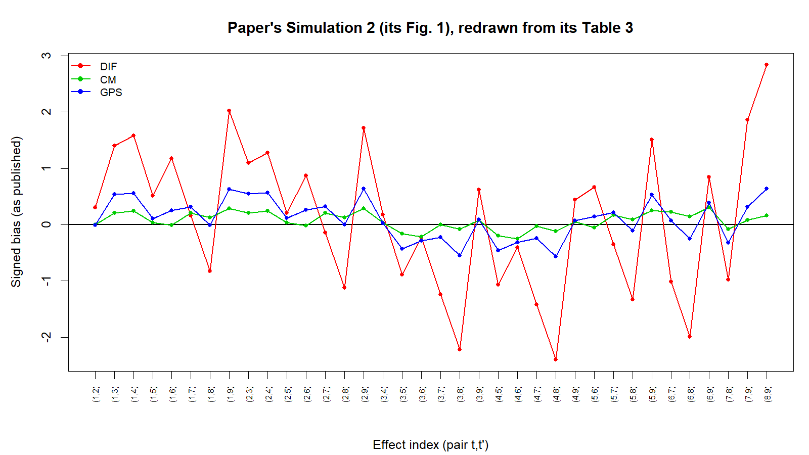

**Figure A. The paper's Fig. 1, redrawn from its Table 3.** Bias of the 36 Simulation 2 effects as published (red DIF, green CM, blue GPS). Table 3 lists the values the paper's Fig. 1 plots; we redraw it from those numbers, rather than reproduce the original image, so it can be read beside our results. Its rebuild counterpart is Figure F ([Results](#results)); the two are overlaid in Figure C ([What differed](#what-differed)).

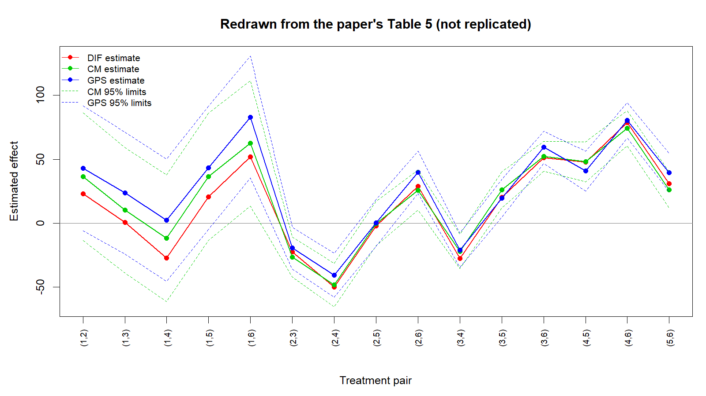

**Figure B. The paper's Fig. 2, redrawn from its Table 5.** Estimates and 95% limits for the 15 pairwise effects in the paper's application (Section 6): DIF (red), CM (green) and GPS (blue), with dashed limits. Redrawn from the published numbers so it can be read here. The paper does not describe how its synthetic data were generated, so this part was not replicated and has no rebuild counterpart.

| Paper | Redrawn here | Rebuild counterpart |
|---|---|---|
| Fig. 1 (Simulation 2 bias; Table 3) | Figure A | Figure F (Results); overlays in Figure C (What differed) |
| Fig. 2 (application; Table 5) | Figure B | none (not replicated) |
| Table 1 (Simulation 1; no figure) | none | Figure D (What differed) |

**How the paper handles the hierarchy.** The paper's setting is hierarchical, with students nested in schools and a treatment at each level, but its estimation is single-level:

- **Treatment.** The student-level and school-level treatments are combined into one multi-valued treatment, T = 1, …, A; Section 4 treats the problem as a multiple-treatment case.
- **Matching.** Both methods match across all units on student covariates X and school covariates Z. Cluster membership is not used: there are no cluster IDs, random effects or within-school matching. Without Z, the methods reduce to those of Yang et al. (2016) for multi-level treatments in non-hierarchical data.
- **Simulations.** Z is drawn separately for each unit, so the simulated data are not nested in schools.

This rebuild follows the paper's design. Matching that uses the clustering, such as matching within schools first, is left for future work.

**The GPS estimator in the cross-check.** The rebuild and Yang et al.'s package compute the same estimator (the paper's Eqs. 3 and 4, read as in D7). For each unit i and level s, with a score r\_s(x, z):

```math
\hat Y_i(s) = \begin{cases} Y_i & \text{if } T_i = s,\\ Y_{j(i,s)} & \text{otherwise,} \end{cases} \qquad j(i,s) = \arg\min_{j:\,T_j = s} \bigl| r_s(x_j, z_j) - r_s(x_i, z_i) \bigr|,
```

$$\hat\tau(t, t') = \frac{1}{n} \sum_{i=1}^{n} \bigl[ \hat Y_i(t) - \hat Y_i(t') \bigr].$$

The score is a fitted multinomial logit, with w = (1, x1, …, x4, z1, z2, z3) and level 1 as the baseline (β\_1 = 0):

$$r_s(x, z) = \frac{\exp(w^\top \beta_s)}{\sum_{k=1}^{A} \exp(w^\top \beta_k)}.$$

The three GPS versions compared in the cross-check differ only in the coefficients and in how nearest neighbours are chosen:

| Version | Score r\_s | Coefficients β | Nearest neighbour j(i, s) |
|---|---|---|---|
| **Our GPS** (rebuild) | p̂\_s | β̂: maximum likelihood with `nnet::multinom` run to reltol = 1e-14, maxit = 10000 (D5) | exact arg min; exact ties broken at random (none occurred) |
| **`existing`** (package, given our scores) | the same p̂\_s (rows adjusted by at most 4.2e-16 so each sums to exactly 1) | not refitted: β̂ as above | `Matching::Match`: candidates within about 1e-10 of the minimum squared standardized distance count as tied, and one is picked at random |
| **`multinom`** (package's own fit) | p̃\_s | β̃: the same likelihood with `nnet::multinom` at its defaults, which stop when an iteration improves the fit by less than a relative 1e-8, or after 100 iterations | as for `existing` |

So `existing` equals our GPS except at near-ties. `multinom` uses β̃ ≈ β̂, but its probabilities differ from ours by up to |p̃ − p̂| = 1.7e-4 in Simulation 1 and 2.2e-3 in Simulation 2. Those differences are larger than many of the gaps between competing candidates, so some j(i, s) change. The package reports μ̂(t′) − μ̂(t); its signs are flipped to τ(t, t′) = E[Y(t) − Y(t′)] here. CM is compared the same way, with the Mahalanobis distance on the seven covariates in place of |r\_s(x\_j, z\_j) − r\_s(x\_i, z\_i)|. [docs/crosscheck_math.md](docs/crosscheck_math.md) shows step by step, from the code of both, that the rebuild and the package compute this estimator, and when their results can differ.

**What the rebuild has to decide.** Rebuilding from the text alone requires thirteen decisions, recorded in [docs/spec.md](docs/spec.md):
- *Data generation:* treatment probabilities (D1), the distribution of Z1 (D2), fixed group sizes (D3), identical assignment for groups 6 and 7 (D10) and thin overlap (D11).
- *Estimators:* the GPS model (D5), the matching distance (D6) and the reading of Eq. (4) (D7).
- *Targets and inference:* which true effect (D4, D9) and how intervals are computed (D8).
- *Records and checks:* the software environment (D12) and the Eq. (4) sensitivity check (D13).

## Design (as in Section 5)

- **Covariates.** X = (X1, …, X4) ~ multivariate normal with the paper's covariance matrix; Z1 ~ Uniform(−3, 3) (D2), Z2 ~ χ²(1), Z3 ~ Bernoulli(0.5).
- **Treatment.** Multinomial logit with η₁ = 0 and η_t = 0.1 × a sum of linear and squared covariate terms (D1). Simulation 1 has A = 4 groups of 100 units (6 effects); Simulation 2 has A = 9 groups of 200 units (36 effects).
- **Outcomes.** Y(t) is linear in (X, Z) with group-specific coefficients, plus N(0, 1) noise.
- **Estimators.** DIF, the raw difference in group means; CM, one Mahalanobis nearest neighbour with replacement on all 7 covariates; GPS, one nearest neighbour on the score from a linear multinomial logit (misspecified on purpose).
- **Inference.** Percentile bootstrap, B = 200, resampling within treatment groups and refitting the GPS model each time (D8).
- **Scale.** 500 replications per simulation. Bias, MSE and coverage are reported against two truths: the population ATE (τ\_pop) and the balanced-design ATE (τ\_bal) (D4, D9).

The full set-up is in [`docs/spec.md`](docs/spec.md).

## What differed

The decisions behind these differences are mapped in [Background](#background) and recorded in [`docs/spec.md`](docs/spec.md). The ones that matter most:

1. **Treatment probabilities (D1).** Each unit's group is drawn from a multinomial logit. For group t, the linear predictor η_t(x, z) is 0.1 times a sum of the unit's covariates and squared covariates (the terms differ by group; see [`docs/spec.md`](docs/spec.md)), and η₁ = 0 for the reference group. The standard model, used here, is

   $$p_t(x,z) = \frac{\exp(\eta_t)}{\sum_{s=1}^{A}\exp(\eta_s)}, \qquad t = 1, \dots, A,$$

   so the A probabilities sum to 1. The paper prints the denominator as 1 + Σ exp(η_s), summed over all A groups. Because η₁ = 0 already adds exp(0) = 1 to the sum, the extra 1 counts the reference group twice, and the probabilities add up to Σ exp(η_s) / (1 + Σ exp(η_s)), which is less than 1.
2. **Z1 (D2).** "N[−3, 3]" is read as Uniform(−3, 3).
3. **Fixed group sizes (D3, D9).** Units are drawn from a large pool by the multinomial probabilities and the first 100 or 200 per group are kept. This sample is not drawn from the population, so CM and GPS estimate the balanced-design ATE; both truths are reported.
4. **Covariance matrix for matching (D6).** The paper builds it from X only but matches on X and Z; we use all 7 covariates.
5. **Eq. (4) (D7, D13).** The printed formula uses the score for t in both terms. The main GPS uses the score for t′ in the second term; the literal reading is reported as a sensitivity check in [`docs/sensitivity.md`](docs/sensitivity.md). In Simulation 1, reading Eq. (4) literally, as printed, raises the mean absolute GPS bias from 0.026 to 0.159, about half the way to the published 0.293. That is not how Yang et al.'s (2016) own R package, `multilevelMatching`, computes the estimator: given our fitted scores, it reproduces the main GPS exactly on a test replication (D7 in [`docs/spec.md`](docs/spec.md#decisions-d1d13)). The literal reading therefore explains the gap only if the paper's code followed Eq. (4) as printed. The original simulation code was not available for this rebuild, the paper names no software ("Code Availability N/A"), and the published text alone does not settle which reading was used.

<table>
  <tr>
    <td>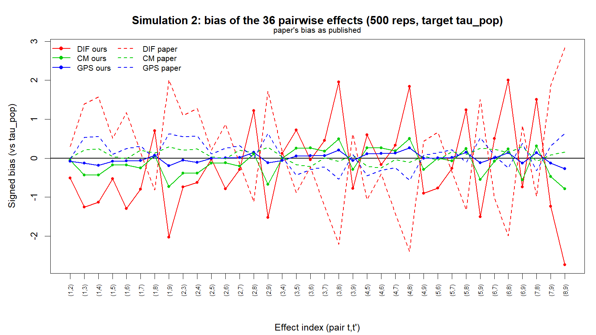</td>
    <td>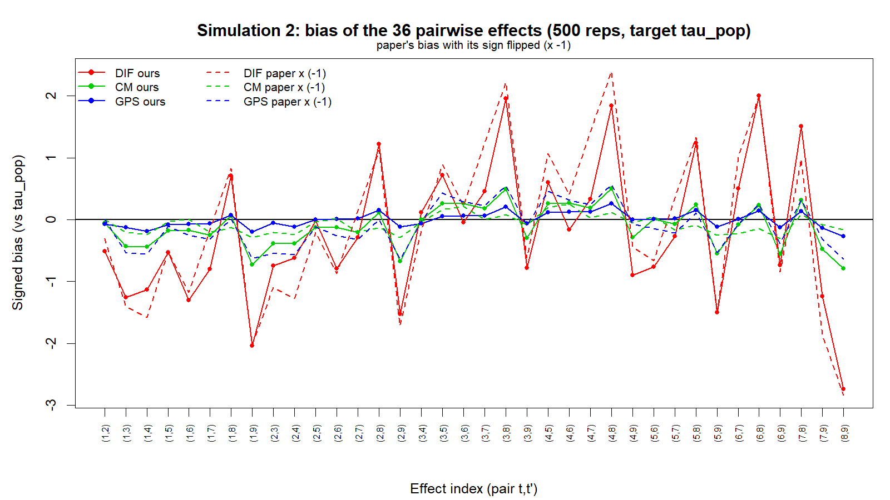</td>
  </tr>
  <tr>
    <td align="center">As published</td>
    <td align="center">Sign flipped</td>
  </tr>
</table>

**Figure C. Rebuild vs the paper's Table 3, Simulation 2 (left: as published; right: sign flipped).** The sign of bias is a further difference. Our bias (solid) is the mean estimate minus the truth; the paper's Table 3 values (dashed) mirror ours as published (left) and line up once multiplied by −1 (right). The paper does not state its convention; see [docs/two_way.md](docs/two_way.md).

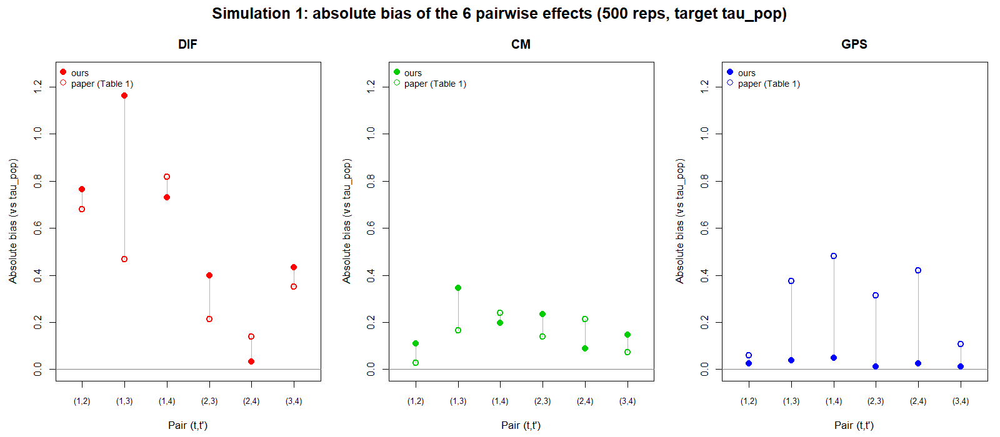

**Figure D. Simulation 1: rebuild vs the paper's Table 1.** Absolute bias of the 6 Simulation 1 effects: rebuild (filled) vs the paper's Table 1 (open), against τ\_pop.

Exploratory checks of the published Table 3 are in [docs/table3_checks.md](docs/table3_checks.md).

## Two targets: τ_pop and τ_bal

Every bias figure here compares an estimate with a true effect, and this design admits two natural truths.

- **Population ATE, τ_pop.** The average effect of treatment t versus t′ over the whole population, as in the paper's Eq. (1). This is the usual average treatment effect (ATE) in propensity score analysis.

$$\tau_{pop}(t,t') = E\left[\,Y(t) - Y(t')\,\right]$$

- **Balanced-design ATE, τ_bal.** The simulations keep a fixed number of units in every treatment group (100 or 200), however rare the group is in the population. The analysed sample is then an equal-weight mix of the groups, and estimators that average over the sample's units target the effect over that mix:

$$\tau_{bal}(t,t') = \frac{1}{A}\sum_{s=1}^{A} E\left[\,Y(t) - Y(t') \mid T = s\,\right]$$

(A is the number of treatment groups, as defined in Background.)

<table>
  <tr>
    <td>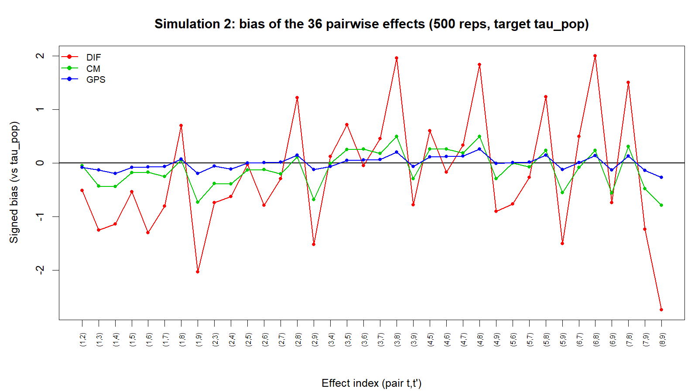</td>
    <td>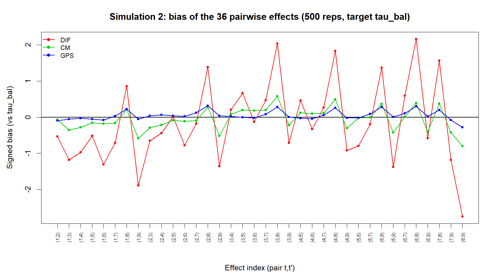</td>
  </tr>
  <tr>
    <td align="center">against τ_pop</td>
    <td align="center">against τ_bal</td>
  </tr>
</table>

**Figure E. Rebuild: Simulation 2 bias against the two truths (left: τ\_pop, as in Figure F; right: τ\_bal).** The same 36 Simulation 2 effects, measured against the two truths.

The two coincide when every treatment group is equally common, or when the effect is the same for everyone. Neither holds here: in Simulation 2 the groups make up 6% to 19% of the population and effects vary with covariates, so the two truths differ by up to 0.18.

**In a real study.** Suppose a district evaluates learning modes by drawing 200 students from each combination of learning mode and school region, including rare ones. An estimator that averages over those students estimates the effect for that over-represented mix, not for the district's student body. Recovering the district-wide effect requires weighting each group by how common it is in the population.

**In propensity score terms.** Choosing a truth means choosing the target population, as with the ATE versus the effect on the treated (ATT) in binary-treatment analyses, or with trimming to improve overlap, which also changes whose effect is estimated (Crump et al., 2009). We report bias against both; the paper's definition, τ_pop, is primary.

## Results

Mean absolute bias (95% CI coverage), averaged over pairs. Per-pair values are in [results/summary.md](results/summary.md); the full comparison with the paper is in [docs/replication_verdict.md](docs/replication_verdict.md), and pair-by-pair tables against the paper's Tables 1 and 3 are in [docs/two_way.md](docs/two_way.md).

| Estimator | Sim 1, vs τ\_pop | Sim 1, vs τ\_bal | Sim 2, vs τ\_pop | Sim 2, vs τ\_bal |
| --- | --- | --- | --- | --- |
| DIF | 0.588 (85%) | 0.612 (84%) | 0.941 (78%) | 0.927 (79%) |
| CM | 0.187 (91%) | 0.223 (90%) | 0.295 (78%) | 0.262 (81%) |
| GPS | 0.026 (100%) | 0.072 (100%) | 0.099 (100%) | 0.096 (100%) |

- **Efficiency.** GPS has about twice CM's MSE (against τ\_pop: 0.68 vs 0.36 in Simulation 1, 0.63 vs 0.29 in Simulation 2), and its intervals are about 30% too wide, which gives its 100% coverage.
- **Against the paper.** Simulation 1 GPS bias averages 0.026 here and 0.29 in the paper's Table 1. In Simulation 2 our bias tracks Table 3 with the opposite sign (correlations −0.95, −0.76 and −0.87 for DIF, CM and GPS).
- **Sensitivity (D13).** Reading Eq. (4) literally raises the Simulation 1 GPS bias to 0.159, about half the way to the paper's value. Yang et al.'s own package computes the main GPS, not the literal reading (D7).


**Figure F. Rebuild: bias of the 36 Simulation 2 effects against τ\_pop.** Red DIF, green CM, blue GPS.

What Figure F shows: DIF swings widely across the 36 effects (−2.74 to 2.00), CM less (−0.79 to 0.50), and GPS stays close to zero (−0.27 to 0.26). Against the paper (bias against τ\_pop), our DIF tracks the paper's sign-flipped values closely (see Figure C and the note on sign in [docs/two_way.md](docs/two_way.md)), but the paper's GPS bias is larger than ours in 31 of 36 pairs (mean absolute bias 0.307 vs 0.099), while its CM bias is smaller (0.139 vs 0.295).

**Answering "Why rebuild it".** Each of the four features listed in [Background](#background), set against what the rebuild finds with the true effects known:

| Feature of the paper | What the rebuild finds |
|---|---|
| **The simulations favour CM.** GPS has larger bias than CM in 6 of 6 Simulation 1 pairs and 32 of 36 Simulation 2 pairs, larger MSE in all 36, and 99–100% coverage. | **Bias reverses; efficiency and over-coverage hold.** GPS has *smaller* bias than CM in 6 of 6 Simulation 1 pairs and 31 of 36 Simulation 2 pairs (mean 0.026 vs 0.187 and 0.099 vs 0.295). CM keeps the lower MSE in 5 of 6 and 33 of 36 pairs. GPS coverage is 100% because its bootstrap intervals are about 30% too wide. |
| **The sections describe efficiency differently.** Section 5: CM more efficient; Section 6: GPS much smaller MSE; Section 7: GPS less efficient. | **Agrees with Sections 5 and 7.** CM has about half GPS's MSE in both simulations (0.36 vs 0.68; 0.29 vs 0.63). Section 6 concerns the application, whose truth is unknown, so the simulations cannot test it directly. |
| **The application cannot show bias.** Its true effects are not reported, so Figure B cannot show which estimate is closer. | **Where the truth is known, GPS is least biased.** Mean absolute bias is 0.026 (GPS), 0.187 (CM) and 0.588 (DIF) in Simulation 1, and 0.099, 0.295 and 0.941 in Simulation 2. The application's own truth remains unknown. |
| **Neither code nor data was released,** and several simulation details are not specified. | **Provided in this repository.** Code, results and the thirteen decisions (D1–D13) are provided under the MIT license; each replication has its own random-number stream, and the D13 reruns reproduce the main results exactly in 500 of 500 replications. |

In short, where the truth is known, the rebuild shows a bias–variance trade-off: GPS is the least biased estimator and CM the most efficient, in line with Sections 5 and 7. GPS is less biased here than in the paper's tables; reading Eq. (4) literally would close about half of the Simulation 1 gap, but Yang et al.'s own package computes the estimator as this rebuild does (D7), so that explains the gap only if the paper's code followed Eq. (4) as printed; the rest depends on details not reported in the paper. The application's own truth remains unknown, so these results speak to the simulated settings. Every choice and result is documented, so each can be checked.

## Side by side with Yang et al.'s package

Every replication of both simulations (500 each) was re-estimated with `multilevelMatching` 1.0.0 (Yang and Barkley, 2019), on the same samples as the main run: CM with `match_on = "covariates"`, and GPS with `match_on = "multinom"`, the package's own GPS fit (`existing`, the package matching on the rebuild's fitted GPS, is used to check the matching itself). The package does not compute DIF, which involves no matching. The paper's values are its Tables 1 and 3, as transcribed in `results/paper_table1.csv` and `results/paper_table3.csv` and checked against the published PDF. All tables and figures of this section, and more, are in [crosscheck/side_by_side/README.md](crosscheck/side_by_side/README.md).

### Bias and MSE by pair

Which estimator is less biased and which has the lower MSE, by pair (the paper's Table 1 has no MSE):

| Simulation | Comparison | Paper | Rebuild | Package | Pairs |
|---|---|---|---|---|---|
| 1 | GPS less biased than CM (pairs) | 0 | 6 | 6 | 6 |
| 1 | CM lower MSE than GPS (pairs) |  | 5 | 5 | 6 |
| 2 | GPS less biased than CM (pairs) | 4 | 31 | 31 | 36 |
| 2 | CM lower MSE than GPS (pairs) | 36 | 33 | 33 | 36 |

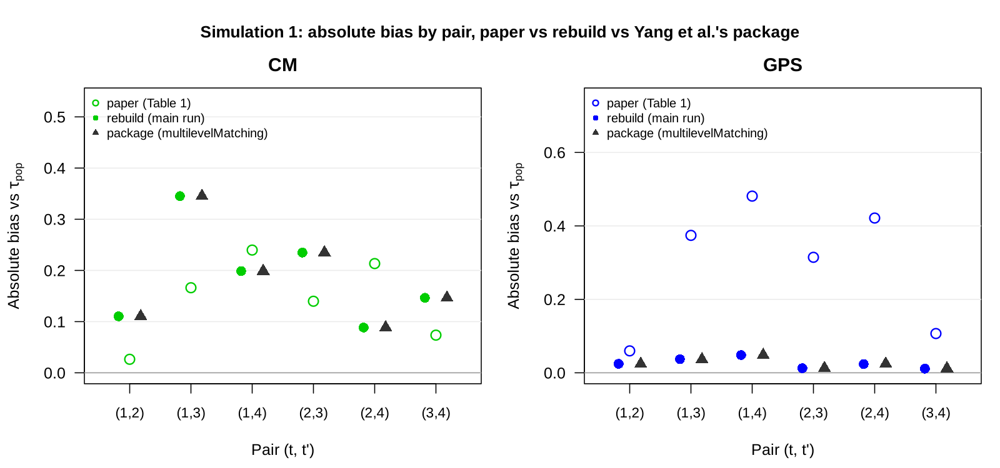

**Figure G. Simulation 1, absolute bias by pair.** Open circles: the paper's Table 1; filled circles: the rebuild; triangles: the package. Rebuild and package coincide; the paper's GPS bias is several times larger.

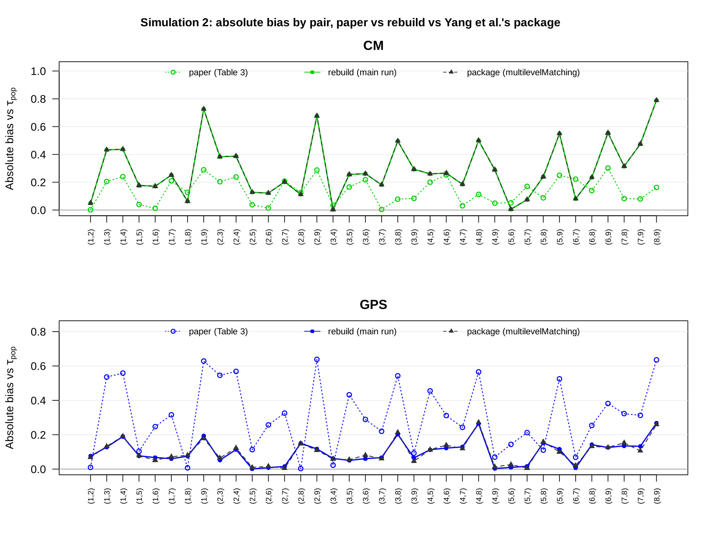

**Figure H. Simulation 2, absolute bias of the 36 effects.** Dotted line and open circles: the paper's Table 3 (absolute values, since its signs are not comparable; see Figure C); solid line: the rebuild; dashed grey line and triangles: the package.

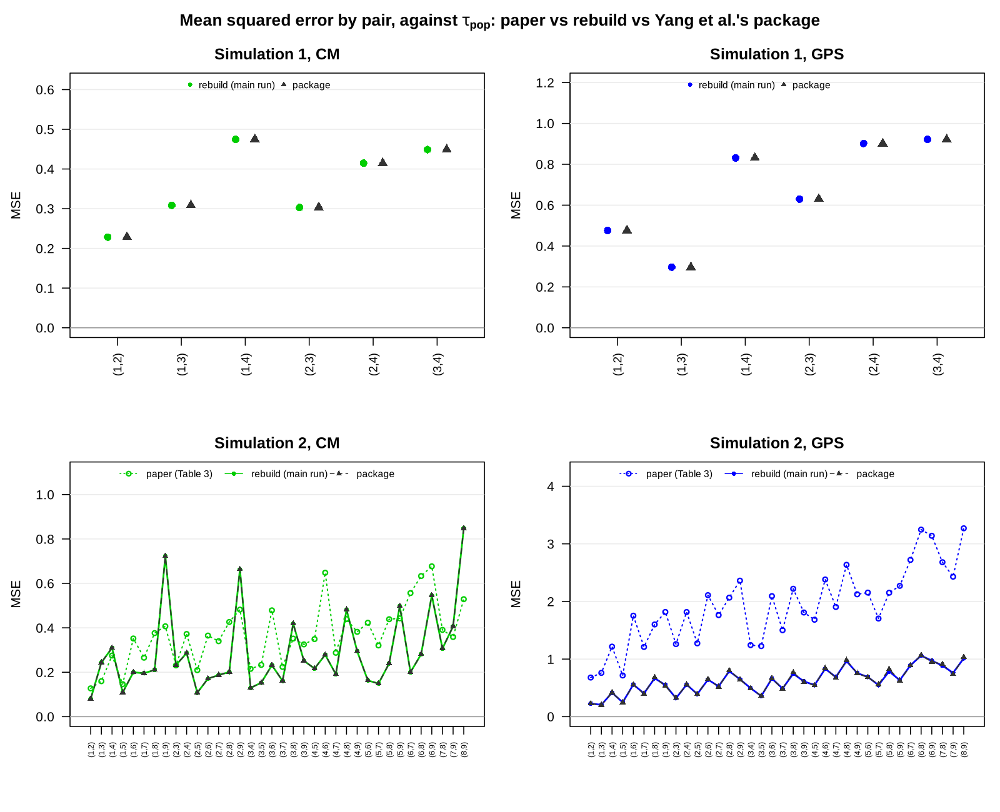

**Figure I. MSE by pair.** Simulation 1 (top; the paper reports no MSE) and Simulation 2 (bottom; dotted: the paper's Table 3). Rebuild and package coincide. The paper's GPS MSE follows the rebuild's pattern pair by pair (correlation 0.963, [docs/table3_checks.md](docs/table3_checks.md)) at about three times the level; its CM MSE is on the rebuild's scale.

### How closely the package reproduces the rebuild

| Package fit | Matches on | Compared with | Replications with every matched outcome identical, Sim. 1 / Sim. 2 | Matched outcomes that differ, average per replication, Sim. 1 / Sim. 2 | Mean absolute bias vs τ\_pop, Sim. 1 / Sim. 2: package (ours) |
|---|---|---|---|---|---|
| `covariates` | the 7 covariates (Mahalanobis) | our CM | 500 / 500 of 500 | 0 / 0 | 0.187 / 0.295 (0.187 / 0.295) |
| `existing` | our fitted GPS, p̂ | our GPS | 499 / 476 of 500 | 0.002 / 0.06 | 0.026 / 0.099 (0.026 / 0.099) |
| `multinom` | its own fitted GPS, p̃ | our GPS | 405 / 0 of 500 | 0.4 of 1,600 / 1,003 of 16,200 (6.2%) | 0.026 / 0.100 (0.026 / 0.099) |

A matched outcome is one imputed potential outcome Ŷ\_i(s); a replication has 400 x 4 = 1,600 of them in Simulation 1 and 1,800 x 9 = 16,200 in Simulation 2. "0 of 500" for `multinom` in Simulation 2 means that every replication has at least one differing matched outcome (6.2% on average), not that the estimates disagree broadly: the bias is the same to two decimals. The three fits are defined in the [Background](#background) ("The GPS estimator in the cross-check").

- **The package computes the rebuild's estimators.** Covariate matching agrees in every replication. Given our fitted GPS, GPS matching agrees except for 30 imputed outcomes in 25 of 1,000 replications. All 30 are near-ties that the package's matching routine (`Matching::Match`) treats as ties and breaks at random; in each, ours is the nearest candidate. [docs/crosscheck_math.md](docs/crosscheck_math.md) shows, from the code of both, why the three GPS versions compute the same estimator.
- **The GPS model's fitting tolerance matters for single estimates (D5).** The package fits the GPS model at nnet's default tolerance. In Simulation 2 that changes about 6% of the matched outcomes in every replication and moves single estimates by up to 2.7 (Figure J), but not the bias or MSE.
- **Reproducibility across setups.** The regenerated samples are the main run's. Our DIF and CM estimates, and our GPS estimates in Simulation 1, reproduce the main run's exactly. In Simulation 2 a few GPS near-ties fall differently on this setup (Linux, R 4.3.3) than in the main run (Windows, R 4.5.1), moving GPS summary means by at most 5.6e-5.

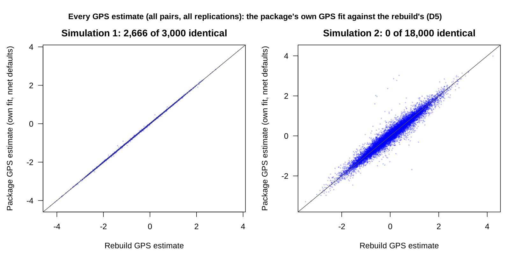

**Figure J. Every GPS estimate, package against rebuild.** Each point is one pair in one replication (3,000 in Simulation 1, 18,000 in Simulation 2). In Simulation 2 the package's own GPS fit moves estimates off the diagonal in both directions; the averages, and hence bias and MSE, are unchanged.

### D7 and the other decisions

The cross-check asks one question: does the rebuild compute the estimators the way Yang et al.'s own software computes them? It therefore bears on the decisions about estimation, not on how the samples or the true effects were made, and it is not a one-at-a-time sensitivity analysis of D1–D13.

- **D7, the reading of Eq. (4): keep it.** The package imputes Y(s) by matching on the score for s, so the t′ term uses the score for t′, and it reproduces the rebuild's GPS. The literal reading is a different estimator from the one the method's authors implement; D13 stays as a sensitivity analysis of it, since the paper's own code is not available.
- **D5 and D6 are confirmed** (the same GPS model form and the same Mahalanobis distance, up to a constant), with the fitting-tolerance note above.
- **The decisions that could change the paper's conclusion about the bias of CM against GPS** are D1–D5, D7 and D9. The cross-check closes the estimation ones (D5, D6, D7); the remaining differences from the paper most likely lie in data generation and the target (D1–D4, D9, D10).

Section 4 of [crosscheck/side_by_side/README.md](crosscheck/side_by_side/README.md) assesses each of D1–D13: what the cross-check says about it, and whether it matters for reproducing the paper, for real applications and for clustered (multilevel) matching.

### Coverage and intervals (D8)

Coverage is secondary: it depends on bias and on how intervals are built, and neither changes the bias and MSE above.

- **The rebuild's low CM coverage comes from CM's bias.** CM's bootstrap intervals cover τ\_pop in 91.4% of replications on average in Simulation 1 and 78.4% in Simulation 2 (the main run's own numbers). A normal approximation from each pair's bias, spread and interval width predicts the observed coverage pair by pair (correlation 0.99). In the worst pair, (1,3) in Simulation 2, the bias is 1.8 times the spread of the estimates, and coverage is 39.6%. Without the bias, the same intervals would cover about 93–94% of the time.
- **D8 sensitivity: analytic intervals.** The paper does not say how its intervals were built; the rebuild uses percentile bootstrap intervals. Replacing them with analytic Abadie–Imbens intervals, estimate ± 1.96 SE, keeps every estimate and changes only coverage. AI 2006 (Abadie and Imbens, 2006) is the large-sample variance of a matching estimator, treating the variable matched on as known; AI 2016 (Abadie and Imbens, 2016) adjusts it for having estimated the GPS.

Mean coverage of τ\_pop (%):

| Simulation | Estimator | Paper | Rebuild: bootstrap (main run) | Rebuild: AI 2006 | Rebuild: AI 2016 |
|---|---|---|---|---|---|
| 1 | CM | 95.0 | 91.4 | 94.8 |  |
| 1 | GPS | 99.7 | 100.0 | 99.6 | 95.9 |
| 2 | CM | 97.1 | 78.4 | 90.1 |  |
| 2 | GPS | 98.9 | 100.0 | 99.6 | 94.6 |

- **GPS:** AI 2016 intervals have the right width (their implied standard errors match the spread of the estimates), and their coverage is near 95%. The bootstrap and AI 2006 intervals are 30–54% too wide and cover in nearly every replication, as the paper's do.
- **CM:** AI 2006 intervals are a little wider than the bootstrap ones and bring coverage closer to the paper's (within 1.4 points per pair on average in Simulation 1); in Simulation 2 the remaining gap follows the bias gap.
- **Reading:** this is consistent with the paper having used analytic Abadie–Imbens (2006) variances, which `Matching` and `multilevelMatching` report by default, but it does not prove it. The bootstrap remains the rebuild's documented D8 choice; the bootstrap is not formally valid for matching estimators (Abadie and Imbens, 2008).
- **More in [crosscheck/intervals/README.md](crosscheck/intervals/README.md):**
  - where each interval method comes from: the paper, the rebuild, Yang et al. (2016), and Abadie and Imbens (2006, 2008, 2016);
  - the math of the bootstrap, AI 2006 and AI 2016 intervals, as the code computes them;
  - why coverage depends on bias relative to spread, and on interval width, rather than on accuracy;
  - an exact breakdown of CM's bias into matching gaps, which explains why CM coverage is low in Simulation 2 and lowest for pair (1,3);
  - a math appendix deriving these results step by step.

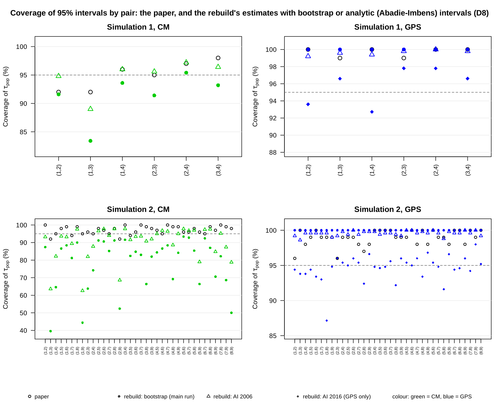

**Figure K. Coverage of 95% intervals by pair.** Open circles: the paper. Filled circles: the rebuild's bootstrap intervals. Triangles: AI 2006 intervals. Diamonds (GPS only): AI 2016 intervals. Dashed line: 95%.

### What "multilevel" means

The word is used in two senses. In Yang et al. (2016), "multi-level treatments" are treatments with more than two levels, such as several programmes; the package name follows that usage, and for independent units a one-level multinomial model for the generalized propensity score (Imbens, 2000) is the appropriate model. In Guo, Liu and Wang (2022), "multilevel" refers to nested data (students in schools) and to covariates and treatments at two levels, but estimation is single-level: X and Z enter as ordinary covariates, with no school identifiers, school effects or within-school matching. That is why the paper's methods reduce to Yang et al.'s, and why neither is multilevel matching in the hierarchical sense. Methods that use the clustering include propensity score models with school effects (Arpino and Mealli, 2011) and propensity score weighting with multilevel data (Li, Zaslavsky and Landrum, 2013); see also the paper's references [43] and [45] (Wang, 2015; Yang, 2018).

## An independent rebuild (rebuild-2)

A second rebuild was written in a separate session and repository, from the paper alone. It never saw this rebuild or its results. [crosscheck/rebuild2/README.md](crosscheck/rebuild2/README.md) compares the two with each other and with the paper.
- **The two rebuilds agree pair by pair.** In Simulation 2 their biases correlate at 0.996 for CM and 0.93 for GPS, and differ by about their Monte Carlo error. Their MSEs agree to within 3%, and the same CM pairs cover least.
- **They made the same choices on most of the open points,** independently. They differ on the CM distance and the interval method, which change little.
- **Both differ from the paper in the same way.** GPS is less biased than CM, and the paper's GPS bias and MSE are larger.
- **The paper's CM column is not bias-adjusted matching.** `Matching::Match(BiasAdjust = TRUE)` removes all of CM's matching gap, but its MSE is a sixth of the paper's.

## Reproduce

From the repository root (R 4.5; packages MASS and nnet):

| Step | Command | Time |
|---|---|---|
| 0. True effects (needed by the summaries) | `Rscript R/check_truth.R` | about 1 min |
| (optional) Tests | `Rscript R/test_estimators.R` (`quick` for unit tests only) | about 6 min |
| 1. Simulations 1 and 2, then summaries | `Rscript R/run_all.R` (options: `R=500 B=200 workers=10`) | On 10 workers: Simulation 1 about 15 min, Simulation 2 about 4 h 48 min, full run about 5 h (log: 14m28s, 4h48m19s, 5h03m08s) |
| 2. Rebuild summaries only | `Rscript R/summarize.R` | seconds |
| 3. Figures and comparisons | `Rscript R/plots.R` | seconds |
| 4. D13 sensitivity (Simulation 1) | `Rscript R/run_gps_literal.R`, then `Rscript R/run_gps_literal2.R` (`check` runs the self-tests) | |
| 5. Cross-check with multilevelMatching | `R_LIBS=<lib> Rscript crosscheck/R/04_crosscheck_all.R sim=1`, then `sim=2` (options: `workers=4`) | On 4 workers: Simulation 1 about 1 min, Simulation 2 about 18 min (log: 55 s, 18 min 16 s) |
| 6. Cross-check summaries | `Rscript crosscheck/R/05_summarize_crosscheck.R`, then `R_LIBS=<lib> Rscript crosscheck/R/06_existing_mismatches.R` | seconds; about 2 min |
| 7. Analytic variances for the rebuild's GPS (D8) | `R_LIBS=<lib> Rscript crosscheck/R/07_d8_analytic_intervals.R sim=1`, then `sim=2` (options: `workers=4`) | On 4 workers: Simulation 1 under 1 min, Simulation 2 about 12 min |
| 8. Side-by-side tables and figures | `Rscript crosscheck/R/08_side_by_side.R` | seconds |
| 9. CM bias decomposition and AI 2006 variance parts | `Rscript crosscheck/R/09_cm_bias_decomposition.R sim=1`, then `sim=2` | On 4 workers: seconds; about 1 min |
| 10. CM-only bootstrap rerun (interval centring) | `Rscript crosscheck/R/10_cm_bootstrap_centring.R sim=2 R=120`, then `sim=1 R=500` | On 4 workers: about 36 min; about 7 min |
| 11. Intervals tables and figure | `Rscript crosscheck/R/11_intervals_summary.R` | seconds |
| 12. Bias-adjusted CM (`Matching::Match(BiasAdjust = TRUE)`) | `Rscript crosscheck/R/12_cm_biasadjust.R sim=1`, then `sim=2` | On 4 workers: about 15 s; about 6 min |
| 13. Rebuild-2 comparison tables and figure | `Rscript crosscheck/R/13_rebuild2_comparison.R` | seconds |

Each replication is saved to `results/reps/simK/rep_###.rds` when it finishes. Re-running `run_all.R` skips replications that are already done, so an interrupted run resumes where it stopped. It refuses to mix checkpoints made with different settings (R, B, seed, optimizer tolerance). Progress goes to standard output; redirect it to `results/run_log.txt` for a background run.

Steps 9–11 need only R with MASS and nnet; step 12 also needs `Matching`. Steps 5–7 need `multilevelMatching` 1.0.0 and `Matching`; on R 4.3 or later the package needs an input workaround that the scripts apply (see [BRIDGE.md](BRIDGE.md) for installation and details). The cross-check ran on R 4.3.3; its replications regenerate the main run's samples from the same seeds.

Each replication uses its own pre-generated L'Ecuyer-CMRG random-number stream, so results do not depend on the number of workers or the order in which replications run. The scripts use only base R, `parallel` and `nnet`, plus `MASS` for data generation. The R version and session details of the full run are in `results/run_session_info.txt`; the `nnet` and `MASS` versions used (7.3.20 and 7.3.65) are on the second line of `results/run_log.txt`. No `renv` lockfile is included.

## Files

### Start here

[README.md](README.md) gives the overview. [docs/replication_verdict.md](docs/replication_verdict.md) says what replicates and what does not, and [docs/two_way.md](docs/two_way.md) sets our numbers beside the paper's Tables 1 and 3, pair by pair. For the comparison with Yang et al.'s package and the paper, start with [crosscheck/side_by_side/README.md](crosscheck/side_by_side/README.md); the cross-check itself is in [docs/crosscheck.md](docs/crosscheck.md).

### Design and decisions

[docs/spec.md](docs/spec.md) is the full simulation specification, with the thirteen decisions D1–D13. [docs/sensitivity.md](docs/sensitivity.md) reports the D13 check, which reads Eq. (4) literally (Simulation 1 only). [docs/table3_checks.md](docs/table3_checks.md) reports exploratory checks of the published Table 3 (label exchange, MSE scale).

### Code

R scripts in the R/ folder, run from the repository root; the order is under Reproduce above.

<details>
<summary>R scripts by role (14 files)</summary>

- **Data generation:** [R/dgp.R](R/dgp.R) (covariates, treatment probabilities, outcomes, true effects); [R/check_truth.R](R/check_truth.R) (computes and saves the true effects).
- **Estimators:** [R/estimators.R](R/estimators.R) (DIF, CM, GPS and the bootstrap); [R/gps_literal.R](R/gps_literal.R) and [R/gps_literal2.R](R/gps_literal2.R) (the D13 variants GPS_lit and GPS_lit2).
- **Runners:** [R/replicate.R](R/replicate.R) (one replication, with its own random-number stream); [R/run_sim.R](R/run_sim.R) (parallel runs with checkpoints); [R/run_all.R](R/run_all.R) (both simulations, then the summaries); [R/run_gps_literal.R](R/run_gps_literal.R) and [R/run_gps_literal2.R](R/run_gps_literal2.R) (paired D13 runs and their self-tests).
- **Summaries and plots:** [R/summarize.R](R/summarize.R) (summary and comparison CSVs); [R/plots.R](R/plots.R) (figures and the Simulation 2 comparison); [R/table3_checks.R](R/table3_checks.R) (exploratory checks of the published Table 3, from existing CSVs).
- **Tests:** [R/test_estimators.R](R/test_estimators.R) (unit and integration tests).

</details>

### Results

[results/summary.md](results/summary.md) has compact per-pair tables. The figures, the CSVs for each simulation and the sensitivity CSVs are listed below.

<details>
<summary>Figures, CSVs and run records (21 files)</summary>

- **Figures:** [results/fig1_bias_sim2_pop.png](results/fig1_bias_sim2_pop.png) and [results/fig1_bias_sim2_bal.png](results/fig1_bias_sim2_bal.png) (signed bias of the 36 Simulation 2 effects, against τ\_pop and τ\_bal); [results/fig1_bias_sim2_pop_vs_paper.png](results/fig1_bias_sim2_pop_vs_paper.png) and [results/fig1_bias_sim2_pop_vs_paper_flipped.png](results/fig1_bias_sim2_pop_vs_paper_flipped.png) (the same with the paper's values overlaid, as published and multiplied by −1); [results/fig_sim1_abs_bias_vs_paper.png](results/fig_sim1_abs_bias_vs_paper.png) (absolute bias of the 6 Simulation 1 effects, ours vs the paper's Table 1); [results/fig1_paper_table3_redrawn.png](results/fig1_paper_table3_redrawn.png) (the paper's Fig. 1 redrawn from its Table 3, not replicated); [results/fig2_table5_redrawn.png](results/fig2_table5_redrawn.png) (the paper's Table 5 redrawn, not replicated).
- **Simulation 1 CSVs:** [results/true_effects_sim1.csv](results/true_effects_sim1.csv) (τ\_pop and τ\_bal per pair); [results/sim1_summary.csv](results/sim1_summary.csv) (bias, SD, MSE, coverage and CI width per estimator, pair and target); [results/sim1_diagnostics.csv](results/sim1_diagnostics.csv) (per replication: run time, GPS convergence, matching distances); [results/sim1_vs_paper.csv](results/sim1_vs_paper.csv) (against the paper's Table 1).
- **Simulation 2 CSVs:** [results/true_effects_sim2.csv](results/true_effects_sim2.csv); [results/sim2_summary.csv](results/sim2_summary.csv); [results/sim2_diagnostics.csv](results/sim2_diagnostics.csv); [results/sim2_vs_paper.csv](results/sim2_vs_paper.csv) (against the paper's Table 3); [results/sim2_bias_correlations.csv](results/sim2_bias_correlations.csv) (correlation with the paper's bias, as published and flipped); [results/table3_checks.csv](results/table3_checks.csv) (the numbers in docs/table3_checks.md).
- **Sensitivity CSVs (D13):** [results/gps_literal_sim1.csv](results/gps_literal_sim1.csv) (GPS against GPS_lit); [results/gps_literal2_sim1.csv](results/gps_literal2_sim1.csv) (GPS, GPS_lit and GPS_lit2).
- **Run records:** [results/run_log.txt](results/run_log.txt) and [results/run_session_info.txt](results/run_session_info.txt) (log and `sessionInfo()` of the full run).

</details>

Per-replication checkpoints (results/reps/, results/reps_gps_literal/, results/reps_gps_literal2/) are local only, not in the repo.

### Cross-check with multilevelMatching

[docs/crosscheck.md](docs/crosscheck.md) reports the cross-check, and [docs/crosscheck_math.md](docs/crosscheck_math.md) shows why the three GPS versions compute the same estimator; [BRIDGE.md](BRIDGE.md) records the setup, the package facts and the workarounds. Code and results are in [crosscheck/](crosscheck/):

- **Scripts:** [crosscheck/R/04_crosscheck_all.R](crosscheck/R/04_crosscheck_all.R) (all replications, both simulations), [crosscheck/R/05_summarize_crosscheck.R](crosscheck/R/05_summarize_crosscheck.R) (summaries) and [crosscheck/R/06_existing_mismatches.R](crosscheck/R/06_existing_mismatches.R) (the `existing` near-ties, unit by unit); [crosscheck/R/01_export_rep001.R](crosscheck/R/01_export_rep001.R), [crosscheck/R/02_pkg_fits.R](crosscheck/R/02_pkg_fits.R) and [crosscheck/R/03_check_pasted.R](crosscheck/R/03_check_pasted.R) (the first check, replication 1 of Simulation 1).
- **Results:** `crosscheck/results/sim1_crosscheck_reps.csv` and `sim2_crosscheck_reps.csv` (every estimate, ours and the package's, with the package's variances); `sim*_crosscheck_info.csv` (per-replication checks); `sim*_crosscheck_summary.csv` (bias, MSE and coverage by pair); `crosscheck_agreement.csv`, `crosscheck_verification.csv` and `crosscheck_overview.csv` (the tables in docs/crosscheck.md); `sim*_crosscheck_multinom_minus_ours.csv` (paired differences); `existing_mismatches.csv` (the 30 near-ties).
- **Logs:** [crosscheck/logs/](crosscheck/logs/).

Per-replication checkpoints (crosscheck/reps/) are local only, not in the repo.

### Side by side: paper, rebuild and package

[crosscheck/side_by_side/README.md](crosscheck/side_by_side/README.md) is the full comparison: bias and MSE, D7 and the thirteen decisions, coverage and the D8 sensitivity analysis, and what "multilevel" means. Its tables are in [crosscheck/side_by_side/tables/](crosscheck/side_by_side/tables/) (CSV and Markdown) and its figures, used as Figures G–K above, in [crosscheck/side_by_side/figures/](crosscheck/side_by_side/figures/). Scripts: [crosscheck/R/07_d8_analytic_intervals.R](crosscheck/R/07_d8_analytic_intervals.R) (analytic variances for the rebuild's GPS) and [crosscheck/R/08_side_by_side.R](crosscheck/R/08_side_by_side.R) (all tables and figures); per-replication analytic variances are in `crosscheck/results/sim{1,2}_d8_gps_variances.csv`.

### Intervals and coverage

[crosscheck/intervals/README.md](crosscheck/intervals/README.md) covers four things: where each interval method comes from, the math of the bootstrap, AI 2006 and AI 2016 intervals, why coverage is not a measure of accuracy, and why CM coverage is low. Its tables are in [crosscheck/intervals/tables/](crosscheck/intervals/tables/) and its figure in [crosscheck/intervals/figures/](crosscheck/intervals/figures/). The scripts are [crosscheck/R/09_cm_bias_decomposition.R](crosscheck/R/09_cm_bias_decomposition.R) (CM bias decomposition, regression-adjusted check, AI 2006 variance parts), [crosscheck/R/10_cm_bootstrap_centring.R](crosscheck/R/10_cm_bootstrap_centring.R) (CM-only bootstrap rerun) and [crosscheck/R/11_intervals_summary.R](crosscheck/R/11_intervals_summary.R) (tables and figure). The per-replication results are `crosscheck/results/sim{1,2}_cm_{gap,terms,bc,boot}_reps.csv`.

### Rebuild-2 comparison

[crosscheck/rebuild2/README.md](crosscheck/rebuild2/README.md) compares this rebuild, the independent rebuild-2 and the paper, and tests bias-adjusted CM. Its tables are in [crosscheck/rebuild2/tables/](crosscheck/rebuild2/tables/), its figure in [crosscheck/rebuild2/figures/](crosscheck/rebuild2/figures/), and rebuild-2's copied summaries in [crosscheck/rebuild2/data/](crosscheck/rebuild2/data/). The scripts are [crosscheck/R/12_cm_biasadjust.R](crosscheck/R/12_cm_biasadjust.R) and [crosscheck/R/13_rebuild2_comparison.R](crosscheck/R/13_rebuild2_comparison.R); per-replication results are in `crosscheck/results/sim{1,2}_cm_biasadjust_reps.csv`.

### Published values

[results/paper_table1.csv](results/paper_table1.csv), [results/paper_table3.csv](results/paper_table3.csv) and [results/paper_table5.csv](results/paper_table5.csv) hold values transcribed from the paper's published tables, for comparison only. The paper's PDF is not included.

### Project files

[LICENSE](LICENSE) (MIT), [CITATION.cff](CITATION.cff) (citation metadata) and [.gitignore](.gitignore) (keeps checkpoints, PDFs and local files out of the repo).

## Lesson

The GPS model's fitting tolerance matters when matching on fitted probabilities. With `nnet::multinom`'s defaults (reltol = 1e-8, maxit = 100), the fitted probabilities were not precise enough for the very small matching distances, and the GPS estimate depended on the optimizer's starting point. Fitting at reltol = 1e-14 with maxit = 10000 (D5) removed this, and a test now checks it. The cross-check shows the same with `multilevelMatching` as shipped: it fits the GPS model at the defaults, and in Simulation 2 about 6% of its matched outcomes differ from ours in every replication ([docs/crosscheck.md](docs/crosscheck.md)).

## Conclusions

In these simulations, covariate matching and GPS matching both remove most of the bias in the raw group difference, as the paper reports. GPS had the smallest bias and CM the smallest mean squared error, so the better choice depends on whether bias or variance matters more. The published numbers cannot be reproduced exactly from the paper alone, because thirteen points are left open; reading Eq. (4) literally would close about half of the GPS discrepancy in Simulation 1, but that is not how Yang et al.'s own package computes the estimator, so it explains the gap only if the paper's code followed Eq. (4) as printed. Yang et al.'s own package, run on the rebuild's samples, gives the rebuild's bias and MSE, so these conclusions do not rest on the rebuild's code: the remaining differences from the paper lie in what the paper does not report, chiefly how its data were generated and which true effect its bias refers to. The paper's reported coverage is closer to analytic Abadie–Imbens intervals than to the rebuild's bootstrap intervals. These results are a baseline for extending the comparison to clustered, multilevel data.

## Acknowledgment

This is a re-implementation, written from the published description of Guo, Liu & Wang (2022). The original authors' code was not used.

Disclosure: the author of this repository is a coauthor of Guo, Liu and Wang (2022).

## AI assistance

The code was written with assistance from Claude Code (Anthropic).

## References

- Abadie, A., & Imbens, G. W. (2006). Large sample properties of matching estimators for average treatment effects. *Econometrica, 74*(1), 235–267.
- Abadie, A., & Imbens, G. W. (2008). On the failure of the bootstrap for matching estimators. *Econometrica, 76*(6), 1537–1557.
- Abadie, A., & Imbens, G. W. (2016). Matching on the estimated propensity score. *Econometrica, 84*(2), 781–807.
- Arpino, B., & Mealli, F. (2011). The specification of the propensity score in multilevel observational studies. *Computational Statistics & Data Analysis, 55*(4), 1770–1780.
- Crump, R. K., Hotz, V. J., Imbens, G. W., & Mitnik, O. A. (2009). Dealing with limited overlap in estimation of average treatment effects. *Biometrika, 96*(1), 187–199. https://doi.org/10.1093/biomet/asn055
- Guo, S., Liu, J., & Wang, Q. (2022). Effective learning during COVID-19: Multilevel covariates matching and propensity score matching. *Annals of Data Science, 9*(5), 967–982. https://doi.org/10.1007/s40745-022-00392-x
- Imbens, G. W. (2000). The role of the propensity score in estimating dose-response functions. *Biometrika, 87*(3), 706–710.
- Li, F., Zaslavsky, A. M., & Landrum, M. B. (2013). Propensity score weighting with multilevel data. *Statistics in Medicine, 32*(19), 3373–3387.
- Wang, Q. (2015). Propensity score matching on multilevel data. In W. Pan & H. Bai (Eds.), *Propensity score analysis: Fundamentals and developments* (pp. 217–235). Guilford Press.
- Wang, Q. (2026). *Generalized propensity score and covariate matching for multilevel treatments in hierarchical data: Rebuilding Guo, Liu, and Wang (2022) in R* (Version 1.0) [Computer software]. https://github.com/wangqiu-syr/glw2022-matching-replication
- Yang, S., & Barkley, B. G. (2019). *multilevelMatching: Propensity score matching and subclassification in observational studies with multi-level treatments* (R package version 1.0.0). https://CRAN.R-project.org/package=multilevelMatching
- Yang, S. (2018). Propensity score weighting for causal inference with clustered data. *Journal of Causal Inference, 6*.
- Yang, S., Imbens, G., Cui, Z., Faries, D., & Kadziola, Z. (2016). Propensity score matching and subclassification in observational studies with multi-level treatments. *Biometrics, 72*, 1055–1065. https://doi.org/10.1111/biom.12505

## How to cite

Wang, Q. (2026). *Cross-checking a rebuild of Guo, Liu, and Wang (2022) with Yang et al.'s (2016) multilevelMatching package* (Version 1.0) [Computer software]. https://github.com/wangqiu-syr/glw2022-multilevelmatching-crosscheck

DOI: to be added after the Zenodo release. Citation metadata are in [`CITATION.cff`](CITATION.cff); please also cite the original paper, Yang et al. (2016) and the rebuild it builds on.

## License

MIT (see `LICENSE`).
