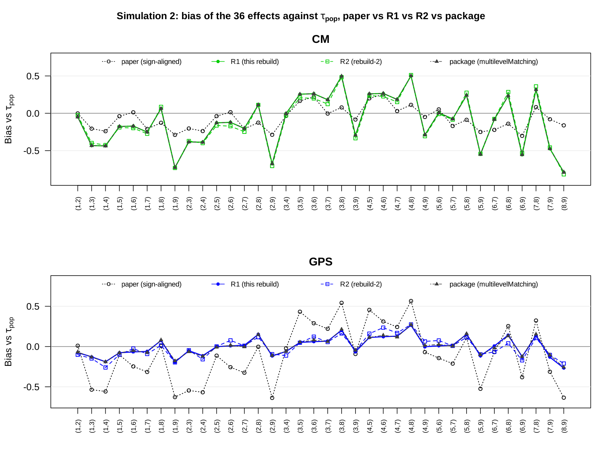
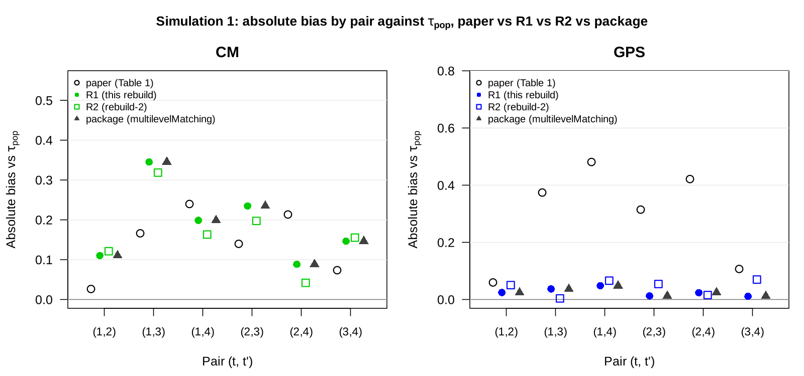
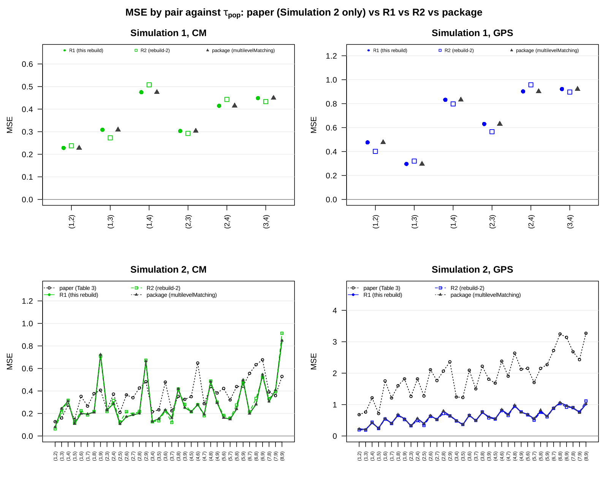

# Four-way comparison: the paper, two independent rebuilds and Yang et al.'s package

This note sets four sets of results for Guo, Liu and Wang's (2022) two simulation studies side by side: the paper's published tables, this repository's rebuild, an independent second rebuild, and Yang et al.'s R package. As in the paper, the main criteria are bias and mean squared error (MSE); coverage comes last.

It brings together comparisons made elsewhere in this repository, which have the detail:

- [crosscheck/side_by_side/README.md](../side_by_side/README.md): the rebuild, the package and the paper;
- [crosscheck/rebuild2/README.md](../rebuild2/README.md): the two rebuilds and the paper, their decisions side by side, and a test of bias-adjusted matching;
- [docs/crosscheck.md](../../docs/crosscheck.md): how closely the package reproduces the rebuild, replication by replication.

## The four sources

| | What it is | Samples | Estimator code | Intervals |
|---|---|---|---|---|
| **Paper** | Guo, Liu and Wang (2022), Table 1 (Simulation 1) and Table 3 (Simulation 2) | not reported | not released ("Code Availability N/A") | not stated |
| **R1** | this repository's rebuild: the main run, imported from glw2022-matching-replication, written from the paper | its own 500 + 500 | its own R code | percentile bootstrap (its D8) |
| **R2** | rebuild-2 (`wangqiu-syr/glw2022-rebuild2`, commit `0a4a038`), written in a separate session and repository from the paper alone, without seeing R1 | its own 500 + 500, independent of R1's | its own R code | analytic, of the Abadie–Imbens (2006) kind (its D26) |
| **Package** | `multilevelMatching` 1.0.0 (Yang and Barkley, 2019), the implementation of Yang et al. (2016), run as a user would run it: CM with `match_on = "covariates"`, GPS with `match_on = "multinom"` (its own GPS fit) | R1's 500 + 500 | Yang et al.'s | Abadie–Imbens 2006; 2016 for its own GPS fit |

So R1 and R2 differ in reading, code and samples; R1 and the package differ in code only. The package does not compute DIF, which involves no matching. R2's independence and its limits are described in [crosscheck/rebuild2/README.md](../rebuild2/README.md), section 1.

**The inputs agree.** The paper's tables were transcribed twice, independently: by R1 (`results/paper_table1.csv`, `results/paper_table3.csv`) and by R2 ([data/](data/)). The two transcriptions are identical:

| Table | Pairs | Cells compared | Cells that differ | Largest difference |
|---|---|---|---|---|
| Table 1 (Simulation 1) | 6 | 30 | 0 | 0 |
| Table 3 (Simulation 2) | 36 | 288 | 0 | 0 |

The truths agree too: R2's τ\_super is R1's τ\_pop (both in closed form), and R2's τ\_mix and R1's τ\_bal differ by at most 0.010 (Monte Carlo; checked against rebuild-2's `results/truth/` files).

Conventions: bias = E(τ̂) − τ, with τ(t, t′) = E[Y(t) − Y(t′)], against τ\_pop. The paper's Table 3 signs are reversed relative to this ([docs/two_way.md](../../docs/two_way.md); R2's D5), so its signed biases are multiplied by −1 ("sign-aligned"); Table 1 gives absolute bias only.

## 1. Bias and MSE

Means over pairs (6 in Simulation 1, 36 in Simulation 2). The paper reports no MSE for Simulation 1, and its Table 3 DIF "MSE" column is not an MSE (R2's D15; [docs/table3_checks.md](../../docs/table3_checks.md)), so those cells are empty:

| Simulation | Estimator | Abs. bias: paper | Abs. bias: R1 | Abs. bias: R2 | Abs. bias: package | MSE: paper | MSE: R1 | MSE: R2 | MSE: package |
|---|---|---|---|---|---|---|---|---|---|
| 1 | DIF | 0.444 | 0.588 | 0.582 |  |  | 1.821 | 1.780 |  |
| 1 | CM | 0.143 | 0.187 | 0.166 | 0.187 |  | 0.363 | 0.364 | 0.363 |
| 1 | GPS | 0.293 | 0.026 | 0.043 | 0.026 |  | 0.676 | 0.656 | 0.676 |
| 2 | DIF | 1.079 | 0.941 | 0.960 |  |  | 2.335 | 2.298 |  |
| 2 | CM | 0.139 | 0.295 | 0.299 | 0.295 | 0.368 | 0.288 | 0.294 | 0.288 |
| 2 | GPS | 0.307 | 0.099 | 0.108 | 0.100 | 1.916 | 0.626 | 0.612 | 0.627 |

- **Three implementations, one answer.** R1, R2 and the package agree on every estimator: CM's absolute bias is 0.17–0.19 (Simulation 1) and 0.30 (Simulation 2), GPS's 0.03–0.04 and 0.10–0.11, and the MSEs agree to within 3%.
- **The paper is the outlier.** Its GPS bias is 7–11 times the implementations' in Simulation 1 and 3 times in Simulation 2, and its Simulation 2 GPS MSE about 3 times. Its CM bias is smaller than all three implementations', while its CM MSE is on their scale.

Which estimator is less biased, and which has the lower MSE, counted over pairs:

| Simulation | Comparison | Paper | R1 | R2 | Package | Pairs |
|---|---|---|---|---|---|---|
| 1 | GPS less biased than CM | 0 | 6 | 6 | 6 | 6 |
| 1 | CM lower MSE than GPS |  | 5 | 6 | 5 | 6 |
| 2 | GPS less biased than CM | 4 | 31 | 30 | 31 | 36 |
| 2 | CM lower MSE than GPS | 36 | 33 | 33 | 33 | 36 |

All three implementations find GPS less biased than CM and CM with the lower MSE: a bias–variance trade-off. The paper agrees on MSE (CM lower in all 36 pairs of Simulation 2) but not on bias (GPS less biased in 0 of 6 and 4 of 36 pairs).

## 2. Pair by pair



**Figure 1. Simulation 2, bias of the 36 effects against τ\_pop.** Dotted black line and open circles: the paper (sign-aligned). Solid line: R1. Dashed line and open squares: R2. Grey triangles: the package. The three implementations lie on top of each other; the paper follows their pattern for CM at a smaller amplitude, and for GPS with larger swings.



**Figure 2. Simulation 1, absolute bias by pair.** Same symbols; the paper's Table 1 gives absolute bias only.



**Figure 3. MSE by pair.** Simulation 1 (top; the paper reports no MSE) and Simulation 2 (bottom). The implementations coincide; the paper's GPS MSE follows their pattern at about three times the level.

Correlation of the per-pair biases between each two sources (signed bias in Simulation 2; absolute bias in Simulation 1, the only form Table 1 gives):

| Sources | Sim. 1 CM (abs. bias) | Sim. 1 GPS (abs. bias) | Sim. 2 CM (signed bias) | Sim. 2 GPS (signed bias) |
|---|---|---|---|---|
| paper vs R1 | 0.245 | 0.620 | 0.764 | 0.874 |
| paper vs R2 | 0.010 | -0.377 | 0.734 | 0.831 |
| paper vs package | 0.245 | 0.628 | 0.764 | 0.886 |
| R1 vs R2 | 0.965 | -0.214 | 0.996 | 0.931 |
| R1 vs package | 1.000 | 0.999 | 1.000 | 0.995 |
| R2 vs package | 0.965 | -0.205 | 0.996 | 0.945 |

- **R1 and the package** share their samples, so they agree almost exactly: CM is identical in every replication, and GPS differs only because the package fits its GPS model at nnet's default tolerance ([docs/crosscheck.md](../../docs/crosscheck.md)).
- **R2 against R1 and against the package** uses independent samples, so differences are Monte Carlo error. In Simulation 2, 32 of 36 CM pairs and 35–36 of 36 GPS pairs agree within 2 Monte Carlo SEs, about what chance allows. In Simulation 1 the GPS biases are all near zero, smaller than their Monte Carlo error, so their correlations are noise; all six pairs agree within 2 Monte Carlo SEs ([tables/agreement_by_source_pair.md](tables/agreement_by_source_pair.md)).
- **The paper against each implementation** correlates at 0.73–0.76 for CM and 0.83–0.89 for GPS in Simulation 2: a similar pattern at different levels. With six pairs, the Simulation 1 correlations say little.

Simulation 1, absolute bias by pair:

| Pair | CM paper | CM R1 | CM R2 | CM package | GPS paper | GPS R1 | GPS R2 | GPS package |
|---|---|---|---|---|---|---|---|---|
| (1,2) | 0.026 | 0.110 | 0.121 | 0.110 | 0.060 | 0.024 | 0.050 | 0.024 |
| (1,3) | 0.166 | 0.345 | 0.319 | 0.345 | 0.374 | 0.037 | 0.004 | 0.036 |
| (1,4) | 0.240 | 0.199 | 0.163 | 0.199 | 0.481 | 0.048 | 0.066 | 0.048 |
| (2,3) | 0.140 | 0.235 | 0.197 | 0.235 | 0.315 | 0.013 | 0.054 | 0.012 |
| (2,4) | 0.213 | 0.088 | 0.042 | 0.088 | 0.421 | 0.024 | 0.016 | 0.024 |
| (3,4) | 0.074 | 0.146 | 0.155 | 0.146 | 0.107 | 0.011 | 0.070 | 0.012 |

Simulation 2 by pair, with signed bias, MSE and coverage for all four sources: [tables/sim2_four_way_by_pair.csv](tables/sim2_four_way_by_pair.csv) (and [tables/sim1_four_way_by_pair.csv](tables/sim1_four_way_by_pair.csv)).

## 3. The estimation choices, four ways

The points where the paper leaves the estimators open, and how each implementation settles them. R1's decisions are in [docs/spec.md](../../docs/spec.md), R2's in its `docs/decisions.md`; the package's choices are in its code ([BRIDGE.md](../../BRIDGE.md); [docs/crosscheck_math.md](../../docs/crosscheck_math.md)).

| Point | The paper | R1 | R2 | Package |
|---|---|---|---|---|
| GPS model | not stated | main-effects multinomial logit, `nnet::multinom` at reltol 1e-14 (D5) | main-effects multinomial logit, its own Newton–Raphson (D12, D22) | main-effects multinomial logit on the covariates passed, `nnet::multinom` at its defaults |
| Score for imputing Y(s) | Eq. (3): the probability of s; Eq. (4) prints the probability of t in both terms | the probability of s, so the t′ term uses p̂\_t′ (D7) | the same (D13), read from Eq. (3); Eq. (4)'s notation is not discussed | the same (column s of the GPS matrix) |
| CM distance | Mahalanobis, with V given for X only | one Mahalanobis distance on X and Z together, pooled covariance (D6) | Mahalanobis on X plus Mahalanobis on Z, pooled covariances (D9) | Mahalanobis on the covariates passed, pooled (`Weight = 2`) |
| Matches | "argmin" | one nearest neighbour, with replacement; exact ties at random | the same; exact ties averaged (D10, D24) | the same; candidates within about 1e-10 count as tied, picked at random |
| Trimming | none described | none (D11) | none (D14) | none (`trimming = FALSE`) |
| Intervals | not stated for the simulations; Section 6 uses estimate ± 1.96 × sd | percentile bootstrap, B = 200 (D8) | analytic, of the Abadie–Imbens (2006) kind (D26) | Abadie–Imbens 2006; 2016 for its own GPS fit |

The implementations agree on everything that changes bias and MSE; R2's different CM distance changes CM's mean absolute bias by at most 0.013 in R2's own sensitivity runs. On how the data were generated (the distribution of Z1, the probability formula, fixed group sizes, the truths), R1 and R2 made the same choices independently ([crosscheck/rebuild2/README.md](../rebuild2/README.md), section 2), and the package shares R1's samples.

## 4. Coverage

Coverage is secondary: it depends on bias and on how intervals are built, not on the bias and MSE above. Mean coverage of τ\_pop (%):

| Simulation | Estimator | Paper | R1: bootstrap | R2: analytic | Package: AI 2006 | Package: AI 2016 |
|---|---|---|---|---|---|---|
| 1 | CM | 95.0 | 91.4 | 94.5 | 94.8 |  |
| 1 | GPS | 99.7 | 100.0 | 99.8 | 99.6 | 95.9 |
| 2 | CM | 97.1 | 78.4 | 90.3 | 90.1 |  |
| 2 | GPS | 98.9 | 100.0 | 99.7 | 99.6 | 94.7 |

- **R2's analytic intervals and the package's AI 2006 intervals cover alike** (within 0.3 points): both are variances of the Abadie–Imbens (2006) kind, which treat the matched-on variable as known.
- **R1's percentile bootstrap covers less for CM,** most of all in Simulation 2, where CM's bias is large relative to its spread ([crosscheck/side_by_side/README.md](../side_by_side/README.md), section 5.1; [crosscheck/intervals/README.md](../intervals/README.md)).
- **For GPS, only the AI 2016 intervals,** which correct for the estimated GPS, are near 95%; the others cover in nearly every replication, as the paper's do.
- **The paper's coverage is closest to the analytic intervals** of R2 and the package, which is consistent with, but does not show, the paper having used variances of that kind.

## 5. What the comparison shows

- **The rebuild's results do not depend on one reading, one code base or one set of samples.** Two independent rebuilds written from the paper, and the method authors' own software on one rebuild's samples, give the same bias and MSE.
- **The paper differs from all three in the same way.** GPS is far more biased in its tables, CM less biased, and the two estimators rank the other way by bias; by MSE they rank the same way. The paper's numbers therefore cannot be reproduced from its description, by either rebuild or with Yang et al.'s software.
- **Where the paper's own computation differs remains open.** Its code is not available. The candidates are details its text does not report, chiefly how its data were generated; its CM column is not explained by bias-adjusted matching ([crosscheck/rebuild2/README.md](../rebuild2/README.md), section 5); and its Table 3 has reporting issues (a DIF "MSE" column that is not an MSE, and reversed bias signs).
- **Limits.** Both rebuilds were reviewed by the same person, a coauthor of the paper, and were written with an AI assistant of the same kind; R2's brief came from a session that knew R1 ([crosscheck/rebuild2/README.md](../rebuild2/README.md), section 1). The package's agreement with R1 tests code, not samples.

## Reproduce

From the repository root, after the cross-check (scripts 04–05) and with R2's summaries in [crosscheck/rebuild2/data/](../rebuild2/data/):

```sh
Rscript crosscheck/R/14_four_way.R      # tables and figures here (seconds; base R)
```

## Files

- **Script:** [crosscheck/R/14_four_way.R](../R/14_four_way.R); log in `crosscheck/logs/14_four_way_log.txt`.
- **Tables** ([tables/](tables/), CSV and Markdown): `transcription_check`, `bias_mse_four_way`, `orderings_four_way`, `agreement_correlations`, `agreement_by_source_pair`, `sim1_abs_bias_four_way`, `coverage_four_way`, and the per-pair tables `sim1_four_way_by_pair.csv`, `sim2_four_way_by_pair.csv`.
- **Figures** ([figures/](figures/)): `fig1_sim2_bias_four_way.png`, `fig2_sim1_abs_bias_four_way.png`, `fig3_mse_four_way.png`.
- **Data** ([data/](data/)): R2's transcription of the paper's Tables 1 and 3, copied for the transcription check. R2's result summaries are the copies in [crosscheck/rebuild2/data/](../rebuild2/data/). The rebuild-2 repository was not changed.

## References

- Abadie, A., & Imbens, G. W. (2006). Large sample properties of matching estimators for average treatment effects. *Econometrica, 74*(1), 235–267.
- Guo, S., Liu, J., & Wang, Q. (2022). Effective learning during COVID-19: Multilevel covariates matching and propensity score matching. *Annals of Data Science, 9*(5), 967–982.
- Yang, S., & Barkley, B. G. (2019). *multilevelMatching* (R package version 1.0.0).
- Yang, S., Imbens, G., Cui, Z., Faries, D., & Kadziola, Z. (2016). Propensity score matching and subclassification in observational studies with multi-level treatments. *Biometrics, 72*, 1055–1065.
