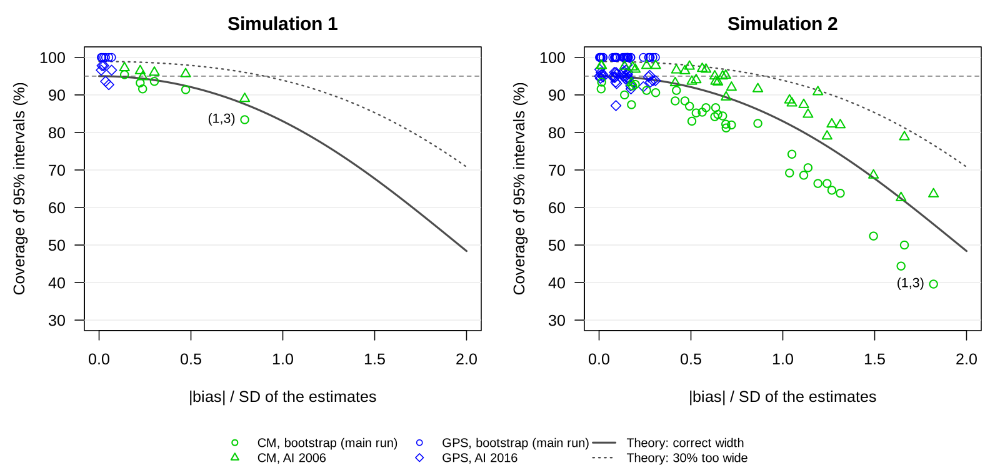

# Intervals and coverage: the bootstrap, Abadie–Imbens variances, and why CM coverage is low

This note answers three questions about the confidence intervals in this repository:

1. **Where does each interval method come from?** Is the bootstrap proposed in the paper (Guo, Liu and Wang, 2022), chosen by the rebuild, or used by Yang et al. (2016), Abadie and Imbens (2006) or Abadie and Imbens (2016)? (Section 1.)
2. **What do the intervals compute?** The math of the rebuild's percentile bootstrap interval, and of the analytic Abadie–Imbens (AI 2006 and AI 2016) intervals that Yang et al.'s package `multilevelMatching` provides, as the code computes them. (Section 2.)
3. **Why is coverage a poor guide to which estimator is better, and why is covariate matching (CM) coverage so low in Simulation 2, lowest for pair (1,3)?** (Sections 3 and 4.)

Coverage is secondary in this repository, as in the paper, whose main criteria are bias and MSE. That does not mean intervals are unnecessary. It means coverage answers a different question: not "which estimator is closer to the truth?" but "are the intervals honest about how far off the estimate can be?" Bias and MSE answer the first question. Coverage answers the second, and it is the second that this note is about.

## In short

- **The bootstrap is the rebuild's choice, not the paper's.** The paper reports coverage but, as the rebuild reads it, does not say how its intervals were built (D8). Abadie and Imbens derived analytic variances for matching estimators (2006, and 2016 for an estimated propensity score) and showed that the standard bootstrap is not valid for them (2008). Yang et al. (2016) use the analytic variances for matching, and their package reports AI 2006 and AI 2016 variances by default. See section 1.
- **The three intervals.** The bootstrap resamples the data and reads the 2.5% and 97.5% quantiles of the re-estimated effects. AI 2006 adds two estimated pieces: the spread of the unit-level imputed effects, and the outcome noise weighted by how often each unit is reused as a match. AI 2016 subtracts a correction for having estimated the GPS. See section 2.
- **Coverage depends on two ratios, not on accuracy.** Approximately, coverage = Φ(1.96 r − b/s) − Φ(−1.96 r − b/s). Here b/s is bias divided by the spread of the estimates, and r is interval width divided by its correct width. GPS covers about 100% because its intervals are about 30% too wide (r ≈ 1.3), not because it is accurate. CM covers too little because its bias is large relative to its spread. See section 3 and Figure 1.
- **CM's bias is the matching gap.** Exactly, in every sample, each CM estimate is the sum of a sample-mix term, a matching-gap term and a noise term. The matching-gap term is the outcome slope times the covariate difference between each unit and its match. It makes up most of the bias: in Simulation 2 its mean absolute size is 0.27, against a mean absolute bias of 0.30. The gaps do not average out, because the groups' covariate distributions differ and z2 is skewed. See section 4.
- **Why pair (1,3) in Simulation 2.** Its bias (−0.43) is only the 10th largest of 36. But its estimates vary less than any other pair's (SD 0.24), so its bias is 1.8 SDs, the largest ratio. Both of its gap terms push the estimate down. Imputing Y(1) uses group-1 units with lower covariate values than the units imputed (−0.29, of which z2 −0.19). Imputing Y(3) uses group-3 units with higher values, mostly on z1 and x1, which have slope 3 in Y(3) (−0.08). See section 4.3.
- **Removing the gap restores the intervals.** A regression adjustment of CM (in the spirit of Abadie and Imbens, 2011) uses the same matches but removes the gap. It cuts the mean absolute bias against the balanced-design truth τ\_bal from 0.30 to 0.008. An interval of the correct width would then cover 92–95%. The remaining bias against τ\_pop is the sample-mix difference τ\_bal − τ\_pop (D9), which no matching can remove. See section 4.4.

## 1. Where each interval method comes from

*Filled in from the sources below.*

## 2. The math of the three intervals

### 2.1 The estimator they are built around

For each unit i (n units in all, n\_g per group) and each level s, CM and GPS matching impute

```math
\hat Y_i(s) = \begin{cases} Y_i & \text{if } T_i = s,\\ Y_{j(i,s)} & \text{otherwise,} \end{cases} \qquad
\hat\tau(t,t') = \frac{1}{n}\sum_{i=1}^{n} \bigl[\hat Y_i(t) - \hat Y_i(t')\bigr],
```

where j(i, s) is the nearest unit in group s: by Mahalanobis distance on the 7 covariates for CM, by |p̂\_s(x\_j) − p̂\_s(x\_i)| for GPS. Matching is with replacement, so a unit can be the match of many others. Let K\_i be the number of times unit i is used as a match (over all levels it is matched for, that is, for its own group's level). All three intervals below use the same point estimate τ̂. They differ only in how they estimate its uncertainty.

### 2.2 The rebuild's interval: percentile bootstrap (D8)

From [R/estimators.R](../../R/estimators.R) (`boot_draws`, `boot_ci`):

1. For b = 1, …, B (B = 200), draw n\_g units with replacement **within each treatment group**, keeping the group sizes fixed as in the design (D3).
2. Recompute the estimator from scratch on that sample: refit the GPS multinomial logit, recompute the covariance matrix for CM, redo all the matches. This gives τ̂\*\_b.
3. The 95% interval is the 2.5% and 97.5% quantiles of τ̂\*\_1, …, τ̂\*\_B (R's `quantile`, type 7):

```math
\bigl[\, q^*_{0.025},\; q^*_{0.975} \,\bigr].
```

What it assumes: that the bootstrap distribution of τ̂\* − τ̂ mimics the sampling distribution of τ̂ − τ, *and* that the latter is centred at zero. A percentile interval is centred where the bootstrap estimates are centred, not where τ̂ is. If the estimator is biased and the bootstrap reproduces part of that bias, the interval moves further from the truth (section 4.5). Two common variants use the same draws:
- the *basic* interval, [2τ̂ − q\*\_0.975, 2τ̂ − q\*\_0.025], which reflects the bootstrap's estimate of bias back;
- the *normal* interval, τ̂ ± 1.96 SD\*, which uses only the bootstrap's spread.

### 2.3 AI 2006: the analytic variance of a matching estimator

From the package's `estVarAI2006()` and `calcKMVarFactor()` ([estimateTau.R](https://github.com/cran/multilevelMatching/blob/master/R/estimateTau.R)) and `estSigSq()` / `calcSigSqAI2006()` ([estSigSq.R](https://github.com/cran/multilevelMatching/blob/master/R/estSigSq.R)), with one match (M = 1) and one match for the variance (J = 1), as in every fit here:

```math
\hat V_{\mathrm{AI06}}(t,t') = \frac{1}{n}\Biggl[\;
\underbrace{\frac{1}{n}\sum_{i=1}^{n}\bigl(\hat Y_i(t) - \hat Y_i(t') - \hat\tau\bigr)^2}_{V_\tau:\ \text{spread of the unit-level imputed effects}}
\;+\;
\underbrace{\frac{1}{n}\sum_{i:\,T_i\in\{t,t'\}} \bigl(K_i^2 + K_i\bigr)\,\hat\sigma_i^2}_{V_E:\ \text{outcome noise, weighted by reuse}}
\;\Biggr],
\qquad
\hat\sigma_i^2 = \tfrac12\bigl(Y_i - Y_{l(i)}\bigr)^2,
```

where l(i) is the nearest *other* unit in i's own group, by the same distance as the matching. The interval is τ̂ ± 1.96 √V̂.

- **Where the weight K\_i² + K\_i comes from.** Unit i's noise ε\_i enters τ̂ once for itself and once for each of the K\_i units it is matched to, so with weight (1 + K\_i)/n. Its variance contribution is (1 + K\_i)²σ²/n². Part of that, about (1 + K\_i)σ²/n², already sits in V\_τ, which is built from the same Y's. The general weight is (K\_i/M)² + ((2M − 1)/M)(K\_i/M), which is K\_i² + K\_i for M = 1. A unit that is reused often makes the estimate noisier, and V\_E says by how much.
- **Where σ̂² comes from.** σ²(x) = Var(Y | x, T) is estimated by comparing each unit with its nearest neighbour in its own group. Two neighbours with almost the same covariates differ in Y mostly by noise, and the factor ½ undoes the doubling. This works when within-group neighbours really are close; section 4.6 shows they are not, here.
- **What it treats as known:** the variable matched on. For GPS, that means p̂ is treated as if it were the true GPS.
- **Check:** rebuilt from these formulas in [09_cm_bias_decomposition.R](../R/09_cm_bias_decomposition.R), the AI 2006 variance for CM equals the package's in all 21,000 (replication, pair) cells, to a relative 5e-12.

### 2.4 AI 2016: the correction for an estimated GPS

From the package's `calcSigSqAI2016()` ([multiMatch.R](https://github.com/cran/multilevelMatching/blob/master/R/multiMatch.R)), used only for GPS matching on a multinomial logit:

```math
\hat V_{\mathrm{AI16}}(t,t') = \hat V_{\mathrm{AI06}}(t,t') \;-\; \hat c_{tt'}^{\top}\, \hat V_{\hat\beta}\, \hat c_{tt'},
\qquad \hat c_{tt'} = \hat c_t + \hat c_{t'},
```

where V̂\_β̂ is the estimated covariance matrix of the multinomial logit coefficients (`vcov()` of the fit). Each ĉ\_s averages, over all units, a local covariance between each covariate and the outcome. It is computed from the two units of group s nearest to the unit on p̂\_s; for a unit of group s, from itself and its nearest other unit of group s. That covariance is multiplied by the derivative factor (1{s = k} − p̂\_k) for the coefficients of level k. In words: how much the matched outcomes would move if the fitted GPS moved, times how uncertain the fitted GPS is.

- **Always smaller than AI 2006.** The subtracted term is a quadratic form in a covariance matrix, so it is never negative. Estimating the GPS makes the average-effect estimator *more* precise than matching on the true GPS would; this is the main result of Abadie and Imbens (2016) for the ATE.
- **Can be negative in finite samples.** In the cross-check the subtraction gave a negative variance 6 times in 3,000 (Simulation 1) and 3 times in 18,000 (Simulation 2). Those cells have no interval ([side_by_side, section 5.2](../side_by_side/README.md#52-analytic-intervals-d8)).
- For the rebuild's own GPS fit (reltol = 1e-14), [07_d8_analytic_intervals.R](../R/07_d8_analytic_intervals.R) runs these same package steps with the rebuild's probabilities and coefficient covariance. With the package's own fit, the same steps reproduce `multiMatch()`'s variances exactly.

### 2.5 Coverage, from bias and width

Suppose τ̂ is approximately normal with mean τ + b (bias b) and standard deviation s over repeated samples, and the interval is τ̂ ± h. The interval covers τ when |τ̂ − τ| ≤ h, so

```math
\text{coverage} \approx \Phi\!\left(\frac{h - b}{s}\right) - \Phi\!\left(\frac{-h - b}{s}\right)
= \Phi\!\left(1.96\,r - \frac{b}{s}\right) - \Phi\!\left(-1.96\,r - \frac{b}{s}\right),
\qquad r = \frac{h}{1.96\,s}.
```

Two numbers decide coverage:
- **b/s, the bias in units of the estimator's own spread.** At b/s = 0 a correct-width interval covers 95%. At b/s = 1 it covers 83%, at 1.5 it covers 68%, and at 2 it covers 48%.
- **r, the interval's width relative to the correct width.** At r = 1.3 (30% too wide) an unbiased estimator covers 98.9%, and still 94% at b/s = 1.

Neither is accuracy. A precise estimator with a small bias can have worse coverage than a noisy estimator with a larger one, because a small s makes b/s large. That is the case for pair (1,3).

## 3. Why coverage is a poor guide to which estimator is better

Coverage is a property of an *estimator together with its interval*. It tells you whether the interval is honest, which bias and MSE cannot. But it does not rank estimators: by the formula above, it can be raised by widening the interval, and lowered by making the estimator more precise while its bias stays.



**Figure 1. Coverage against |bias| / SD of the estimates, every pair, target τ\_pop.** Solid curve: the formula of section 2.5 with an interval of the correct width (r = 1); dotted: 30% too wide (r = 1.3). Green circles: CM with the main run's bootstrap intervals; green triangles: CM with AI 2006 intervals; blue circles: GPS with the main run's bootstrap intervals; blue diamonds: GPS with AI 2016 intervals. Dashed line: 95%.

What it shows:
- **GPS (blue):** its bias is small (|bias|/SD at most 0.31 in any pair), so where its coverage lands depends on width alone. The bootstrap intervals are about 30% too wide, so they sit on the dotted curve, at 100%. The AI 2016 intervals have about the right width (section 5.2 of the side-by-side note), so they sit on the solid curve, near 95%. The estimator is the same in both cases; only the interval changed.
- **CM (green):** its bias reaches 1.8 SDs, and its coverage falls along the curves as |bias|/SD grows (correlation −0.96 over the 36 Simulation 2 pairs, bootstrap). AI 2006 intervals are wider than the bootstrap ones, so they sit higher (section 4.6). The bootstrap points fall *below* the solid curve in Simulation 2, so these intervals cover less than their width predicts (section 4.5).

So the paper's and the rebuild's 99–100% GPS coverage says the GPS intervals are too wide, not that GPS is better. CM's 78% coverage says CM's intervals are centred too far from the truth, which is the bias that bias and MSE already show. In that sense coverage works as an index here: it flags, correctly, that CM's intervals cannot be trusted. It is just not an index of which estimator is more accurate.

## 4. Why CM coverage is low in Simulation 2, and lowest for pair (1,3)

### 4.1 An exact decomposition of each CM estimate

In both simulations the potential outcomes are linear without intercept, Y\_i(s) = β\_s′w\_i + ε\_i, where w\_i is the 7 covariates minus the design's shift (R/dgp.R) and ε\_i ~ N(0, 1). Substituting into Ŷ\_i(s) = Y\_{j(i,s)} gives, in every sample and exactly,

```math
\hat\tau(t,t') =
\underbrace{(\beta_t - \beta_{t'})^{\top}\,\bar w}_{\text{sample mix}}
+ \underbrace{\beta_t^{\top} D_t - \beta_{t'}^{\top} D_{t'}}_{\text{matching gap}}
+ \underbrace{N_t - N_{t'}}_{\text{noise}},
```

```math
\bar w = \frac{1}{n}\sum_i w_i, \qquad
D_s = \frac{1}{n}\sum_{i:\,T_i \ne s} \bigl(w_{j(i,s)} - w_i\bigr), \qquad
N_s = \frac{1}{n}\sum_i \varepsilon_{j(i,s)} \quad (j(i,s) = i \text{ if } T_i = s).
```

- **Sample mix.** The true effect averaged over the sample's own units. Because the design keeps n\_g units per group (D3), its expectation is τ\_bal, not τ\_pop (D9).
- **Matching gap.** D\_s is the mean covariate difference between the units imputed for level s and their matches. Multiplied by the outcome slopes β\_s, it is how far the imputed Y(s) is off on average.
- **Noise.** It averages to zero, because matching uses the covariates only.

So bias against τ\_pop = (τ\_bal − τ\_pop) + E[matching gap] + Monte Carlo noise, and the matching-gap part splits by level (t or t′) and by covariate. [09_cm_bias_decomposition.R](../R/09_cm_bias_decomposition.R) regenerates all 500 samples of each simulation from the main run's random-number streams. It reproduces the main run's CM estimates (means within 4e-15) and checks the identity in every replication (largest error 9e-16).

### 4.2 The matching gap is most of the bias

Means over pairs, against τ\_pop ([tables/cm_coverage_summary.md](tables/cm_coverage_summary.md)):

| Simulation | Mean abs. bias | Mean abs. matching-gap term | Mean abs. sample-mix term (τ\_bal − τ\_pop) | Mean abs. noise term | Mean SD | Mean abs. bias / SD | Coverage: bootstrap | Coverage: AI 2006 |
|---|---|---|---|---|---|---|---|---|
| 1 | 0.187 | 0.217 | 0.033 | 0.008 | 0.559 | 0.36 | 91.4 | 94.8 |
| 2 | 0.295 | 0.265 | 0.078 | 0.004 | 0.397 | 0.74 | 78.4 | 90.1 |

Mean matching gap D\_s times slope β\_s, Simulation 2, by the level being imputed (rows) and covariate (columns) ([tables/sim2_cm_gap_contribution.md](tables/sim2_cm_gap_contribution.md)):

| Level | x1 | x2 | x3 | x4 | z1 | z2 | z3 | Total |
|---|---|---|---|---|---|---|---|---|
| t1 | -0.039 | -0.022 | 0.016 | -0.023 | -0.027 | -0.190 | -0.001 | -0.286 |
| t2 | -0.054 | -0.010 | 0.023 | 0.047 | 0.098 | -0.317 | -0.000 | -0.212 |
| t3 | 0.077 | 0.008 | -0.031 | 0.040 | 0.146 | -0.161 | 0.001 | 0.080 |
| t4 | 0.054 | 0.005 | -0.031 | -0.042 | 0.182 | -0.162 | -0.000 | 0.006 |
| t5 | 0.071 | 0.005 | -0.010 | -0.009 | -0.030 | -0.163 | -0.000 | -0.137 |
| t6 | 0.095 | 0.018 | -0.011 | -0.025 | -0.054 | -0.134 | -0.000 | -0.111 |
| t7 | 0.122 | 0.007 | -0.080 | -0.011 | -0.095 | -0.066 | 0.001 | -0.120 |
| t8 | -0.332 | -0.025 | 0.093 | -0.060 | -0.104 | -0.067 | 0.001 | -0.493 |
| t9 | 0.217 | 0.020 | -0.007 | 0.053 | 0.180 | -0.158 | 0.002 | 0.308 |

Why the gaps do not average out:
- **The groups' covariate distributions differ, by design.** Group t's assignment score η\_t raises the chance of group t where certain covariates (or their squares) are large. Each group therefore over-represents some regions of covariate space and under-represents others. A unit from a region where group s is thin finds its nearest group-s neighbour on the side where group s is dense. So the gaps D\_s point, on average, toward group s's own distribution. Group 1 (η₁ = 0) is relatively most common where the other groups' scores are low, so its matches tend to have lower covariate values. Group 3's score includes +z1 and +x1, so its matches tend to have higher z1 and x1.
- **z2 is skewed.** z2 ~ χ²(1) has a long right tail. A unit far out in that tail has few neighbours anywhere, and its nearest neighbour almost always has a *smaller* z2. That is why the mean z2 gap is negative for every level (−0.07 to −0.19).
- **Nearest-neighbour matching on several continuous covariates leaves gaps that shrink slowly.** There are six continuous covariates here (x1–x4, z1, z2). Abadie and Imbens (2006) show that the bias of nearest-neighbour matching shrinks more slowly than the standard error when several continuous covariates are matched on (section 1).

### 4.3 Pair (1,3) in Simulation 2

τ\_pop(1,3) = 0. CM's mean estimate is −0.433, with SD 0.238 over replications, so the bias is 1.82 SDs. By the formula of section 2.5, a correct-width interval centred on the estimate would cover about 50%. The bootstrap intervals cover 39.6%, the AI 2006 intervals 63.6%.

| Part | Value |
|---|---|
| Sample mix (τ\_bal − τ\_pop, up to Monte Carlo error) | −0.063 |
| Matching gap, level 1: β₁′D₁ | −0.286 |
| Matching gap, level 3: −β₃′D₃ | −0.080 |
| Noise | −0.003 |
| **Bias** | **−0.433** |

By covariate ([tables/sim2_cm_lowest_pair_by_covariate.md](tables/sim2_cm_lowest_pair_by_covariate.md)):

| Covariate | β₁ | Gap D₁ | β₁ × D₁ | β₃ | Gap D₃ | −β₃ × D₃ | Net |
|---|---|---|---|---|---|---|---|
| x1 | 1 | -0.039 | -0.039 | 3 | 0.026 | -0.077 | -0.116 |
| x2 | 1 | -0.022 | -0.022 | 1 | 0.008 | -0.008 | -0.029 |
| x3 | 1 | 0.016 | 0.016 | 2 | -0.015 | 0.031 | 0.047 |
| x4 | 1 | -0.023 | -0.023 | 1 | 0.040 | -0.040 | -0.063 |
| z1 | 1 | -0.027 | -0.027 | 3 | 0.049 | -0.146 | -0.173 |
| z2 | 1 | -0.190 | -0.190 | 1 | -0.161 | 0.161 | -0.030 |
| z3 | 1 | -0.001 | -0.001 | 3 | 0.000 | -0.001 | -0.001 |
| Total |  |  | -0.286 |  |  | -0.080 | -0.366 |

Three things make (1,3) the worst pair:
1. **Both gap terms push the same way.** Imputed Y(1) is too low: group-1 matches have lower covariate values than the units imputed, above all on z2 (−0.19). Imputed Y(3) is too high: group-3 matches have higher z1 and x1, and Y(3) has slope 3 on both (+0.146 and +0.077 in β₃′D₃). τ̂(1,3) = μ̂(1) − μ̂(3) subtracts a too-high number from a too-low one, so the two errors add. In half of the 36 pairs the two gap terms partly cancel instead.
2. **Its estimates are the least variable of all 36 pairs** (SD 0.238; the median is 0.41). Its bias, the 10th largest in absolute value, is the largest relative to its spread. Coverage depends on that ratio (section 2.5), and over the 36 pairs bootstrap coverage and |bias|/SD correlate at −0.96.
3. **The sample-mix term adds −0.06.** τ\_bal(1,3) = −0.074 differs from τ\_pop = 0 (D9).

The same pair is also the lowest in Simulation 1 (bias −0.345, 0.79 SDs, coverage 83.4%), for the same reason: β₁′D₁ = −0.312 and −β₃′D₃ = −0.085 ([tables/sim1_cm_bias_coverage.md](tables/sim1_cm_bias_coverage.md)).

**Why Simulation 2 is worse than Simulation 1.** Its CM bias is larger (0.295 against 0.187 on average): it has 9 groups, so each group's 200 units must serve as matches for 1,600 others (8 to 1) rather than 300 (3 to 1), and the groups differ more. Its CM estimates are less variable (SD 0.40 against 0.56), because it has 1,800 units rather than 400. Both push |bias|/SD up, from 0.36 to 0.74. A larger study, matched the same way, would have *worse* CM coverage, because the spread falls faster than the matching bias.

### 4.4 Check: removing the gap removes the bias

If the matching gap is the cause, adjusting each imputed outcome for its own gap should remove the bias. The adjusted CM keeps CM's matches and imputes

```math
\hat Y_i^{\mathrm{adj}}(s) = Y_{j(i,s)} + \hat\mu_s(x_i) - \hat\mu_s(x_{j(i,s)}),
```

with μ̂\_s an ordinary least-squares fit of Y on the 7 covariates within group s. This is the idea of the bias-corrected matching estimator of Abadie and Imbens (2011), available in `Matching::Match(BiasAdjust = TRUE)` but not used by `multilevelMatching`. Here it is used only as a diagnostic, not as an estimator of the rebuild. The outcome model is linear, so the adjustment is correctly specified, which is the favourable case.

| Simulation | CM: mean abs. bias vs τ\_pop | Adjusted: vs τ\_pop | Adjusted: vs τ\_bal | CM: mean SD | Adjusted: mean SD | Adjusted: coverage of τ\_pop with an interval of the correct width |
|---|---|---|---|---|---|---|
| 1 | 0.187 | 0.040 | 0.007 | 0.559 | 0.310 | 95.2 |
| 2 | 0.295 | 0.080 | 0.008 | 0.397 | 0.190 | 92.2 |

The adjustment removes almost all of the bias against τ\_bal. What is left against τ\_pop is the sample-mix difference τ\_bal − τ\_pop (D9), which concerns *which* population the sample represents, and which no matching can remove. It also halves the SD, because the gap varies from sample to sample (section 4.6). The coverage column uses an interval of the correct width (1.96 × the SD of the adjusted estimates). It is an oracle check that the remaining bias is small, not an interval one could compute from a single sample. For pair (1,3) in Simulation 2, the adjusted estimate's bias is −0.068 against τ\_pop and 0.006 against τ\_bal ([tables/sim2_cm_bias_coverage.md](tables/sim2_cm_bias_coverage.md)).

### 4.5 Why the bootstrap covers less than its width predicts

In Simulation 2 the main run's CM bootstrap intervals cover less than the formula of section 2.5 predicts from their bias, spread and mean width. For pair (1,3) they cover 39.6% against a predicted 50.3%; averaged over pairs, 78.4% against 82.4% ([side_by_side, section 5.1](../side_by_side/README.md#51-why-the-rebuilds-cm-coverage-is-low)). The AI 2006 intervals match their prediction (section 4.6), so the shortfall is specific to the bootstrap. The main run did not keep its intervals per replication. So [10_cm_bootstrap_centring.R](../R/10_cm_bootstrap_centring.R) reran the same CM bootstrap on the main run's samples: 200 draws within groups, everything re-estimated in each draw. It used the first 120 replications of Simulation 2 and all 500 of Simulation 1. The draws are not the main run's: those also refitted the GPS, which used the random-number stream differently. The procedure is the same, and the rerun's percentile coverage in Simulation 2 (78.4% over 120 replications) equals the main run's (78.4% over 500).

SIM_BOOT_TABLE

- **The bootstrap reproduces part of CM's bias, in the same direction.** In a bootstrap sample each group holds only about 63% distinct units, so the matches are sparser and the gaps larger. The bootstrap estimates therefore sit further from the truth than τ̂ does: on average by about a quarter of the bias, and in the bias's direction in nearly every pair (correlation 0.94 over the 36 pairs).
- **The percentile interval is centred on the bootstrap estimates, so it moves with them.** Its midpoint sits on the far side of τ̂ from the truth. That is why it covers less than an interval of the same width centred on τ̂ would.
- **The basic interval reflects the shift back** and covers more: 84.4% against 78.4% in Simulation 2. It still falls short of 95% because the bootstrap sees only a quarter of the bias. The normal interval, τ̂ ± 1.96 SD\*, does about as well (83.4%).
- **The bootstrap SD is also a little small:** 0.379 against an actual 0.406 in Simulation 2, so the intervals are about 7% too narrow.

Abadie and Imbens (2008) show that the bootstrap is not valid for nearest-neighbour matching estimators (section 1). This rerun shows one concrete way it goes wrong here. It is not a general result about the size of the problem.

### 4.6 Why AI 2006 intervals are wider, and right partly by accident

AI 2006 intervals for CM cover more than the bootstrap ones (90.1% against 78.4% in Simulation 2), because they are wider. Across replications they also match the coverage the formula of section 2.5 predicts from their mean width (pair (1,3): 63.6% observed, 64.2% predicted), as an interval centred on τ̂ should. The two parts of the AI 2006 variance, set against the actual variance of the CM estimates (means over pairs; [tables/cm_variance_parts_summary.md](tables/cm_variance_parts_summary.md)):

| Simulation | Variance of the CM estimates | from sample mix | from matching gap | from noise | AI 2006: V\_τ/n | AI 2006: V\_E/n | V\_E/n if σ̂² were the true σ² = 1 | AI 2006 total | Bootstrap, approx. |
|---|---|---|---|---|---|---|---|---|---|
| 1 | 0.321 | 0.069 | 0.212 | 0.028 | 0.119 | 0.264 | 0.023 | 0.383 | 0.311 |
| 2 | 0.162 | 0.023 | 0.120 | 0.014 | 0.039 | 0.176 | 0.013 | 0.215 | 0.141 |

(The variance parts do not add up exactly because of covariances: 0.012 and 0.005. "Bootstrap, approx." is (mean width / 3.92)².)

- **The largest part of CM's variance is the matching gap varying from sample to sample** (0.120 of 0.162 in Simulation 2). The AI 2006 formula has no term for it. V\_τ is the spread of the unit-level effects within one sample, and V\_E is the outcome noise. AI 2006 describe the variance around the estimator's conditional mean given the covariates, and treat the conditional bias separately (section 1).
- **σ̂² is far too large.** Within each group, a unit's nearest neighbour differs in covariates, and with outcome slopes up to 9, ½(Y\_i − Y\_l(i))² is mostly that covariate difference, not noise. σ̂² averages 13.2 in Simulation 1 and 16.0 in Simulation 2, against a true σ² of 1 ([tables/sim2_ai2006_sigma2.md](tables/sim2_ai2006_sigma2.md)). V\_E is accordingly about 12–14 times what the true σ² would give.
- **Together:** the inflated V\_E stands in for the missing gap variance, and overshoots. The AI 2006 variance ends up 19% (Simulation 1) and 32% (Simulation 2) larger than the actual variance on average. It is about the right size partly by accident.
- **The bootstrap gets the spread about right.** It re-matches in every draw, so it does see the gap varying: its implied variance is 3% (Simulation 1) and 13% (Simulation 2) below the actual one. Its problem is where the interval is centred (section 4.5).

## 5. What this means

- **For this rebuild:** nothing in the bias and MSE results changes. The bootstrap stays the documented D8 choice. When coverage is reported, the interval method should be named, because the same estimates give 78% or 90% CM coverage, or 100% or 95% GPS coverage, depending on it.
- **For reading the paper's tables:** its 99–100% GPS coverage is what intervals about 30% too wide would give (the bootstrap or AI 2006 in the rebuild), and its higher CM coverage goes with its smaller CM bias. Neither says which estimator is more accurate.
- **For CM in practice:** with several continuous covariates, nearest-neighbour matching without bias correction leaves a bias that intervals do not account for, and the problem grows with sample size. Bias-corrected matching (Abadie and Imbens, 2011) is the standard remedy.
- **For GPS in practice:** the AI 2016 interval has about the right width for the rebuild's GPS estimator in both simulations.

## Reproduce

From the repository root, after the cross-check steps in the main [README](../../README.md#reproduce) (R with MASS and nnet; script 09 needs no other package):

| Step | Command | Time on 4 workers |
|---|---|---|
| CM decomposition, regression-adjusted check, AI 2006 parts | `Rscript crosscheck/R/09_cm_bias_decomposition.R sim=1`, then `sim=2` | seconds; about 1 min |
| CM-only bootstrap rerun | `Rscript crosscheck/R/10_cm_bootstrap_centring.R sim=2 R=200`, then `sim=1 R=500` | |
| Tables and figure | `Rscript crosscheck/R/11_intervals_summary.R` | seconds |

Logs are in [crosscheck/logs/](../logs/).

## Files

- **Scripts:** [crosscheck/R/09_cm_bias_decomposition.R](../R/09_cm_bias_decomposition.R), [crosscheck/R/10_cm_bootstrap_centring.R](../R/10_cm_bootstrap_centring.R), [crosscheck/R/11_intervals_summary.R](../R/11_intervals_summary.R).
- **Per-replication results:** `crosscheck/results/sim{1,2}_cm_gap_reps.csv` (mean matching gaps D\_s, noise N\_s, covariate means and σ̂² parts, by replication and level); `sim{1,2}_cm_terms_reps.csv` (each CM estimate's three terms and its AI 2006 variance parts, by replication and pair); `sim{1,2}_cm_bc_reps.csv` (CM and the regression-adjusted CM); `sim{1,2}_cm_boot_reps.csv` (the CM bootstrap rerun).
- **Tables:** [tables/](tables/), CSV and Markdown. **Figure:** [figures/fig1_coverage_vs_bias_ratio.png](figures/fig1_coverage_vs_bias_ratio.png).

## References

- Abadie, A., & Imbens, G. W. (2006). Large sample properties of matching estimators for average treatment effects. *Econometrica, 74*(1), 235–267.
- Abadie, A., & Imbens, G. W. (2008). On the failure of the bootstrap for matching estimators. *Econometrica, 76*(6), 1537–1557.
- Abadie, A., & Imbens, G. W. (2011). Bias-corrected matching estimators for average treatment effects. *Journal of Business & Economic Statistics, 29*(1), 1–11.
- Abadie, A., & Imbens, G. W. (2016). Matching on the estimated propensity score. *Econometrica, 84*(2), 781–807.
- Guo, S., Liu, J., & Wang, Q. (2022). Effective learning during COVID-19: Multilevel covariates matching and propensity score matching. *Annals of Data Science, 9*(5), 967–982.
- Yang, S., Imbens, G. W., Cui, Z., Faries, D. E., & Kadziola, Z. (2016). Propensity score matching and subclassification in observational studies with multi-level treatments. *Biometrics, 72*(4), 1055–1065.
- Yang, S., & Barkley, B. G. (2019). *multilevelMatching* (R package version 1.0.0).
