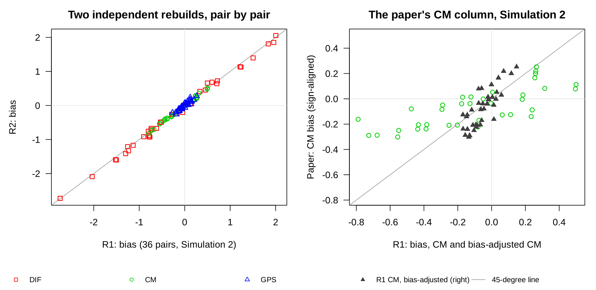

# Rebuild 2: an independent rebuild, set beside this rebuild and the paper

Rebuild 2 is a second rebuild of the two simulation studies in Guo, Liu and Wang (2022), made independently of this repository's rebuild. This note compares the two rebuilds with each other and with the paper. It also tests one idea about the paper's covariate matching (CM) results that the comparison suggested: that the paper's CM was bias-adjusted.

Names used below:
- **R1:** this repository's rebuild (the main run, imported from glw2022-matching-replication).
- **R2:** rebuild 2, in the private repository `wangqiu-syr/glw2022-rebuild2`, at commit `7b25857` on `main`.
- **Truths:** R2's τ\_super and τ\_mix are R1's τ\_pop and τ\_bal.

R2's summary results are copied into [data/](data/), with their source.

## In short

- **The paper's tables were transcribed twice, and the transcriptions agree.** R1 and R2 each transcribed the paper's Tables 1 and 3 on their own; all 318 cells are identical (section 1).
- **The two rebuilds agree, pair by pair.** In Simulation 2:
  - **Bias:** R1 and R2 correlate at 0.998 for DIF, 0.996 for CM and 0.93 for GPS over the 36 pairs. The mean absolute difference is 0.026 for CM and 0.039 for GPS, about one Monte Carlo SE of the difference.
  - **MSE:** the two agree to within 3% on average.
  - **Coverage:** the lowest-coverage CM pairs are the same, (1,9), (1,3), (2,9) and (8,9).
- **They mostly made the same choices, independently.** Where the paper is unclear, R2 chose as R1 did on:
  - the distribution of Z1;
  - the probability formula;
  - fixed group sizes;
  - the two truths;
  - the reading of Eq. (4);
  - the GPS model;
  - no trimming;
  - the sign of the paper's biases.

  It chose differently on two points, the CM distance and the interval method. R2's own sensitivity check shows the distance makes little difference, and both analytic interval methods give about the same coverage.
- **Both differ from the paper in the same way.**
  - **Which estimator is less biased:** in both rebuilds GPS is less biased than CM, while the paper has CM less biased.
  - **CM bias:** the paper's is about half the rebuilds' in Simulation 2 (0.14 against 0.30), and somewhat smaller in Simulation 1 (0.14 against 0.17–0.19).
  - **GPS bias:** the paper's is about three times the rebuilds' in Simulation 2, and 7–11 times in Simulation 1.
  - **What does agree:** CM has the lower MSE in the paper and in both rebuilds.
- **R2 adds three findings.**
  - **Misspecification:** the paper's explanation for GPS's higher MSE, a misspecified propensity model, is not supported. A correctly specified model does not lower it, and matching on the population scores raises it 2.4–2.7-fold. (The population scores are the propensity scores of the data-generating model: correct for the population, but not for a sample drawn with fixed group sizes.)
  - **The paper's DIF "MSE" column** is close to the sum of the two within-group outcome variances, rather than to the MSE of a difference in means. R1 had found only that it is about 100 times its own MSE.
  - **Its D3 check:** the paper's CM biases follow τ\_mix − τ\_super.
- **The paper's CM column is not bias-adjusted matching.**
  - **The pattern:** across the 36 Simulation 2 pairs, the paper's CM biases fit 1.38 × R1's sample-mix term plus 0.22 × R1's matching-gap term (R² = 0.93; [intervals note](../intervals/README.md), section 4.1). It is as if most of the matching gap had been removed.
  - **The test:** `Matching::Match(BiasAdjust = TRUE)` on R1's samples removes all of the gap.
  - **Bias:** the adjusted CM is less biased than the paper's (0.040 and 0.080, against 0.143 and 0.139), and its per-pair pattern in Simulation 1 does not match the paper's.
  - **MSE:** the adjusted CM's is a sixth of the paper's (0.046 against 0.368 in Simulation 2).
  - **Variance:** the paper's CM has about twice the variance of plain CM (0.34 against 0.16), which bias adjustment would lower, not raise.
  - **Conclusion:** what the paper computed remains open.

## 1. How independent is rebuild 2?

R2 was built in a new Claude Code session, on a new repository, from the paper alone. The session was given only the paper's PDF and a short brief:
- **Rules:** rebuild Simulations 1 and 2 in R; record every unclear point as a decision with its reason; do not use other code, other replications, or packages that implement these matching estimators; work in four stages, each stopping for review.
- **What the brief left out:** R1's decisions, its results, the two truths, Eq. (4), and Yang et al.'s package.
- **What R2 never saw:** R1's repository or this one.

Limits to that independence:
- **The same reviewer:** both rebuilds were reviewed by the same person, the repositories' owner, who is a coauthor of the paper.
- **The same kind of tool:** both were written with an AI assistant of the same kind.
- **The brief's author:** the brief came from a session that knew R1. It was written to avoid hints, but it is not blind.
- **No advance prediction:** the plan was for this repository to predict R2's results from its code before R2 ran them. R2 had finished by the time it was read here, and its decisions log already quoted stage-3 numbers, so no blind prediction was made. This note is a comparison after the fact.

**The paper's tables, transcribed twice.** Both comparisons with the paper rest on its Tables 1 and 3, and each rebuild transcribed them on its own: R1 into `results/paper_table1.csv` and `results/paper_table3.csv`, R2 into its `data/paper/` (copied into [data/](data/)). Cell by cell, the two transcriptions are identical ([tables/transcription_check.md](tables/transcription_check.md)):

| Table | Pairs | Cells compared | Cells that differ |
|---|---|---|---|
| Table 1 (Simulation 1): absolute bias of DIF, CM and GPS; CM and GPS coverage | 6 | 30 | 0 |
| Table 3 (Simulation 2): bias and "MSE" of DIF, CM and GPS; CM and GPS coverage | 36 | 288 | 0 |

So the differences from the paper reported below are not transcription errors. R2 also checked its transcription against the tables' structure: each pairwise bias is a difference of two per-treatment terms, and all of the paper's bias columns fit that pattern to rounding.

## 2. The decisions, side by side

R1's decisions are in [docs/spec.md](../../docs/spec.md) (D1–D13). R2's are in its `docs/decisions.md` (D1–D26). The numbers are specific to each repository, and the same label can name different decisions: R1's D9 is the balanced-design point, R2's D9 the CM distance. So this note always says whose decision a number refers to, as in "R2's D15" or "its D20".

| Open point in the paper | R1 | R2 | Same? |
|---|---|---|---|
| Denominator 1 + Σ exp(η) makes probabilities sum below 1 | D1: standard softmax | D2: standard softmax | Same |
| Z1 ~ "N[−3, 3]" | D2: Uniform(−3, 3) | D1: Uniform(−3, 3); among four readings it fits the paper's DIF column best | Same |
| "100 (200) per treatment combination" vs model-based assignment | D3: draw a pool, assign by the model, keep each group's first n\_g units | D3: the same | Same |
| Which true effect | D4: τ\_pop primary, τ\_bal also reported | D4: τ\_super primary, τ\_mix also reported | Same |
| The fixed-size sample is not a population sample | D9: CM and GPS estimate τ\_bal | D3, D11: CM and GPS target τ\_mix | Same; R2 adds that the paper's CM biases follow τ\_mix − τ\_super (r = 0.82) |
| GPS model | D5: main-effects multinomial logit, `nnet::multinom` at reltol 1e-14 | D12, D22: main-effects multinomial logit, its own Newton–Raphson to a step of 1e-8 | Same model |
| CM distance | D6: one Mahalanobis distance on all 7 covariates, pooled covariance | D9: Mahalanobis distance on X plus Mahalanobis distance on Z, pooled covariances | **Different.** R2's check of R1's metric: Simulation 2 CM mean abs. bias 0.304, against 0.299 with its own |
| Eq. (4): the score for the t′ term | D7: the score of the level being imputed | D13: the same, read as the literal meaning of Eq. (3) | Same |
| Interval method | D8: percentile bootstrap, B = 200 | D26: an analytic variance derived from the estimator's form, of the Abadie–Imbens (2006) kind; the bootstrap is rejected | **Different** |
| η₆ = η₇ (z3 is binary) | D10 | spec §2 | Same |
| Trimming | D11: none | D14: none | Same |
| Sign of the paper's Table 3 biases | flipped for comparison ([docs/two_way.md](../../docs/two_way.md)) | D5: flipped for comparison | Same |
| Y(1) printed without ε (Simulation 2) | spec: add ε | D6: add ε | Same |
| ε across potential outcomes | one per unit | D8: one per unit | Same |
| Ties in matching | broken at random | D10, D24: averaged | Different, no effect: there are no ties |
| The paper's DIF "MSE" | about 100 times R1's ([docs/table3_checks.md](../../docs/table3_checks.md)) | D15: close to 0.81–1.00 × the sum of the two within-group outcome variances, rather than an MSE | Same finding; R2 identifies what the column holds |
| Sensitivity checks of the GPS | D13: Eq. (4) read literally (GPS\_lit, GPS\_lit2) | D25: correctly specified logit (GPS\_cs) and population scores (GPS\_true) | Different checks |
| Random numbers | one L'Ecuyer-CMRG stream per replication | D17, D23: the same scheme, its own draw protocol | Same approach, different seeds, so independent samples |

## 3. Bias and MSE

Means over pairs, against τ\_pop (τ\_super). "Paper" is its Tables 1 and 3, which give no Simulation 1 MSE ([tables/bias_mse_summary.md](tables/bias_mse_summary.md)):

| Simulation | Estimator | Abs. bias: paper | R1 | R2 | MSE: paper | R1 | R2 |
|---|---|---|---|---|---|---|---|
| 1 | DIF | 0.444 | 0.588 | 0.582 |  | 1.821 | 1.780 |
| 1 | CM | 0.143 | 0.187 | 0.166 |  | 0.363 | 0.364 |
| 1 | GPS | 0.293 | 0.026 | 0.043 |  | 0.676 | 0.656 |
| 1 | GPS, correctly specified logit (R2) |  |  | 0.037 |  |  | 0.710 |
| 1 | GPS, population scores (R2) |  |  | 0.110 |  |  | 1.581 |
| 2 | DIF | 1.079 | 0.941 | 0.960 |  | 2.335 | 2.298 |
| 2 | CM | 0.139 | 0.295 | 0.299 | 0.368 | 0.288 | 0.294 |
| 2 | GPS | 0.307 | 0.099 | 0.108 | 1.916 | 0.626 | 0.612 |
| 2 | GPS, correctly specified logit (R2) |  |  | 0.097 |  |  | 0.839 |
| 2 | GPS, population scores (R2) |  |  | 0.179 |  |  | 1.657 |

Pair by pair, R1 against R2 ([tables/r1_vs_r2_by_pair.md](tables/r1_vs_r2_by_pair.md)). "MC SE of difference" combines both rebuilds' Monte Carlo standard errors of the bias:

| Simulation | Estimator | Pairs | Bias: correlation | Bias: mean abs. difference | Mean MC SE of difference | Pairs within 2 MC SE | MSE: correlation | MSE: R2 / R1 |
|---|---|---|---|---|---|---|---|---|
| 1 | DIF | 6 | 0.994 | 0.055 | 0.071 | 6 | 0.959 | 0.977 |
| 1 | CM | 6 | 0.992 | 0.028 | 0.036 | 6 | 0.975 | 1.004 |
| 1 | GPS | 6 | 0.286 | 0.036 | 0.051 | 6 | 0.982 | 0.970 |
| 2 | DIF | 36 | 0.998 | 0.068 | 0.062 | 32 | 0.993 | 0.984 |
| 2 | CM | 36 | 0.996 | 0.026 | 0.025 | 32 | 0.992 | 1.020 |
| 2 | GPS | 36 | 0.931 | 0.039 | 0.048 | 35 | 0.991 | 0.978 |

- **The rebuilds differ by about their Monte Carlo error.** With 36 pairs, 2 MC SE would leave about 2 pairs outside by chance; 1 to 4 are. The low Simulation 1 GPS correlation (0.29) is not a disagreement. There the six GPS biases are all near zero (0.03–0.04 on average), smaller than the Monte Carlo error, and all six pairs agree to within 2 MC SE.
- **R2's CM has the same structure as R1's.** R1's two bias terms are averages over its 500 samples, so they describe the design, which R2 shares. Regressed on them (sample mix and matching gap), R2's CM biases give coefficients 0.94 and 1.01 (R² = 0.99; [tables/sim2_cm_bias_on_terms.md](tables/sim2_cm_bias_on_terms.md)). So R2's CM bias is R1's matching gap plus the D9 sample mix, as the [intervals note](../intervals/README.md) found for R1, even with R2's different CM distance.

**Figure 1.** Left: Simulation 2 bias of each pair, R2 against R1. Red squares are DIF, green circles CM, blue triangles GPS; the grey line is 45 degrees. Right: the paper's CM bias (sign-aligned) against R1's CM bias (green circles) and R1's bias-adjusted CM bias (grey triangles; section 5).

## 4. Coverage

Means over pairs, against τ\_pop ([tables/coverage_summary.md](tables/coverage_summary.md)). R1's AI 2006 and AI 2016 intervals are its D8 sensitivity analysis ([intervals note](../intervals/README.md)). R2's interval is its own analytic one (D26).

| Simulation | Estimator | Paper | R1: bootstrap | R1: AI 2006 | R1: AI 2016 | R2: analytic | R2: GPS with population scores | R2: SE / SD |
|---|---|---|---|---|---|---|---|---|
| 1 | CM | 95.0 | 91.4 | 94.8 |  | 94.5 |  | 1.05 |
| 1 | GPS | 99.7 | 100.0 | 99.6 | 95.9 | 99.8 | 94.4 | 1.58 |
| 2 | CM | 97.1 | 78.4 | 90.1 |  | 90.3 |  | 1.14 |
| 2 | GPS | 98.9 | 100.0 | 99.6 | 94.6 | 99.7 | 94.2 | 1.51 |

- **R2's analytic interval behaves like R1's AI 2006 interval.**
  - **Coverage:** the two cover within 0.1–0.3 points of each other on average.
  - **Width:** R2 finds its interval 5–14% too wide for CM and 51–58% too wide for GPS. R1 finds AI 2006 about 8–15% and 49–54% too wide.
  - **CM pairs:** the per-pair correlation of CM coverage is 0.97 in Simulation 2. (For GPS, where every pair covers 99–100%, a correlation means nothing.)
  - **Why:** both formulas treat the score as known and leave the matching gap out of the variance.
- **Two ways to correct the GPS width.** R1's AI 2016 interval corrects it for the estimated GPS. R2 instead shows that matching on the population scores gives correct-width intervals (94.2–94.4%), at a cost of 2.4–2.7 times the MSE. Both point the same way: estimating the GPS makes the estimator less variable than the uncorrected variance says.
- **The same CM pairs cover least** ([tables/cm_lowest_coverage_pairs.md](tables/cm_lowest_coverage_pairs.md)). In Simulation 2 the lowest are (1,9), then (1,3) and (2,9), then (8,9): R1 (AI 2006) 62.6%, 63.6%, 68.6%, 78.8%; R2 63.4%, 68.8%, 68.0%, 74.6%. The [intervals note](../intervals/README.md) (section 4.3) explains why (1,3) is among them.

## 5. The paper's CM column, and a test of bias adjustment

### 5.1 What the paper's CM biases follow

Correlations over the 36 Simulation 2 pairs, signed bias, paper sign-aligned ([tables/sim2_bias_correlations.md](tables/sim2_bias_correlations.md)):

| | Paper CM | Paper GPS | R1 CM | R1 GPS | R2 CM | R2 GPS | R1 CM, bias-adjusted | Sample-mix term (R1) |
|---|---|---|---|---|---|---|---|---|
| Paper CM | 1 | 0.82 | 0.76 | 0.62 | 0.73 | 0.76 | 0.82 | 0.84 |
| Paper GPS | 0.82 | 1 | 0.95 | 0.87 | 0.94 | 0.83 | 0.50 | 0.51 |

- **The paper's GPS column follows the rebuilds' CM** (0.95 with R1, 0.94 with R2). [docs/table3_checks.md](../../docs/table3_checks.md) had found this and asked whether the CM and GPS labels were exchanged. It also found that the MSE column does not fit an exchange.
- **The paper's CM column follows the sample-mix term** (τ\_bal − τ\_pop; 0.84) and a bias-adjusted CM (0.82) more closely than any rebuild estimator (at most 0.76).

Regressed on R1's two CM bias terms ([tables/sim2_cm_bias_on_terms.md](tables/sim2_cm_bias_on_terms.md)):

| Bias column | Coefficient on sample-mix term (SE) | Coefficient on matching-gap term (SE) | R² |
|---|---|---|---|
| Paper CM | 1.38 (0.08) | 0.22 (0.02) | 0.93 |
| R1 CM | 1.03 (0.01) | 1.00 (0.00) | 1.00 |
| R2 CM | 0.94 (0.06) | 1.01 (0.02) | 0.99 |
| R1 CM, bias-adjusted | 1.03 (0.01) | −0.005 (0.002) | 1.00 |

(R1's CM is not exactly 1 and 1 because of the Monte Carlo noise term.) The paper's CM biases look like an estimator that kept about a fifth of the matching gap.

### 5.2 Test: CM with `Matching::Match(BiasAdjust = TRUE)`

A bias-corrected matching estimator (Abadie and Imbens, 2011) adjusts each matched outcome by a regression on the covariates. It is available in the standard `Matching` package as `BiasAdjust = TRUE`, so it is a plausible thing for the paper to have used. [12_cm_biasadjust.R](../R/12_cm_biasadjust.R) runs it on R1's 500 + 500 samples, with the same matches as R1's CM:
- **The calls:** one `Match()` per level s, with the units outside group s as "treated", M = 1 and Mahalanobis distance (`Weight = 2`), as in `multilevelMatching`.
- **The estimate:** μ̂(s) = Ȳ − ((n − n\_s)/n) × the ATT estimate.
- **Check:** without the adjustment, this reproduces R1's CM in all 21,000 (replication, pair) cells (to 4e-15).
- **A trap:** `Match()` adjusts only with `ties = TRUE`. With `ties = FALSE`, the setting `multilevelMatching` uses, it warns and silently turns the adjustment off. The script therefore uses `ties = TRUE` for the adjusted run, and stops if `Match()` warns.

Results, against τ\_pop ([tables/cm_biasadjust_vs_paper.md](tables/cm_biasadjust_vs_paper.md), [tables/sim1_cm_abs_bias_by_pair.md](tables/sim1_cm_abs_bias_by_pair.md)):

| Simulation | Abs. bias: paper | CM | Bias-adjusted | Bias-adjusted, vs τ\_bal | MSE: paper | CM | Bias-adjusted | Variance: paper (MSE − bias²) | CM | Bias-adjusted |
|---|---|---|---|---|---|---|---|---|---|---|
| 1 | 0.143 | 0.187 | 0.040 | 0.008 |  | 0.363 | 0.103 |  | 0.321 | 0.101 |
| 2 | 0.139 | 0.295 | 0.080 | 0.008 | 0.368 | 0.288 | 0.046 | 0.340 | 0.162 | 0.037 |

What the test shows:
- **Bias adjustment removes the whole matching gap,** as the regression adjustment of the intervals note did. What remains is the sample-mix difference τ\_bal − τ\_pop (D9): its bias against τ\_bal is 0.008.
- **It does not reproduce the paper.**
  - **Bias:** its bias is smaller than the paper's (0.040 and 0.080, against 0.143 and 0.139). In Simulation 1 its per-pair pattern does not match: the correlation with the paper's absolute biases is 0.19, against 0.25 for plain CM.
  - **MSE:** the decisive check. The adjusted CM has a sixth of the paper's MSE in Simulation 2.
  - **Variance:** the paper's CM has about *twice* plain CM's variance (0.34 against 0.16; the two correlate at 0.89 over pairs), while bias adjustment lowers it to 0.04.
- **What the paper's CM column looks like.** It is less biased than plain CM and more variable. Neither plain CM, nor a bias-adjusted CM, nor an exchange of the CM and GPS labels accounts for both its bias and its MSE. Without the original code, this stays open.

## 6. What this means

- **For the rebuild:** an independent rebuild, written from the paper alone, reproduces R1's results to within Monte Carlo error, estimator by estimator and pair by pair. R1's results therefore do not hinge on R1's particular reading of the paper. Where the two readings differ (the CM distance, the intervals), the results do not.
- **For the paper:** the points where both rebuilds differ from the paper are firmer than either alone:
  - GPS is less biased than CM;
  - the paper's GPS bias is 3 (Simulation 2) to 7–11 (Simulation 1) times the rebuilds', and its Simulation 2 GPS MSE 3 times;
  - its DIF MSE column appears to hold a different quantity from an MSE (close to the within-group outcome variances);
  - its bias signs appear reversed relative to the paper's own definition.

  The CM column remains unexplained. It is not bias-adjusted matching.
- **For intervals:** two independent analytic variances of the AI 2006 kind give the same coverage, too wide for GPS and too narrow for biased CM pairs. This supports the [intervals note](../intervals/README.md) reading: low CM coverage comes from the matching gap, which the variance does not include, and the high GPS coverage from not correcting for the estimated GPS.

## Reproduce

From the repository root (R with MASS, nnet and Matching):

| Step | Command | Time on 4 workers |
|---|---|---|
| Bias-adjusted CM | `Rscript crosscheck/R/12_cm_biasadjust.R sim=1`, then `sim=2` | about 15 s; about 6 min |
| Tables and figure | `Rscript crosscheck/R/13_rebuild2_comparison.R` | seconds |

Script 13 reads R1's results, the outputs of scripts 04, 08, 09, 11 and 12, and R2's copied summaries and table transcriptions in [data/](data/).

## Files

- **Scripts:** [crosscheck/R/12_cm_biasadjust.R](../R/12_cm_biasadjust.R), [crosscheck/R/13_rebuild2_comparison.R](../R/13_rebuild2_comparison.R).
- **Results:** `crosscheck/results/sim{1,2}_cm_biasadjust_reps.csv.gz`: R1's CM, the same through `Match()`, and the bias-adjusted CM, by replication and pair. Logs are in `crosscheck/logs/12_*`.
- **R2's summaries and its transcription of the paper's Tables 1 and 3:** [data/](data/).
- **Tables:** [tables/](tables/), CSV and Markdown. **Figure:** [figures/fig1_r1_r2_paper_bias.png](figures/fig1_r1_r2_paper_bias.png).

## References

- Abadie, A., & Imbens, G. W. (2011). Bias-corrected matching estimators for average treatment effects. *Journal of Business & Economic Statistics, 29*(1), 1–11.
- Guo, S., Liu, J., & Wang, Q. (2022). Effective learning during COVID-19: Multilevel covariates matching and propensity score matching. *Annals of Data Science, 9*(5), 967–982.
- Sekhon, J. S. (2011). Multivariate and propensity score matching software with automated balance optimization: The Matching package for R. *Journal of Statistical Software, 42*(7), 1–52.
