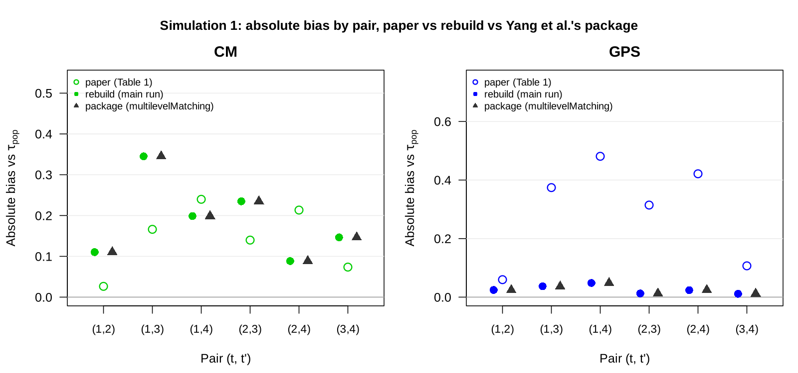
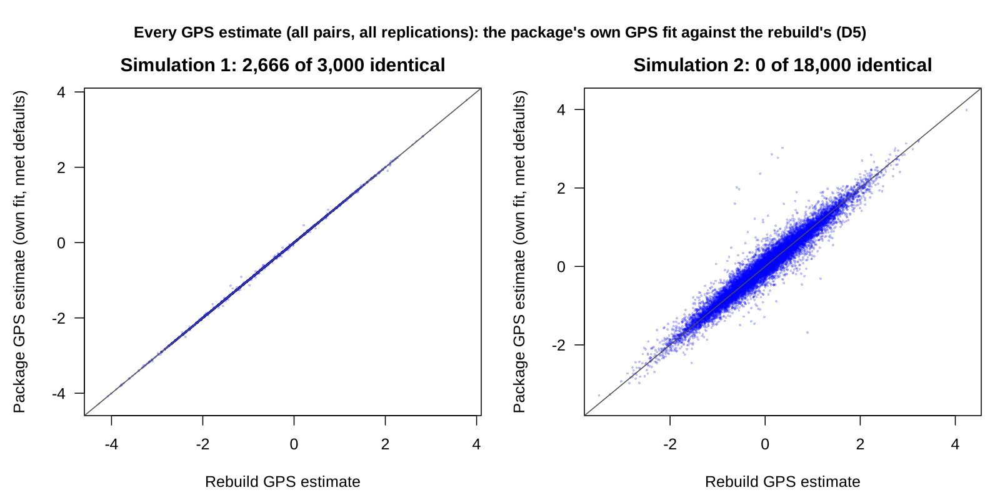
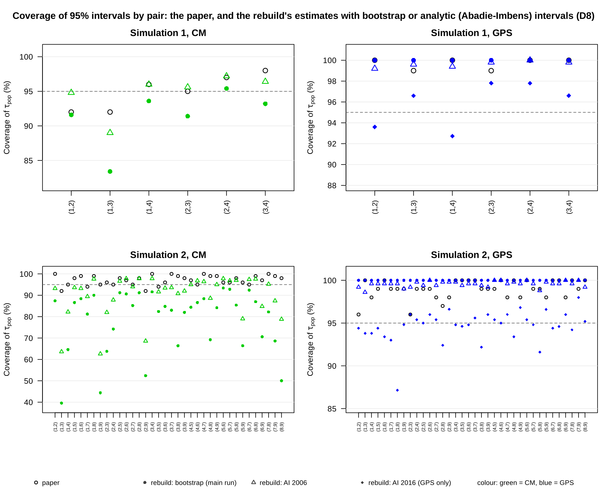

# Side by side: the paper, the rebuild and Yang et al.'s package

This folder collects the comparisons discussed after the cross-check: what Yang et al.'s package gives when it is used to rerun both simulations, how that compares with the rebuild and the paper, what follows for the thirteen decisions (D1–D13), and a sensitivity analysis of D8 with analytic intervals. It is a working collection; the tables and figures can later be moved into the README and other documents.

- **Tables:** [tables/](tables/), each as CSV and as Markdown (the Markdown versions are inserted below unchanged).
- **Figures:** [figures/](figures/).
- **Code:** [crosscheck/R/07_d8_analytic_intervals.R](../R/07_d8_analytic_intervals.R) (analytic variances for the rebuild's GPS) and [crosscheck/R/08_side_by_side.R](../R/08_side_by_side.R) (all tables and figures here). Both read results already in the repository; 07 regenerates the samples.

Sources and conventions:

- **Paper:** Guo, Liu and Wang (2022), Table 1 (Simulation 1: absolute bias and coverage) and Table 3 (Simulation 2: bias, MSE and coverage), as transcribed in `results/paper_table1.csv` and `results/paper_table3.csv`.
- **Rebuild:** the main run (`results/sim1_summary.csv`, `results/sim2_summary.csv`), 500 replications per simulation.
- **Package:** `multilevelMatching` 1.0.0 run as a user would run it, on the same 1,000 samples: CM from `match_on = "covariates"`, GPS from `match_on = "multinom"` (the package fits its own GPS model at nnet's default tolerance). The package does not compute DIF, which involves no matching.
- Bias is against τ\_pop, the population ATE (D4); τ\_bal versions are in the CSVs. The paper's Table 3 signs are not comparable (see `docs/spec.md`), so the paper is compared by absolute bias.

## 1. Rerunning both simulations with the package

All 1,000 replications were re-estimated with the package (`crosscheck/R/04_crosscheck_all.R`; details in [docs/crosscheck.md](../../docs/crosscheck.md)). Point estimates are the rebuild's: CM agrees in every replication, and the package's own GPS fit gives the same bias and MSE to two or three decimals, although individual Simulation 2 estimates move (Figure 3). Only the intervals differ, because the rebuild uses bootstrap intervals and the package analytic ones (section 5).

**Which estimator is less biased, and which more efficient.** Counts of pairs (the paper's Table 1 has no MSE), then mean absolute bias against τ\_pop:

| Simulation | Comparison | Paper | Rebuild | Package | Pairs |
|---|---|---|---|---|---|
| 1 | GPS less biased than CM (pairs) | 0 | 6 | 6 | 6 |
| 1 | CM lower MSE than GPS (pairs) |  | 5 | 5 | 6 |
| 2 | GPS less biased than CM (pairs) | 4 | 31 | 31 | 36 |
| 2 | CM lower MSE than GPS (pairs) | 36 | 33 | 33 | 36 |

| Simulation | Mean absolute bias vs τ_pop | Paper | Rebuild | Package |
|---|---|---|---|---|
| 1 | CM | 0.143 | 0.187 | 0.187 |
| 1 | GPS | 0.293 | 0.026 | 0.026 |
| 2 | CM | 0.139 | 0.295 | 0.295 |
| 2 | GPS | 0.307 | 0.099 | 0.100 |

### Simulation 1

Absolute bias against τ\_pop:

| Pair | CM paper | CM rebuild | CM package | GPS paper | GPS rebuild | GPS package |
|---|---|---|---|---|---|---|
| (1,2) | 0.026 | 0.110 | 0.110 | 0.060 | 0.024 | 0.024 |
| (1,3) | 0.166 | 0.345 | 0.345 | 0.374 | 0.037 | 0.036 |
| (1,4) | 0.240 | 0.199 | 0.199 | 0.481 | 0.048 | 0.048 |
| (2,3) | 0.140 | 0.235 | 0.235 | 0.315 | 0.013 | 0.012 |
| (2,4) | 0.213 | 0.088 | 0.088 | 0.421 | 0.024 | 0.024 |
| (3,4) | 0.074 | 0.146 | 0.146 | 0.107 | 0.011 | 0.012 |
| Mean | 0.143 | 0.187 | 0.187 | 0.293 | 0.026 | 0.026 |

Mean squared error (the paper's Table 1 reports none):

| Pair | CM rebuild | CM package | GPS rebuild | GPS package |
|---|---|---|---|---|
| (1,2) | 0.228 | 0.228 | 0.476 | 0.476 |
| (1,3) | 0.308 | 0.308 | 0.297 | 0.296 |
| (1,4) | 0.475 | 0.475 | 0.832 | 0.831 |
| (2,3) | 0.303 | 0.303 | 0.630 | 0.630 |
| (2,4) | 0.415 | 0.415 | 0.902 | 0.902 |
| (3,4) | 0.449 | 0.449 | 0.922 | 0.921 |
| Mean | 0.363 | 0.363 | 0.676 | 0.676 |

**Figure 1. Simulation 1, absolute bias by pair.** Open circles: the paper's Table 1; filled circles: the rebuild; triangles: the package. Rebuild and package coincide; the paper's GPS bias is several times larger.

### Simulation 2

Means over the 36 pairs are in the orderings table above; pair-by-pair values are in [tables/sim2_abs_bias.md](tables/sim2_abs_bias.md), [tables/sim2_mse.md](tables/sim2_mse.md) and [tables/sim2_side_by_side.csv](tables/sim2_side_by_side.csv) (which also has signed bias).

**Figure 2. Simulation 2, absolute bias of the 36 effects.** Dotted line and open circles: the paper's Table 3 (absolute values); solid line: the rebuild; dashed grey line and triangles: the package. Rebuild and package lie on top of each other.

**Figure 3. Every GPS estimate, package against rebuild.** Each point is one pair in one replication (3,000 in Simulation 1, 18,000 in Simulation 2). Points on the diagonal are identical. In Simulation 2 the package's own GPS fit, at nnet's default tolerance, moves many estimates off the diagonal in both directions (D5); the averages, and hence bias and MSE, are unchanged.

## 2. CM and GPS: what agrees with the paper and what does not

- **Rebuild and package agree.** With the same samples, Yang et al.'s own software gives the rebuild's results: GPS is less biased than CM (all 6 pairs in Simulation 1, 31 of 36 in Simulation 2), and CM has the lower MSE (5 of 6 and 33 of 36). The bias–variance trade-off described in the README is a property of the estimators, not of the rebuild's code.
- **The paper agrees on efficiency.** In its Table 3, CM has the lower MSE in all 36 pairs.
- **The paper disagrees on bias.** In its tables GPS is less biased than CM in 0 of 6 pairs (Table 1) and 4 of 36 (Table 3), and its mean GPS bias is 0.293 (Simulation 1) against 0.026 here.
- **What this implies.** The paper states that its methods reduce to Yang et al.'s, and the package reproduces the rebuild on the same data. The bias gap is therefore not a coding difference in the estimators as specified. It must come from what the package cannot check: how the data were generated (D1–D3, D10), which true effect bias is measured against (D4, D9), the GPS model (D5), or the paper's own code (for example a literal reading of Eq. (4), D13).

## 3. D7: why it kept coming up, and the conclusion

D7 is the reading of the paper's Eq. (4): the printed formula uses the score for t in both terms of τ̂(t, t′); the rebuild matches the t′ term on the score for t′. It came up repeatedly for three reasons: it is the only open decision about the estimator formula itself; a reference implementation can settle it; and the README's earlier claim that the literal reading "accounts for about half" of the GPS gap depended on it.

**Conclusion: keep D7.** Yang et al.'s package imputes Y(s) by matching on the score for s, so the t′ term uses the score for t′, and with our fitted scores it reproduces the rebuild's GPS exactly (up to 30 near-ties in 1,000 replications; [docs/crosscheck_math.md](../../docs/crosscheck_math.md)). The literal reading compares one unit's probability of t′ with another unit's probability of t, which is a different estimator from the one the method's authors implement. What the paper's own code did cannot be established ("Code Availability N/A"), so D13 stays as a sensitivity analysis of how much a literal implementation would change the results.

## 4. The other twelve decisions

The package checks how estimates are computed from a given sample. It cannot check how the samples or the true effects were made.

| Decision | What it fixes | Bearing of the cross-check | Conclusion |
|---|---|---|---|
| D1 | Treatment-probability formula | None: rebuild and package use the same samples | Open |
| D2 | Distribution of Z1 | None | Open |
| D3 | Fixed group sizes | None | Open. The paper's Simulation 1 DIF differs pair by pair, and DIF involves no estimator choice, so the data design probably differs somewhere (D1–D3) |
| D4 | True effect (τ\_pop primary) | None | Open |
| D5 | GPS model and its fitting tolerance | Yes | Same model form as the package's default. The tolerance changes individual Simulation 2 estimates but not bias or MSE (now noted in D5) |
| D6 | Mahalanobis distance on X and Z | Yes | Confirmed: the package's distance is the rebuild's up to a constant |
| D7 | Reading of Eq. (4) | Yes | Settled for the method: keep (section 3) |
| D8 | Interval method | Partly | See section 5 |
| D9 | Balanced-design target τ\_bal | None | Open. The package also averages over the sample's units, so it estimates the same quantity |
| D10 | Groups 6 and 7 assigned identically | None | Open |
| D11 | No trimming | Weakly | Consistent: the package trims only on request, and only for its own GPS fit |
| D12 | Software record | Yes | Two additions: the package needs an input workaround on R 4.3 and later, and the Simulation 2 GPS reproduces across setups only up to near-ties |
| D13 | Literal Eq. (4) sensitivity check | Yes | Neither literal variant is what the package computes |

So the cross-check closes the questions about how the estimates are computed (D5, D6, D7, D13). The remaining differences from the paper most likely lie in data generation and the target (D1–D4, D9, D10) and in how the paper computed its intervals (D8).

## 5. D8 sensitivity: analytic intervals

D8 is the interval method. The paper does not say how its confidence intervals were built, and the rebuild uses percentile bootstrap intervals (B = 200, resampling within treatment groups, everything re-estimated in each draw). This sensitivity analysis keeps every point estimate of the rebuild and replaces only the intervals, with analytic ones of the form estimate ± 1.96 SE, using Abadie–Imbens variances:

- **CM, AI 2006:** the variance of Abadie and Imbens (2006, Theorem 7), taken from the package's `covariates` fit, which reproduces the rebuild's CM estimates exactly.
- **GPS, AI 2006:** the same formula, treating the fitted GPS as known.
- **GPS, AI 2016:** the Abadie and Imbens (2016) adjustment for having estimated the GPS by multinomial logit. The package computes it only for its own GPS fit, so [07_d8_analytic_intervals.R](../R/07_d8_analytic_intervals.R) runs the package's internal steps with the rebuild's own fitted model (its probabilities and coefficient covariance at reltol = 1e-14). As a check, the same steps run with the package's own fit reproduce `multiMatch()`'s variances exactly, in both simulations. Negative AI 2016 variances (6 of 3,000 in Simulation 1, 3 of 18,000 in Simulation 2) give no interval and are left out.

Coverage is against τ\_pop; the τ\_bal versions are in [tables/d8_coverage_summary_bal.md](tables/d8_coverage_summary_bal.md) and the CSVs. "Mean abs. diff. from paper" is the average over pairs of |coverage − the paper's coverage|.

| Simulation | Estimator | Method | Mean coverage | Min | Max | Mean width | Mean abs. diff. from paper | Unavailable intervals |
|---|---|---|---|---|---|---|---|---|
| 1 | CM | paper | 95.0 | 92.0 | 98.0 |  |  |  |
| 1 | CM | bootstrap (main run) | 91.4 | 83.4 | 95.4 | 2.15 | 3.6 | 0 |
| 1 | CM | AI 2006 | 94.8 | 89.0 | 97.2 | 2.38 | 1.4 | 0 |
| 1 | GPS | paper | 99.7 | 99.0 | 100.0 |  |  |  |
| 1 | GPS | bootstrap (main run) | 100.0 | 100.0 | 100.0 | 4.18 | 0.3 | 0 |
| 1 | GPS | AI 2006 | 99.6 | 99.2 | 100.0 | 4.89 | 0.5 | 0 |
| 1 | GPS | AI 2016 | 95.9 | 92.7 | 97.8 | 3.44 | 3.8 | 6 |
| 2 | CM | paper | 97.1 | 92.0 | 100.0 |  |  |  |
| 2 | CM | bootstrap (main run) | 78.4 | 39.6 | 93.4 | 1.45 | 18.6 | 0 |
| 2 | CM | AI 2006 | 90.1 | 62.6 | 97.8 | 1.78 | 7.4 | 0 |
| 2 | GPS | paper | 98.9 | 96.0 | 100.0 |  |  |  |
| 2 | GPS | bootstrap (main run) | 100.0 | 100.0 | 100.0 | 3.93 | 1.1 | 0 |
| 2 | GPS | AI 2006 | 99.6 | 98.6 | 100.0 | 4.49 | 0.9 | 0 |
| 2 | GPS | AI 2016 | 94.6 | 87.1 | 98.0 | 3.05 | 4.3 | 3 |

Pair by pair: [tables/sim1_coverage.md](tables/sim1_coverage.md) and [tables/sim2_coverage.md](tables/sim2_coverage.md).

**Figure 4. Coverage of 95% intervals by pair.** Open circles: the paper. Filled circles: the rebuild's bootstrap intervals (main run). Triangles: the rebuild's estimates with AI 2006 intervals. Diamonds (GPS only): AI 2016 intervals. Dashed line: 95%.

Why the methods differ: interval width against the actual spread of the estimates. Each interval method's implied standard error is its mean width divided by 3.92 (an approximation for the percentile bootstrap); the Monte Carlo SD is the spread of the estimates over the 500 replications; all are averaged over pairs.

| Simulation | Estimator | Monte Carlo SD of the estimates | Bootstrap | AI 2006 | AI 2016 | Mean abs. bias / SD |
|---|---|---|---|---|---|---|
| 1 | CM | 0.559 | 0.548 | 0.606 |  | 0.361 |
| 1 | GPS | 0.809 | 1.067 | 1.247 | 0.878 | 0.035 |
| 2 | CM | 0.397 | 0.370 | 0.455 |  | 0.744 |
| 2 | GPS | 0.770 | 1.002 | 1.145 | 0.777 | 0.130 |

**What it shows.**

- **GPS: the AI 2016 intervals have the right width.** Their implied standard error (0.878 and 0.777) matches the actual spread of the GPS estimates (0.809 and 0.770), and their coverage is close to 95% (95.9% and 94.6%). The bootstrap and AI 2006 intervals are 30–54% too wide, so they cover in nearly every replication (99.6–100%). The paper's GPS coverage, 99–100% in Simulation 1 and 96–100% in Simulation 2, matches these conservative intervals, not AI 2016.
- **CM: coverage is driven by bias.** CM's bias is a large share of its spread (0.36 SD in Simulation 1, 0.74 SD in Simulation 2), so any interval centred on the estimate under-covers. The AI 2006 intervals are wider than the bootstrap ones (by 11% and 23%), which raises coverage from 91.4% to 94.8% (Simulation 1) and from 78.4% to 90.1% (Simulation 2). In Simulation 1 that is within 1.4 points of the paper per pair on average (the paper's mean is 95.0%). In Simulation 2 it stays below the paper's 97.1% in the pairs where the rebuild's CM bias is large. The paper's CM bias is smaller (mean 0.139 against 0.295), so the remaining gap follows the bias gap, that is, data generation (D1–D3), not the interval method.
- **Point estimates, bias and MSE do not change;** only the intervals do.

**Conclusion on D8.**

- **The paper's coverage is closer to analytic intervals than to the percentile bootstrap.** For CM the mean distance from the paper's coverage falls from 3.6 to 1.4 points (Simulation 1) and from 18.6 to 7.4 points (Simulation 2); for GPS, AI 2006 and the bootstrap are equally close (0.5 against 0.3 points, and 0.9 against 1.1). This is consistent with the paper having used analytic Abadie–Imbens (2006) variances, which `Matching` and `multilevelMatching` report by default, but it does not prove it.
- **For the rebuild,** the bootstrap can stay as the documented D8 choice, with these analytic intervals as its sensitivity analysis. For inference rather than for matching the paper, AI 2016 is the better GPS interval and AI 2006 the better CM interval; the bootstrap is not formally valid for matching estimators (Abadie and Imbens, 2008).

## Files

Tables, in [tables/](tables/) (CSV; Markdown where shown above):

- `orderings_counts`, `mean_abs_bias` (and `orderings.csv`): which estimator is less biased and which more efficient, and mean absolute bias, for paper, rebuild and package.
- `sim1_abs_bias`, `sim1_mse`, `sim1_coverage`; `sim2_abs_bias`, `sim2_mse`, `sim2_coverage`: by pair.
- `sim1_side_by_side.csv`, `sim2_side_by_side.csv`: every per-pair column in one file, including signed bias.
- `d8_coverage_summary` (`_pop.md`, `_bal.md`, `.csv`), `d8_coverage_by_pair.csv`, `d8_interval_width_vs_spread`: the D8 sensitivity analysis.

Figures, in [figures/](figures/):

- `fig1_sim1_abs_bias.png`, `fig2_sim2_abs_bias.png`: absolute bias by pair, paper vs rebuild vs package.
- `fig3_gps_per_replication.png`: every GPS estimate, package's own fit against the rebuild.
- `fig4_coverage_by_method.png`: coverage by pair and interval method.

Inputs: `results/` (the paper's tables and the main run), `crosscheck/results/` (the cross-check, and `sim{1,2}_d8_gps_variances.csv` from 07). Logs: `crosscheck/logs/07_d8_sim{1,2}_log.txt`, `crosscheck/logs/08_side_by_side_log.txt`.

References: Abadie and Imbens (2006, 2008, 2016) and Yang et al. (2016), as listed in [docs/crosscheck.md](../../docs/crosscheck.md).
