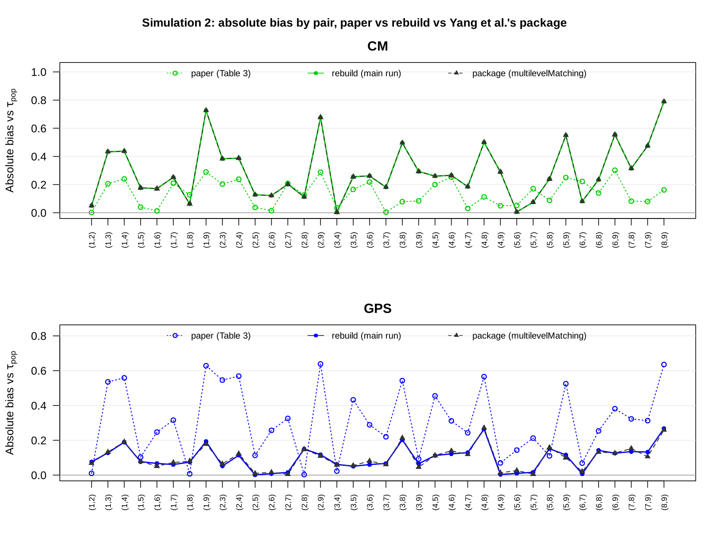
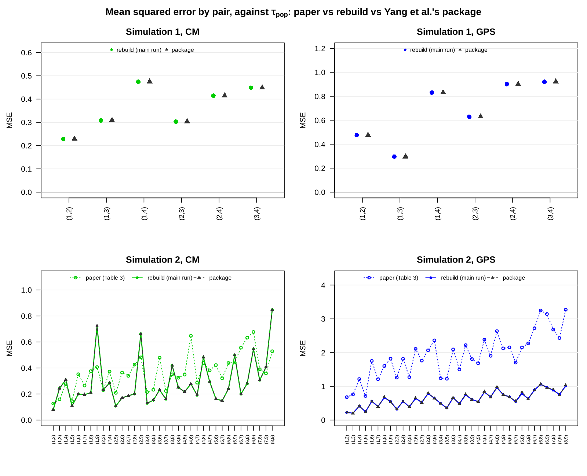

# Side by side: the paper, the rebuild and Yang et al.'s package

This folder compares, for both simulations, three sets of results: the paper's published tables, the rebuild's main run, and Yang et al.'s package (`multilevelMatching`) run on the rebuild's samples. As in the paper and the rebuild, the main criteria are **bias and mean squared error (MSE)**. Then come the decisions D1–D13 (what this repository tests and which decisions matter), interval coverage with the D8 sensitivity analysis, and what "multilevel" means in Yang et al. and in the paper. It is a working collection; the tables and figures can later be moved into the README and other documents.

- **Tables:** [tables/](tables/), each as CSV and as Markdown (the Markdown versions are inserted below unchanged).
- **Figures:** [figures/](figures/).
- **Code:** [crosscheck/R/08_side_by_side.R](../R/08_side_by_side.R) (all tables and figures here) and [crosscheck/R/07_d8_analytic_intervals.R](../R/07_d8_analytic_intervals.R) (analytic variances for the rebuild's GPS, section 5).

Sources and conventions:

- **Paper:** Guo, Liu and Wang (2022), Table 1 (Simulation 1: absolute bias and coverage; no MSE) and Table 3 (Simulation 2: bias, MSE and coverage), as transcribed in `results/paper_table1.csv` and `results/paper_table3.csv`. Both were checked against the published PDF: Table 1 matches in all six rows, and the Table 3 rows checked match.
- **Rebuild:** the main run (`results/sim1_summary.csv`, `results/sim2_summary.csv`), 500 replications per simulation, run on R 4.5.1. Nothing in this folder reruns or changes it.
- **Package:** `multilevelMatching` 1.0.0 run as a user would run it, on the same 1,000 samples: CM from `match_on = "covariates"`, GPS from `match_on = "multinom"` (the package fits its own GPS model at nnet's default tolerance). The package does not compute DIF, which involves no matching.
- Bias and MSE are against τ\_pop, the population ATE (D4); τ\_bal versions are in the CSVs. The paper's Table 3 signs are not comparable (see `docs/spec.md`), so the paper is compared by absolute bias.

## 1. Bias and MSE

Means over pairs (6 in Simulation 1, 36 in Simulation 2):

| Simulation | Estimator | Abs. bias: paper | Abs. bias: rebuild | Abs. bias: package | MSE: paper | MSE: rebuild | MSE: package |
|---|---|---|---|---|---|---|---|
| 1 | CM | 0.143 | 0.187 | 0.187 |  | 0.363 | 0.363 |
| 1 | GPS | 0.293 | 0.026 | 0.026 |  | 0.676 | 0.676 |
| 2 | CM | 0.139 | 0.295 | 0.295 | 0.368 | 0.288 | 0.288 |
| 2 | GPS | 0.307 | 0.099 | 0.100 | 1.916 | 0.626 | 0.627 |

- **The package reproduces the rebuild.** With the same samples, Yang et al.'s own software gives the rebuild's bias and MSE, exactly for CM and to within 0.001 for GPS. The rebuild's estimators are implemented as the method's authors implement them.
- **GPS is much less biased than CM; CM has the lower MSE.** This bias–variance trade-off holds in the rebuild and the package alike.
- **Against the paper, bias disagrees and MSE partly agrees.** The paper's GPS bias is 11 times the rebuild's in Simulation 1 (0.293 against 0.026) and 3 times in Simulation 2 (0.307 against 0.099), while its CM bias is smaller (0.143 against 0.187 in Simulation 1; about half, 0.139 against 0.295, in Simulation 2). The paper also has CM with the lower MSE, in all 36 pairs, and its GPS MSE follows the rebuild's pair by pair (correlation 0.963, [docs/table3_checks.md](../../docs/table3_checks.md)), but at about three times the level.

Pair counts:

| Simulation | Comparison | Paper | Rebuild | Package | Pairs |
|---|---|---|---|---|---|
| 1 | GPS less biased than CM (pairs) | 0 | 6 | 6 | 6 |
| 1 | CM lower MSE than GPS (pairs) |  | 5 | 5 | 6 |
| 2 | GPS less biased than CM (pairs) | 4 | 31 | 31 | 36 |
| 2 | CM lower MSE than GPS (pairs) | 36 | 33 | 33 | 36 |

### Simulation 1

Absolute bias against τ\_pop:

| Pair | CM paper | CM rebuild | CM package | GPS paper | GPS rebuild | GPS package |
|---|---|---|---|---|---|---|
| (1,2) | 0.026 | 0.110 | 0.110 | 0.060 | 0.024 | 0.024 |
| (1,3) | 0.166 | 0.345 | 0.345 | 0.374 | 0.037 | 0.036 |
| (1,4) | 0.240 | 0.199 | 0.199 | 0.481 | 0.048 | 0.048 |
| (2,3) | 0.140 | 0.235 | 0.235 | 0.315 | 0.013 | 0.012 |
| (2,4) | 0.213 | 0.088 | 0.088 | 0.421 | 0.024 | 0.024 |
| (3,4) | 0.074 | 0.146 | 0.146 | 0.107 | 0.011 | 0.012 |
| Mean | 0.143 | 0.187 | 0.187 | 0.293 | 0.026 | 0.026 |

MSE (the paper's Table 1 reports none):

| Pair | CM rebuild | CM package | GPS rebuild | GPS package |
|---|---|---|---|---|
| (1,2) | 0.228 | 0.228 | 0.476 | 0.476 |
| (1,3) | 0.308 | 0.308 | 0.297 | 0.296 |
| (1,4) | 0.475 | 0.475 | 0.832 | 0.831 |
| (2,3) | 0.303 | 0.303 | 0.630 | 0.630 |
| (2,4) | 0.415 | 0.415 | 0.902 | 0.902 |
| (3,4) | 0.449 | 0.449 | 0.922 | 0.921 |
| Mean | 0.363 | 0.363 | 0.676 | 0.676 |

**Figure 1. Simulation 1, absolute bias by pair.** Open circles: the paper's Table 1; filled circles: the rebuild; triangles: the package. Rebuild and package coincide; the paper's GPS bias is several times larger.

### Simulation 2

Pair-by-pair values: [tables/sim2_abs_bias.md](tables/sim2_abs_bias.md), [tables/sim2_mse.md](tables/sim2_mse.md) and [tables/sim2_side_by_side.csv](tables/sim2_side_by_side.csv) (which also has signed bias).

**Figure 2. Simulation 2, absolute bias of the 36 effects.** Dotted line and open circles: the paper's Table 3 (absolute values); solid line: the rebuild; dashed grey line and triangles: the package. Rebuild and package lie on top of each other.

### MSE by pair

**Figure 3. MSE by pair.** Simulation 1 (top; the paper reports no MSE) and Simulation 2 (bottom; dotted: the paper's Table 3). Rebuild and package coincide. In Simulation 2 the paper's GPS MSE follows the rebuild's pattern at a higher level, and its CM MSE is on the rebuild's scale.

### Agreement replication by replication

**Figure 4. Every GPS estimate, package against rebuild.** Each point is one pair in one replication (3,000 in Simulation 1, 18,000 in Simulation 2). In Simulation 2 the package's own GPS fit, at nnet's default tolerance, moves estimates off the diagonal in both directions (D5); the averages, and hence bias and MSE, are unchanged. The package's CM estimates are identical to the rebuild's in every replication.

## 2. CM and GPS: what agrees with the paper and what does not

- **Rebuild and package agree** on both criteria: GPS is less biased than CM (all 6 pairs in Simulation 1, 31 of 36 in Simulation 2), and CM has the lower MSE (5 of 6 and 33 of 36). The bias–variance trade-off described in the README is a property of the estimators, not of the rebuild's code.
- **The paper agrees on MSE:** in its Table 3, CM has the lower MSE in all 36 pairs.
- **The paper disagrees on bias:** in its tables GPS is less biased than CM in 0 of 6 pairs (Table 1) and 4 of 36 (Table 3).
- **What this implies.** The paper states that its methods reduce to Yang et al.'s, and the package reproduces the rebuild on the same data. The bias gap is therefore not a coding difference in the estimators as specified. It must come from what the package cannot check: how the data were generated (D1–D3, D10), which true effect bias is measured against (D4, D9), the GPS model (D5), or the paper's own code (for example a literal reading of Eq. (4), D13).

## 3. D7: why it kept coming up, and the conclusion

D7 is the reading of the paper's Eq. (4): the printed formula uses the score for t in both terms of τ̂(t, t′); the rebuild matches the t′ term on the score for t′. It came up repeatedly for three reasons: it is the only open decision about the estimator formula itself; a reference implementation can settle it; and the README's earlier claim that the literal reading "accounts for about half" of the GPS gap depended on it.

**Conclusion: keep D7.** Yang et al.'s package imputes Y(s) by matching on the score for s, so the t′ term uses the score for t′, and with our fitted scores it reproduces the rebuild's GPS exactly (up to 30 near-ties in 1,000 replications; [docs/crosscheck_math.md](../../docs/crosscheck_math.md)). The literal reading compares one unit's probability of t′ with another unit's probability of t, which is a different estimator from the one the method's authors implement. What the paper's own code did cannot be established ("Code Availability N/A"), so D13 stays as a sensitivity analysis of how much a literal implementation would change the results.

## 4. The thirteen decisions

### 4.1 What this repository tests, and why only some decisions

The rebuild did not test D1–D13 one at a time, and this repository does not either. Its goal is one question: **does the rebuild compute the estimators the way Yang et al.'s own software computes them?** The package makes its own choices about the GPS model, the matching distance and the estimator formula, so comparing it with the rebuild bears automatically on the decisions about estimation (D5, D6, D7, and D13, the check of D7). D7 also came up because the first cross-check asked what its result implied for D7, and D8 because the package reports analytic variances, which made an analytic-interval sensitivity analysis possible. These results are by-products of the cross-check, not a planned sensitivity analysis of all thirteen decisions; such an analysis, varying each decision in turn and recording bias and MSE, would be a separate study.

Some decisions had already been examined in the rebuild: D4 and D9 by reporting every result against both targets, τ\_pop and τ\_bal; D5's fitting tolerance by a test of start-independence; and D7 by the D13 sensitivity runs.

### 4.2 What the cross-check says about each decision

The package checks how estimates are computed from a given sample. It cannot check how the samples or the true effects were made.

| Decision | What it fixes | Bearing of the cross-check | Conclusion |
|---|---|---|---|
| D1 | Treatment-probability formula | None: rebuild and package use the same samples | Open |
| D2 | Distribution of Z1 | None | Open |
| D3 | Fixed group sizes | None | Open. The paper's Simulation 1 DIF differs pair by pair, and DIF involves no estimator choice, so the data design probably differs somewhere (D1–D3) |
| D4 | True effect (τ\_pop primary) | None | Open |
| D5 | GPS model and its fitting tolerance | Yes | Same model form as the package's default. The tolerance changes individual Simulation 2 estimates but not bias or MSE (now noted in D5) |
| D6 | Mahalanobis distance on X and Z | Yes | Confirmed: the package's distance is the rebuild's up to a constant |
| D7 | Reading of Eq. (4) | Yes | Settled for the method: keep (section 3) |
| D8 | Interval method | Partly | Coverage only; bias and MSE are unaffected (section 5) |
| D9 | Balanced-design target τ\_bal | None | Open. The package also averages over the sample's units, so it estimates the same quantity |
| D10 | Groups 6 and 7 assigned identically | None | Open |
| D11 | No trimming | Weakly | Consistent: the package trims only on request, and only for its own GPS fit |
| D12 | Software record | Yes | Two additions: the package needs an input workaround on R 4.3 and later, and the Simulation 2 GPS reproduces across setups only up to near-ties |
| D13 | Literal Eq. (4) sensitivity check | Yes | Neither literal variant is what the package computes |

So the cross-check closes the questions about how the estimates are computed (D5, D6, D7, D13). The remaining differences from the paper most likely lie in data generation and the target (D1–D4, D9, D10).

### 4.3 Which decisions matter beyond this replication

Each decision matters in one or more of three ways: for reproducing the paper's numbers, for applying the methods to real data, and for matching with clustered (multilevel) data. The table gives an assessment; only D4/D9, D5, D7 (through D13) and D8 have been examined quantitatively.

| Decision | What it is | Changes the replication's numbers? | Matters in real applications? | Matters for clustered (multilevel) matching? |
|---|---|---|---|---|
| D1 | Treatment-probability formula | Yes: it sets how strongly treatment depends on the covariates | No: in real data the assignment mechanism is unknown, and any fitted multinomial model gives probabilities that sum to 1 | No |
| D2 | Distribution of Z1 | Somewhat | No | No |
| D3 | Fixed group sizes | Yes: it changes the population the sample represents | Yes, in designs that fix group sizes | Somewhat: multilevel designs often fix the numbers of schools and students per school, which likewise shapes the estimand |
| D4, D9 | The true effect (target) | Yes: bias is measured against it | Yes: choosing the estimand, the effect for which population | Yes: student-level or school-level effects, averaged over which students or schools |
| D5 | GPS model and its fitting tolerance | Yes: misspecification drives GPS bias; the tolerance matters only replication by replication | Yes: the GPS model is the main practical risk of GPS methods | Central: whether the model represents the clustering (school effects or school-level terms) is where multilevel propensity methods differ |
| D6 | Matching distance | Yes, for CM | Yes: scaling and choice of covariates | Yes: matching across schools or within them, and how school covariates are weighted |
| D7 | Reading of Eq. (4) | Possibly large (D13) | Yes | Theoretically required: to impute Y(s), the balancing score is the probability of s (Imbens, 2000), so the t′ term must be matched on the score for t′ |
| D8 | Interval method | Coverage only | Yes: the bootstrap is not valid for matching estimators | Yes: with clustered data, intervals must allow for correlation within schools; neither the rebuild's bootstrap nor the Abadie–Imbens formulas do, which is harmless here only because the simulated units are independent |
| D10 | Groups 6 and 7 assigned identically | Barely | No | No |
| D11 | No trimming (overlap) | Somewhat, in Simulation 2 | Yes: limited overlap biases matching | Yes: small schools and small groups often have poor overlap (the paper's application has a group of 8 students) |
| D12 | Software record | Reproducibility only | Yes | No |
| D13 | Literal Eq. (4) check | A sensitivity check of D7 | | |

The decisions that could change the paper's conclusion about the bias of CM against GPS are D1–D5, D7 and D9; D8, D11 and D12 affect intervals, overlap and reproducibility rather than that conclusion.

## 5. Coverage, and the D8 sensitivity analysis

Coverage is secondary here: it depends on bias and on how intervals are built, and neither changes the bias and MSE above.

### 5.1 Why the rebuild's CM coverage is low

The rebuild's CM intervals (main run, percentile bootstrap) cover τ\_pop in 91.4% of replications on average in Simulation 1 and 78.4% in Simulation 2, with the lowest pair at 83.4% and 39.6%. These are the main run's own numbers (`results/sim1_summary.csv` and `results/sim2_summary.csv`, R 4.5.1); the rebuild's README and `results/summary.md` already report them. They do not depend on the R version used for the cross-check, which reran nothing in the main run.

The cause is CM's bias. For each pair, a normal approximation predicts coverage from three numbers in the main run's summary: the bias b, the spread of the estimates over replications (Monte Carlo SD s) and the interval half-width h, as the probability that |b + sZ| ≤ h with Z standard normal.

| Simulation | Estimator | Observed mean coverage | Predicted from bias, SD and width | Predicted if unbiased | Correlation, observed vs predicted (pairs) | Lowest pair | Its coverage | Its abs. bias / SD |
|---|---|---|---|---|---|---|---|---|
| 1 | CM | 91.43 | 92.18 | 94.43 | 0.99 | (1,3) | 83.40 | 0.79 |
| 1 | GPS | 100.00 | 98.93 | 98.94 |  | (1,2) | 100.00 | 0.04 |
| 2 | CM | 78.41 | 82.36 | 93.12 | 0.99 | (1,3) | 39.60 | 1.82 |
| 2 | GPS | 100.00 | 98.79 | 98.88 |  | (1,2) | 100.00 | 0.16 |

The prediction tracks the observed CM coverage pair by pair (correlation 0.99). In the worst pair, (1,3) in Simulation 2, the CM bias is 1.8 times the spread of the estimates, so an interval centred on the estimate rarely reaches the truth: 39.6% observed, 50% predicted. With the same intervals and no bias, CM coverage would be about 93–94% in both simulations. GPS has little bias and over-covers (section 5.2).

### 5.2 Analytic intervals (D8)

D8 is the interval method. The paper does not say how its confidence intervals were built, and the rebuild uses percentile bootstrap intervals (B = 200, resampling within treatment groups, everything re-estimated in each draw). This sensitivity analysis keeps every point estimate of the rebuild, and therefore its bias and MSE, and replaces only the intervals, with analytic ones of the form estimate ± 1.96 SE, using the variances of Abadie and Imbens:

- **AI 2006** (Abadie and Imbens, 2006): the large-sample variance of a nearest-neighbour matching estimator. It accounts for how much the unit-level effects vary, for the noise in the outcomes (estimated by matching each unit to its nearest neighbour in its own group) and for how often each unit is reused as a match. It treats the variable matched on as known. For CM it is taken from the package's `covariates` fit, which reproduces the rebuild's CM estimates exactly; for GPS it treats the fitted GPS as known.
- **AI 2016** (Abadie and Imbens, 2016): for matching on an estimated propensity score. It subtracts from AI 2006 a correction for the uncertainty in the fitted multinomial logit; for average effects the correction lowers the variance. The package computes it only for its own GPS fit, so [07_d8_analytic_intervals.R](../R/07_d8_analytic_intervals.R) runs the package's internal steps with the rebuild's own fitted model. As a check, the same steps run with the package's own fit reproduce `multiMatch()`'s variances exactly, in both simulations. Negative AI 2016 variances (6 of 3,000 in Simulation 1, 3 of 18,000 in Simulation 2) give no interval and are left out.

Coverage of τ\_pop ("Mean abs. diff. from paper" is the average over pairs of |coverage − the paper's coverage|; τ\_bal versions in [tables/d8_coverage_summary_bal.md](tables/d8_coverage_summary_bal.md)):

| Simulation | Estimator | Method | Mean coverage | Min | Max | Mean width | Mean abs. diff. from paper | Unavailable intervals |
|---|---|---|---|---|---|---|---|---|
| 1 | CM | paper | 95.0 | 92.0 | 98.0 |  |  |  |
| 1 | CM | bootstrap (main run) | 91.4 | 83.4 | 95.4 | 2.15 | 3.6 | 0 |
| 1 | CM | AI 2006 | 94.8 | 89.0 | 97.2 | 2.38 | 1.4 | 0 |
| 1 | GPS | paper | 99.7 | 99.0 | 100.0 |  |  |  |
| 1 | GPS | bootstrap (main run) | 100.0 | 100.0 | 100.0 | 4.18 | 0.3 | 0 |
| 1 | GPS | AI 2006 | 99.6 | 99.2 | 100.0 | 4.89 | 0.5 | 0 |
| 1 | GPS | AI 2016 | 95.9 | 92.7 | 97.8 | 3.44 | 3.8 | 6 |
| 2 | CM | paper | 97.1 | 92.0 | 100.0 |  |  |  |
| 2 | CM | bootstrap (main run) | 78.4 | 39.6 | 93.4 | 1.45 | 18.6 | 0 |
| 2 | CM | AI 2006 | 90.1 | 62.6 | 97.8 | 1.78 | 7.4 | 0 |
| 2 | GPS | paper | 98.9 | 96.0 | 100.0 |  |  |  |
| 2 | GPS | bootstrap (main run) | 100.0 | 100.0 | 100.0 | 3.93 | 1.1 | 0 |
| 2 | GPS | AI 2006 | 99.6 | 98.6 | 100.0 | 4.49 | 0.9 | 0 |
| 2 | GPS | AI 2016 | 94.6 | 87.1 | 98.0 | 3.05 | 4.3 | 3 |

Interval width against the actual spread of the estimates (implied standard error = mean width / 3.92, an approximation for the percentile bootstrap; all averaged over pairs):

| Simulation | Estimator | Monte Carlo SD of the estimates | Bootstrap | AI 2006 | AI 2016 | Mean abs. bias / SD |
|---|---|---|---|---|---|---|
| 1 | CM | 0.559 | 0.548 | 0.606 |  | 0.361 |
| 1 | GPS | 0.809 | 1.067 | 1.247 | 0.878 | 0.035 |
| 2 | CM | 0.397 | 0.370 | 0.455 |  | 0.744 |
| 2 | GPS | 0.770 | 1.002 | 1.145 | 0.777 | 0.130 |

**Figure 5. Coverage of 95% intervals by pair.** Open circles: the paper. Filled circles: the rebuild's bootstrap intervals (main run). Triangles: AI 2006 intervals. Diamonds (GPS only): AI 2016 intervals. Dashed line: 95%.

**What it shows.**

- **GPS:** the AI 2016 intervals have the right width. Their implied standard error (0.878 and 0.777) matches the spread of the GPS estimates (0.809 and 0.770), and their coverage is close to 95% (95.9% and 94.6%). The bootstrap and AI 2006 intervals are 30–54% too wide, so they cover in nearly every replication (99.6–100%). The paper's GPS coverage (99–100% and 96–100%) matches these conservative intervals.
- **CM:** coverage is driven by bias (section 5.1). AI 2006 intervals are 11% and 23% wider than the bootstrap ones, which raises coverage from 91.4% to 94.8% (Simulation 1) and from 78.4% to 90.1% (Simulation 2). In Simulation 1 that is within 1.4 points of the paper per pair on average; in Simulation 2 the remaining gap follows the bias gap (the paper's CM bias is about half the rebuild's).

**Conclusion on D8.** The paper's reported coverage is closer to analytic Abadie–Imbens (2006) intervals than to the percentile bootstrap: for CM the mean distance from the paper falls from 3.6 to 1.4 points (Simulation 1) and from 18.6 to 7.4 points (Simulation 2); for GPS the two are equally close. This is consistent with the paper having used analytic variances, which `Matching` and `multilevelMatching` report by default, but does not prove it. For the rebuild, the bootstrap can stay as the documented D8 choice with these analytic intervals as its sensitivity analysis; for inference rather than for matching the paper, AI 2016 is the better GPS interval and AI 2006 the better CM interval. The bootstrap is not formally valid for matching estimators (Abadie and Imbens, 2008).

## 6. What "multilevel" means here

The word is used in two different senses.

- **Yang et al. (2016): treatments with more than two levels.** The title says "multi-level treatments": a treatment that takes several values, such as several programmes or doses, as levels of a factor. It does not refer to nested data, and the package name `multilevelMatching` follows that usage. For independent units, a one-level multinomial model for the generalized propensity score is the appropriate model; Imbens (2000) introduced the generalized propensity score for this case.
- **Guo, Liu and Wang (2022): nested data.** Students are nested in schools, the covariates are at two levels (X for students, Z for schools), and a student-level and a school-level treatment are combined into one multi-valued treatment. Estimation is nevertheless single-level: the GPS model and the matching use X and Z as ordinary covariates, with no school identifiers, school effects or within-school matching. That is why the paper's methods reduce to Yang et al.'s when Z is dropped, and why the package can reproduce the rebuild.

So neither the paper's estimators nor Yang et al.'s are multilevel matching in the hierarchical sense. Methods that use the clustering include propensity score models with school random or fixed effects (Arpino and Mealli, 2011), propensity score weighting with multilevel data (Li, Zaslavsky and Landrum, 2013), and the approaches in the paper's own references [43] (Wang, 2015) and [45] (Yang, 2018). The rebuild's README lists matching that uses the clustering as future work.

References for sections 4 and 6:

- Arpino, B., & Mealli, F. (2011). The specification of the propensity score in multilevel observational studies. *Computational Statistics & Data Analysis, 55*(4), 1770–1780.
- Imbens, G. W. (2000). The role of the propensity score in estimating dose-response functions. *Biometrika, 87*(3), 706–710.
- Li, F., Zaslavsky, A. M., & Landrum, M. B. (2013). Propensity score weighting with multilevel data. *Statistics in Medicine, 32*(19), 3373–3387.
- Wang, Q. (2015). Propensity score matching on multilevel data. In W. Pan & H. Bai (Eds.), *Propensity score analysis: Fundamentals and developments* (pp. 217–235). Guilford Press.
- Yang, S. (2018). Propensity score weighting for causal inference with clustered data. *Journal of Causal Inference, 6*.

## Files

Tables, in [tables/](tables/) (CSV; Markdown where shown above):

- `bias_mse_summary`, `orderings_counts` (and `orderings.csv`, `mean_abs_bias`): headline bias and MSE, and which estimator is less biased and which more efficient.
- `sim1_abs_bias`, `sim1_mse`, `sim1_coverage`; `sim2_abs_bias`, `sim2_mse`, `sim2_coverage`: by pair.
- `sim1_side_by_side.csv`, `sim2_side_by_side.csv`: every per-pair column in one file, including signed bias.
- `coverage_vs_bias`: why coverage is low where it is.
- `d8_coverage_summary` (`_pop.md`, `_bal.md`, `.csv`), `d8_coverage_by_pair.csv`, `d8_interval_width_vs_spread`: the D8 sensitivity analysis.

Figures, in [figures/](figures/):

- `fig1_sim1_abs_bias.png`, `fig2_sim2_abs_bias.png`: absolute bias by pair.
- `fig3_mse_by_pair.png`: MSE by pair.
- `fig4_gps_per_replication.png`: every GPS estimate, package's own fit against the rebuild.
- `fig5_coverage_by_method.png`: coverage by pair and interval method.

Inputs: `results/` (the paper's tables and the main run), `crosscheck/results/` (the cross-check, and `sim{1,2}_d8_gps_variances.csv` from 07). Logs: `crosscheck/logs/07_d8_sim{1,2}_log.txt`, `crosscheck/logs/08_side_by_side_log.txt`.

References: Abadie and Imbens (2006, 2008, 2016) and Yang et al. (2016), as listed in [docs/crosscheck.md](../../docs/crosscheck.md).
