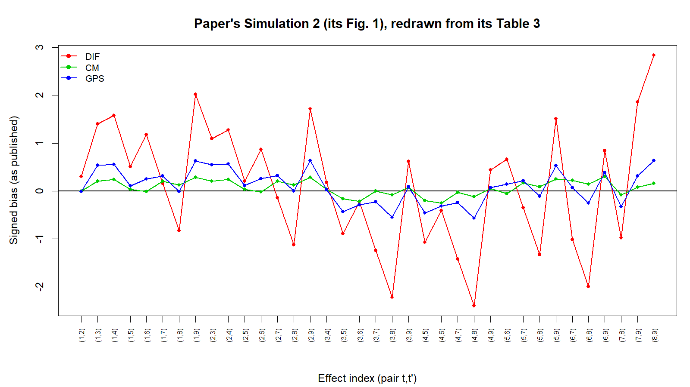
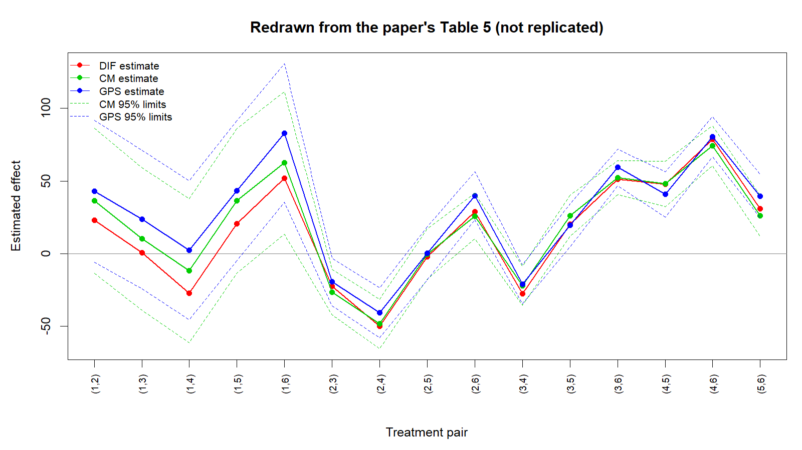
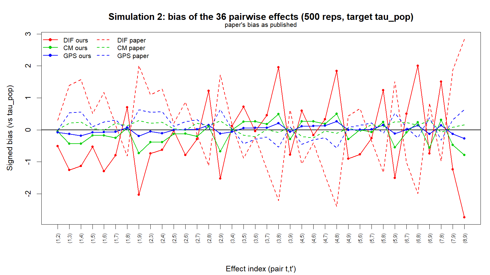
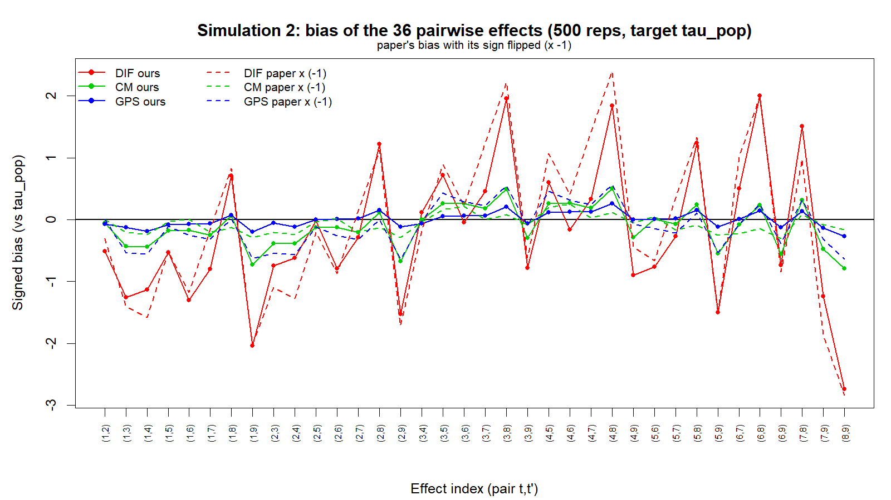
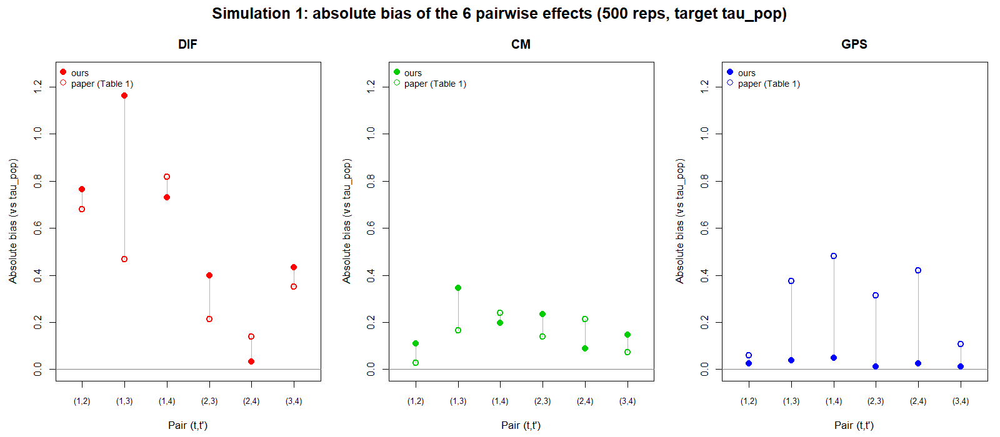
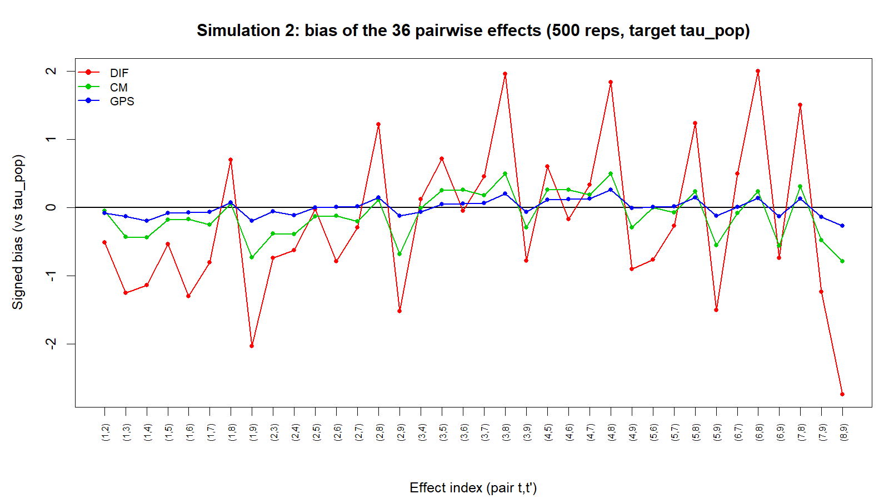
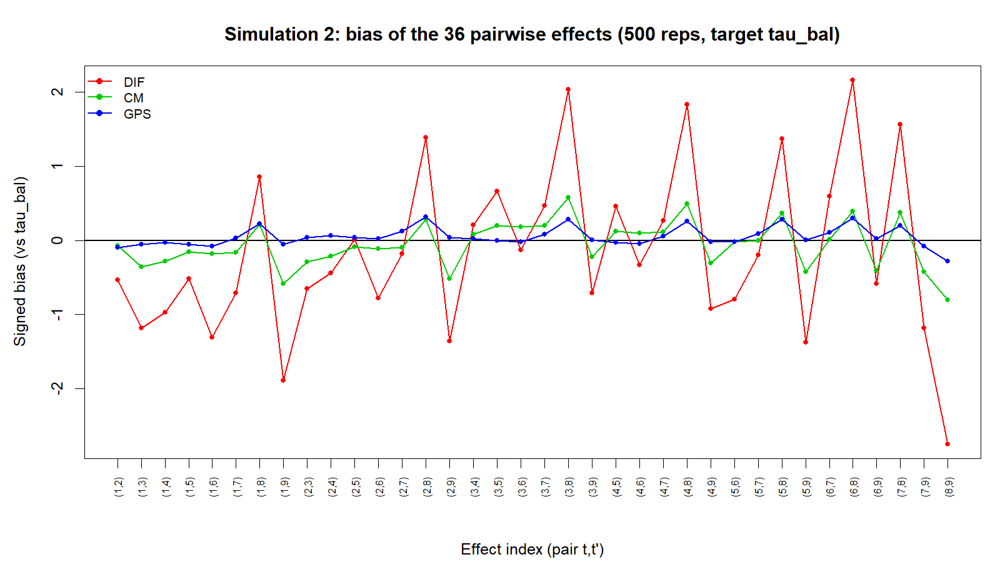

# The rebuild: background, design and results

This document holds the rebuild's own account: why the paper was rebuilt, how the paper handles the hierarchy, the design, what differed from the paper, the two true effects, and the results with Figures A–F. These sections were the front half of the main [README](../README.md) until 2026-11-17. They moved here when the README was slimmed to a summary and a map. Since then they have gained notes from the cross-check and follow the wording of rebuild 1's README. The rebuild itself is unchanged since the import from glw2022-matching-replication. Later work in this repository is in [crosscheck.md](crosscheck.md), [../crosscheck/side_by_side/README.md](../crosscheck/side_by_side/README.md), [../crosscheck/intervals/README.md](../crosscheck/intervals/README.md) and [../crosscheck/rebuild2/README.md](../crosscheck/rebuild2/README.md).

## Key findings of the rebuild

Guo, Liu and Wang (2022) proposed covariate matching (CM) and generalized propensity score (GPS) matching to estimate pairwise effects across multilevel treatment combinations, and reported simulations showing that both reduce the bias of the raw group difference.

- **Published vs rebuilt.** The rebuild, written from the paper's text alone without the original code, confirms the paper's central claim: both matching methods remove most of the raw-difference bias. Mean absolute bias falls from 0.6–0.9 (raw difference) to 0.2–0.3 (CM) and 0.03–0.10 (GPS).
- **GPS does better than published.** In the rebuild, GPS matching has the smallest bias of the three estimators in both simulations, and in Simulation 1 it is nearly unbiased (mean absolute bias 0.026, against 0.29 in the paper's Table 1).
- **Thirteen decisions, documented.** Rebuilding from the published text alone, as any reader without the original code must, requires thirteen decisions (D1–D13). Each default follows the paper's description or is a reasoned reading of it, and is recorded in [docs/spec.md](spec.md). One of them, the reading of Eq. (4) (D7), could account for about half of the GPS gap in Simulation 1, but only if the paper's code read Eq. (4) literally; Yang et al.'s (2016) own package computes the estimator as this rebuild does. The remaining differences depend on details not reported in the paper.
- **The method stands.** The paper's estimators are implemented unchanged. CM is more efficient, with about half GPS's mean squared error, and GPS is less biased: a bias–variance trade-off. Not every number improves: CM coverage in Simulation 1 is lower than published (83–95% against 92–98%). The rebuild offers no evidence against using GPS matching for multilevel treatments in the setting the paper considers.

## Why this replication

The paper offers estimators for treatment effects when students are nested in schools, but it provides no code or data and leaves several simulation details unspecified. This rebuild checks which reported results hold up and documents the choices needed to run it (D1–D13), with code and results that others can rerun and check.

## Background

This repository rebuilds the two simulation studies in Guo, Liu and Wang (2022) from the published text, to test what the paper reports about covariate matching (CM) and generalized propensity score (GPS) matching for treatments that operate at more than one level.

**The estimation task.** The paper crosses a student-level treatment (for example, hybrid versus fully online learning) with a school-level treatment (for example, school location). Each combination of the two is one treatment group; as in the paper, A is the number of groups: A = 4 in Simulation 1, 9 in Simulation 2 and 6 in the application. The target is the average effect τ(t, t′) for every pair of groups, giving 6, 36 and 15 pairwise effects. Each effect is estimated three ways: the raw difference in group means (DIF), CM and GPS matching.

**Why rebuild it.** Four features of the paper motivate a rebuild in which the true effects are known.
- **The simulations favour CM.** In the paper's own tables, GPS has larger absolute bias than CM in all 6 Simulation 1 pairs (Table 1) and in 32 of 36 Simulation 2 pairs (Table 3), and a larger mean squared error in all 36 (Table 3); GPS coverage in Simulation 1 is 99–100%, above the nominal 95%. The paper plots the Table 3 biases as its Fig. 1 (see Figure A below).
- **The sections describe efficiency differently.** Section 5 finds CM more efficient, Section 6 describes GPS as having much smaller mean squared error, and Section 7 describes GPS as less efficient.
- **The application cannot show bias.** The application (Section 6) uses synthetic data whose true effects are not reported. In the paper's Fig. 2 (Figure B below), the CM and GPS estimates depart from the raw difference by about 10 to 31 points on the 8th-grade mathematics score in the five pairs involving group 1, which has only 8 students (the paper's Table 4), and by at most about 11 points elsewhere; without a known truth, the figure cannot show which estimate is closer.
- **Neither code nor data was released,** and several simulation details are not specified.

**The paper's two figures, redrawn.** The published figures are under exclusive licence to Springer Nature and are not reproduced in this repository. Both are redrawn here from the values printed in the paper's tables, transcribed into [results/paper_table3.csv](../results/paper_table3.csv) and [results/paper_table5.csv](../results/paper_table5.csv), in the paper's colours (red DIF, green CM, blue GPS). They show the paper's numbers, not results of this rebuild.



**Figure A. The paper's Fig. 1, redrawn from its Table 3.** Bias of the 36 Simulation 2 effects as published (red DIF, green CM, blue GPS). Table 3 lists the values the paper's Fig. 1 plots; we redraw it from those numbers, rather than reproduce the original image, so it can be read beside our results. Its rebuild counterpart is Figure F ([Results](#results)); the two are overlaid in Figure C ([What differed](#what-differed)).



**Figure B. The paper's Fig. 2, redrawn from its Table 5.** Estimates and 95% limits for the 15 pairwise effects in the paper's application (Section 6): DIF (red), CM (green) and GPS (blue), with dashed limits. Redrawn from the published numbers so it can be read here. The paper does not describe how its synthetic data were generated, so this part was not replicated and has no rebuild counterpart.

| Paper | Redrawn here | Rebuild counterpart |
|---|---|---|
| Fig. 1 (Simulation 2 bias; Table 3) | Figure A | Figure F (Results); overlays in Figure C (What differed) |
| Fig. 2 (application; Table 5) | Figure B | none (not replicated) |
| Table 1 (Simulation 1; no figure) | none | Figure D (What differed) |

**How the paper handles the hierarchy.** The paper's setting is hierarchical, with students nested in schools and a treatment at each level, but its estimation is single-level:

- **Treatment.** The student-level and school-level treatments are combined into one multi-valued treatment, T = 1, …, A; Section 4 treats the problem as a multiple-treatment case.
- **Matching.** Both methods match across all units on student covariates X and school covariates Z. Cluster membership is not used: there are no cluster IDs, random effects or within-school matching. Without Z, the methods reduce to those of Yang et al. (2016) for multi-level treatments in non-hierarchical data.
- **Simulations.** Z is drawn separately for each unit, so the simulated data are not nested in schools.

This rebuild follows the paper's design. Matching that uses the clustering, such as matching within schools first, is left for future work.

**The GPS estimator in the cross-check.** The rebuild and Yang et al.'s package compute the same estimator (the paper's Eqs. 3 and 4, read as in D7). For each unit i and level s, with a score r\_s(x, z):

```math
\hat Y_i(s) = \begin{cases} Y_i & \text{if } T_i = s,\\ Y_{j(i,s)} & \text{otherwise,} \end{cases} \qquad j(i,s) = \arg\min_{j:\,T_j = s} \bigl| r_s(x_j, z_j) - r_s(x_i, z_i) \bigr|,
```

$$\hat\tau(t, t') = \frac{1}{n} \sum_{i=1}^{n} \bigl[ \hat Y_i(t) - \hat Y_i(t') \bigr].$$

The score is a fitted multinomial logit, with w = (1, x1, …, x4, z1, z2, z3) and level 1 as the baseline (β\_1 = 0):

$$r_s(x, z) = \frac{\exp(w^\top \beta_s)}{\sum_{k=1}^{A} \exp(w^\top \beta_k)}.$$

The three GPS versions compared in the cross-check differ only in the coefficients and in how nearest neighbours are chosen:

| Version | Score r\_s | Coefficients β | Nearest neighbour j(i, s) |
|---|---|---|---|
| **Our GPS** (rebuild) | p̂\_s | β̂: maximum likelihood with `nnet::multinom` run to reltol = 1e-14, maxit = 10000 (D5) | exact arg min; exact ties broken at random (none occurred) |
| **`existing`** (package, given our scores) | the same p̂\_s (rows adjusted by at most 4.2e-16 so each sums to exactly 1) | not refitted: β̂ as above | `Matching::Match`: candidates within about 1e-10 of the minimum squared standardized distance count as tied, and one is picked at random |
| **`multinom`** (package's own fit) | p̃\_s | β̃: the same likelihood with `nnet::multinom` at its defaults, which stop when an iteration improves the fit by less than a relative 1e-8, or after 100 iterations | as for `existing` |

So `existing` equals our GPS except at near-ties. `multinom` uses β̃ ≈ β̂, but its probabilities differ from ours by up to |p̃ − p̂| = 1.7e-4 in Simulation 1 and 2.2e-3 in Simulation 2. Those differences are larger than many of the gaps between competing candidates, so some j(i, s) change. The package reports μ̂(t′) − μ̂(t); its signs are flipped to τ(t, t′) = E[Y(t) − Y(t′)] here. CM is compared the same way, with the Mahalanobis distance on the seven covariates in place of |r\_s(x\_j, z\_j) − r\_s(x\_i, z\_i)|. [docs/crosscheck_math.md](crosscheck_math.md) shows step by step, from the code of both, that the rebuild and the package compute this estimator, and when their results can differ.

**What the rebuild has to decide.** Rebuilding from the text alone requires thirteen decisions, recorded in [docs/spec.md](spec.md):
- *Data generation:* treatment probabilities (D1), the distribution of Z1 (D2), fixed group sizes (D3), identical assignment for groups 6 and 7 (D10) and thin overlap (D11).
- *Estimators:* the GPS model (D5), the matching distance (D6) and the reading of Eq. (4) (D7).
- *Targets and inference:* which true effect (D4, D9) and how intervals are computed (D8).
- *Records and checks:* the software environment (D12) and the Eq. (4) sensitivity check (D13).

## Design (as in Section 5)

- **Covariates.** X = (X1, …, X4) ~ multivariate normal with the paper's covariance matrix; Z1 ~ Uniform(−3, 3) (D2), Z2 ~ χ²(1), Z3 ~ Bernoulli(0.5).
- **Treatment.** Multinomial logit (logistic regression extended to more than two groups) with η₁ = 0 and η_t = 0.1 × a sum of linear and squared covariate terms (D1). Simulation 1 has A = 4 groups of 100 units (6 effects); Simulation 2 has A = 9 groups of 200 units (36 effects).
- **Outcomes.** Y(t) is linear in (X, Z) with group-specific coefficients, plus N(0, 1) noise.
- **Estimators.** DIF, the raw difference in group means; CM, which matches each unit to its nearest neighbour on all 7 covariates by Mahalanobis distance (a distance that scales the covariates by their variances and allows for their correlations), one match per unit and with replacement, so a unit can be used more than once; GPS, which matches on the estimated probability of receiving each treatment, from a multinomial logit with linear terms only (misspecified on purpose, because treatment depends on squared terms too).
- **Inference.** Percentile bootstrap: each 95% interval runs from the 2.5th to the 97.5th percentile of the estimates in B = 200 resampled data sets, resampling within treatment groups and refitting the GPS model each time (D8).
- **Scale.** 500 replications per simulation. Bias (mean estimate minus the truth), MSE (mean squared error: the average squared distance between estimate and truth, which combines bias and variance) and coverage (the share of 95% intervals that contain the truth) are reported against two truths: the population ATE (τ\_pop) and the balanced-design ATE (τ\_bal) (D4, D9).

The full set-up is in [`docs/spec.md`](spec.md).

## What differed

The decisions behind these differences are mapped in [Background](#background) and recorded in [`docs/spec.md`](spec.md). The ones that matter most:

1. **Treatment probabilities (D1).** Each unit's group is drawn from a multinomial logit. For group t, the linear predictor η_t(x, z) is 0.1 times a sum of the unit's covariates and squared covariates (the terms differ by group; see [`docs/spec.md`](spec.md)), and η₁ = 0 for the reference group. The standard model, used here, is

   $$p_t(x,z) = \frac{\exp(\eta_t)}{\sum_{s=1}^{A}\exp(\eta_s)}, \qquad t = 1, \dots, A,$$

   so the A probabilities sum to 1. The paper prints the denominator as 1 + Σ exp(η_s), summed over all A groups. Because η₁ = 0 already adds exp(0) = 1 to the sum, the extra 1 counts the reference group twice, and the probabilities add up to Σ exp(η_s) / (1 + Σ exp(η_s)), which is less than 1.
2. **Z1 (D2).** "N[−3, 3]" is read as Uniform(−3, 3).
3. **Fixed group sizes (D3, D9).** Units are drawn from a large pool by the multinomial probabilities and the first 100 or 200 per group are kept. This sample is not drawn from the population, so CM and GPS estimate the balanced-design ATE; both truths are reported.
4. **Covariance matrix for matching (D6).** The paper builds it from X only but matches on X and Z; we use all 7 covariates.
5. **Eq. (4) (D7, D13).** The paper defines the GPS match in Eq. (3) and the effect estimate in Eq. (4) (Guo, Liu and Wang, 2022, Section 4, p. 972):

   $$GPS(t,p) = \arg\min_{j:\,T_j=t}\ \big\|\Pr(t\mid x_j,z_j) - p\big\| \qquad (3)$$

   $$\hat\tau_{GPS}(t,t') = \frac{1}{n}\sum_{i=1}^{n}\Big\{Y^{obs}_{GPS}\big(t,\ \Pr(t\mid x_i,z_i)\big) - Y^{obs}_{GPS}\big(t',\ \Pr(t\mid x_i,z_i)\big)\Big\} \qquad (4)$$

   Here $Y^{obs}_{GPS}(t, p)$ is the observed outcome of the unit that Eq. (3) picks. In words: for each unit, find its closest match in group t and its closest match in group t′, and average the difference in their outcomes over all n units. As printed, the second term also uses the score for t, Pr(t | x_i, z_i), so a unit's match in group t′ would be found by comparing each candidate's probability of t′ with the unit's probability of t, two different quantities. The main GPS uses the score for t′ there, Pr(t′ | x_i, z_i) (D7); the literal reading is reported as a sensitivity check in [`docs/sensitivity.md`](sensitivity.md). In Simulation 1, reading Eq. (4) literally, as printed, raises the mean absolute GPS bias from 0.026 to 0.159, about half the way to the published 0.293. That is not how Yang et al.'s (2016) own R package, `multilevelMatching`, computes the estimator: given our fitted scores, it reproduces the main GPS exactly on a test replication (D7 in [`docs/spec.md`](spec.md#decisions-d1d13)). The literal reading therefore explains the gap only if the paper's code followed Eq. (4) as printed. The original simulation code was not available for this rebuild, the paper names no software ("Code Availability N/A"), and the published text alone does not settle which reading was used.

<table>
  <tr>
    <td></td>
    <td></td>
  </tr>
  <tr>
    <td align="center">As published</td>
    <td align="center">Sign flipped</td>
  </tr>
</table>

**Figure C. Rebuild vs the paper's Table 3, Simulation 2 (left: as published; right: sign flipped).** The sign of bias is a further difference. Our bias (solid) is the mean estimate minus the truth; the paper's Table 3 values (dashed) mirror ours as published (left) and line up once multiplied by −1 (right). The paper does not state its convention; see [docs/two_way.md](two_way.md).



**Figure D. Simulation 1: rebuild vs the paper's Table 1.** Absolute bias of the 6 Simulation 1 effects: rebuild (filled) vs the paper's Table 1 (open), against τ\_pop.

Exploratory checks of the published Table 3 are in [docs/table3_checks.md](table3_checks.md).

## Two targets: τ_pop and τ_bal

Every bias figure here compares an estimate with a true effect, and this design admits two natural truths.

- **Population ATE, τ_pop.** The average effect of treatment t versus t′ over the whole population, as in the paper's Eq. (1). This is the usual average treatment effect (ATE) in propensity score analysis.

$$\tau_{pop}(t,t') = E\left[\,Y(t) - Y(t')\,\right]$$

- **Balanced-design ATE, τ_bal.** The simulations keep a fixed number of units in every treatment group (100 or 200), however rare the group is in the population. The analysed sample is then an equal-weight mix of the groups, and estimators that average over the sample's units target the effect over that mix:

$$\tau_{bal}(t,t') = \frac{1}{A}\sum_{s=1}^{A} E\left[\,Y(t) - Y(t') \mid T = s\,\right]$$

(A is the number of treatment groups, as defined in Background.)

<table>
  <tr>
    <td></td>
    <td></td>
  </tr>
  <tr>
    <td align="center">against τ_pop</td>
    <td align="center">against τ_bal</td>
  </tr>
</table>

**Figure E. Rebuild: Simulation 2 bias against the two truths (left: τ\_pop, as in Figure F; right: τ\_bal).** The same 36 Simulation 2 effects, measured against the two truths.

The two coincide when every treatment group is equally common, or when the effect is the same for everyone. Neither holds here: in Simulation 2 the groups make up 6% to 19% of the population and effects vary with covariates, so the two truths differ by up to 0.18.

**In a real study.** Suppose a district evaluates learning modes by drawing 200 students from each combination of learning mode and school region, including rare ones. An estimator that averages over those students estimates the effect for that over-represented mix, not for the district's student body. Recovering the district-wide effect requires weighting each group by how common it is in the population.

**In propensity score terms.** Choosing a truth means choosing the target population, as with the ATE versus the effect on the treated (ATT) in binary-treatment analyses, or with trimming to improve overlap, which also changes whose effect is estimated (Crump et al., 2009). We report bias against both; the paper's definition, τ_pop, is primary.

## Results

Mean absolute bias (95% CI coverage), averaged over pairs. Per-pair values are in [results/summary.md](../results/summary.md); the full comparison with the paper is in [docs/replication_verdict.md](replication_verdict.md), and pair-by-pair tables against the paper's Tables 1 and 3 are in [docs/two_way.md](two_way.md).

| Estimator | Sim 1, vs τ\_pop | Sim 1, vs τ\_bal | Sim 2, vs τ\_pop | Sim 2, vs τ\_bal |
| --- | --- | --- | --- | --- |
| DIF | 0.588 (85%) | 0.612 (84%) | 0.941 (78%) | 0.927 (79%) |
| CM | 0.187 (91%) | 0.223 (90%) | 0.295 (78%) | 0.262 (81%) |
| GPS | 0.026 (100%) | 0.072 (100%) | 0.099 (100%) | 0.096 (100%) |

- **Efficiency.** GPS has about twice CM's MSE (against τ\_pop: 0.68 vs 0.36 in Simulation 1, 0.63 vs 0.29 in Simulation 2), and its intervals are about 30% too wide, which gives its 100% coverage.
- **Against the paper.** Simulation 1 GPS bias averages 0.026 here and 0.29 in the paper's Table 1. In Simulation 2 our bias tracks Table 3 with the opposite sign (correlations −0.95, −0.76 and −0.87 for DIF, CM and GPS).
- **Sensitivity (D13).** Reading Eq. (4) literally raises the Simulation 1 GPS bias to 0.159, about half the way to the paper's value; this explains part of the gap only if the paper's code read Eq. (4) that way. Yang et al.'s own package computes the main GPS, not the literal reading (D7).


**Figure F. Rebuild: bias of the 36 Simulation 2 effects against τ\_pop.** Red DIF, green CM, blue GPS.

What Figure F shows: DIF swings widely across the 36 effects (−2.74 to 2.00), CM less (−0.79 to 0.50), and GPS stays close to zero (−0.27 to 0.26). Against the paper (bias against τ\_pop), our DIF tracks the paper's sign-flipped values closely (see Figure C and the note on sign in [docs/two_way.md](two_way.md)), but the paper's GPS bias is larger than ours in 31 of 36 pairs (mean absolute bias 0.307 vs 0.099), while its CM bias is smaller (0.139 vs 0.295).

**Answering "Why rebuild it".** Each of the four features listed in [Background](#background), set against what the rebuild finds with the true effects known:

| Feature of the paper | What the rebuild finds |
|---|---|
| **The simulations favour CM.** GPS has larger bias than CM in 6 of 6 Simulation 1 pairs and 32 of 36 Simulation 2 pairs, larger MSE in all 36, and 99–100% coverage. | **Bias reverses; efficiency and over-coverage hold.** GPS has *smaller* bias than CM in 6 of 6 Simulation 1 pairs and 31 of 36 Simulation 2 pairs (mean 0.026 vs 0.187 and 0.099 vs 0.295). CM keeps the lower MSE in 5 of 6 and 33 of 36 pairs. GPS coverage is 100% because its bootstrap intervals are about 30% too wide. |
| **The sections describe efficiency differently.** Section 5: CM more efficient; Section 6: GPS much smaller MSE; Section 7: GPS less efficient. | **Agrees with Sections 5 and 7.** CM has about half GPS's MSE in both simulations (0.36 vs 0.68; 0.29 vs 0.63). Section 6 concerns the application, whose truth is unknown, so the simulations cannot test it directly. |
| **The application cannot show bias.** Its true effects are not reported, so Figure B cannot show which estimate is closer. | **Where the truth is known, GPS is least biased.** Mean absolute bias is 0.026 (GPS), 0.187 (CM) and 0.588 (DIF) in Simulation 1, and 0.099, 0.295 and 0.941 in Simulation 2. The application's own truth remains unknown. |
| **Neither code nor data was released,** and several simulation details are not specified. | **Provided in this repository.** Code, results and the thirteen decisions (D1–D13) are provided under the MIT license; each replication has its own random-number stream, and the D13 reruns reproduce the main results exactly in 500 of 500 replications. |

In short, where the truth is known, the rebuild shows a bias–variance trade-off: GPS is the least biased estimator and CM the most efficient, in line with Sections 5 and 7. GPS is less biased here than in the paper's tables; reading Eq. (4) literally would close about half of the Simulation 1 gap, but Yang et al.'s own package computes the estimator as this rebuild does (D7), so that explains the gap only if the paper's code followed Eq. (4) as printed; the rest depends on details not reported in the paper. The application's own truth remains unknown, so these results speak to the simulated settings. Every choice and result is documented, so each can be checked.

## Lessons

- **Write down every choice the paper leaves open, before running anything.** Thirteen were needed here (D1–D13 in [docs/spec.md](spec.md)), and several change the numbers.
- **Know which true effect you are estimating.** Drawing a fixed number of units per group changes whom the sample represents ([τ\_pop vs τ\_bal](#two-targets-τ_pop-and-τ_bal)).
- **Fit the propensity model precisely before matching on it.** With the software's default settings, which units were matched depended on where the fitting algorithm started. Fitting more precisely (D5) removed this: fitted from two different starting points, the model now gives the same scores and the same estimates (test 4b in [R/test_estimators.R](../R/test_estimators.R)). The cross-check shows the same with `multilevelMatching` as shipped: it fits the GPS model at the default settings, and in Simulation 2 about 6% of its matched outcomes differ from ours in every replication ([docs/crosscheck.md](crosscheck.md)).
- **Tables should state their conventions:** the sign of the bias, what the MSE measures, and how the intervals were built.

## Files of the rebuild

### Design and decisions

[docs/spec.md](spec.md) is the full simulation specification, with the thirteen decisions D1–D13. [docs/sensitivity.md](sensitivity.md) reports the D13 check, which reads Eq. (4) literally (Simulation 1 only). [docs/table3_checks.md](table3_checks.md) reports exploratory checks of the published Table 3 (label exchange, MSE scale).

### Code

R scripts in the R/ folder, run from the repository root; the order is under [Reproduce](../README.md#reproduce) in the README.

<details>
<summary>R scripts by role (14 files)</summary>

- **Data generation:** [R/dgp.R](../R/dgp.R) (covariates, treatment probabilities, outcomes, true effects); [R/check_truth.R](../R/check_truth.R) (computes and saves the true effects).
- **Estimators:** [R/estimators.R](../R/estimators.R) (DIF, CM, GPS and the bootstrap); [R/gps_literal.R](../R/gps_literal.R) and [R/gps_literal2.R](../R/gps_literal2.R) (the two literal readings of Eq. (4) used in the D13 check; see [docs/sensitivity.md](sensitivity.md)).
- **Runners:** [R/replicate.R](../R/replicate.R) (one replication, with its own random-number stream); [R/run_sim.R](../R/run_sim.R) (parallel runs with checkpoints); [R/run_all.R](../R/run_all.R) (both simulations, then the summaries); [R/run_gps_literal.R](../R/run_gps_literal.R) and [R/run_gps_literal2.R](../R/run_gps_literal2.R) (paired D13 runs and their self-tests).
- **Summaries and plots:** [R/summarize.R](../R/summarize.R) (summary and comparison CSVs); [R/plots.R](../R/plots.R) (figures and the Simulation 2 comparison); [R/table3_checks.R](../R/table3_checks.R) (exploratory checks of the published Table 3, from existing CSVs).
- **Tests:** [R/test_estimators.R](../R/test_estimators.R) (unit and integration tests).

</details>

### Results

[results/summary.md](../results/summary.md) has compact per-pair tables. The figures, the CSVs for each simulation and the sensitivity CSVs are listed below.

<details>
<summary>Figures, CSVs and run records (21 files)</summary>

- **Figures:** [results/fig1_bias_sim2_pop.png](../results/fig1_bias_sim2_pop.png) and [results/fig1_bias_sim2_bal.png](../results/fig1_bias_sim2_bal.png) (signed bias of the 36 Simulation 2 effects, against τ\_pop and τ\_bal); [results/fig1_bias_sim2_pop_vs_paper.png](../results/fig1_bias_sim2_pop_vs_paper.png) and [results/fig1_bias_sim2_pop_vs_paper_flipped.png](../results/fig1_bias_sim2_pop_vs_paper_flipped.png) (the same with the paper's values overlaid, as published and multiplied by −1); [results/fig_sim1_abs_bias_vs_paper.png](../results/fig_sim1_abs_bias_vs_paper.png) (absolute bias of the 6 Simulation 1 effects, ours vs the paper's Table 1); [results/fig1_paper_table3_redrawn.png](../results/fig1_paper_table3_redrawn.png) (the paper's Fig. 1 redrawn from its Table 3, not replicated); [results/fig2_table5_redrawn.png](../results/fig2_table5_redrawn.png) (the paper's Fig. 2 redrawn from its Table 5, not replicated).
- **Simulation 1 CSVs:** [results/true_effects_sim1.csv](../results/true_effects_sim1.csv) (τ\_pop and τ\_bal per pair); [results/sim1_summary.csv](../results/sim1_summary.csv) (bias, SD, MSE, coverage and CI width per estimator, pair and target); [results/sim1_diagnostics.csv](../results/sim1_diagnostics.csv) (per replication: run time, GPS convergence, matching distances); [results/sim1_vs_paper.csv](../results/sim1_vs_paper.csv) (against the paper's Table 1).
- **Simulation 2 CSVs:** [results/true_effects_sim2.csv](../results/true_effects_sim2.csv); [results/sim2_summary.csv](../results/sim2_summary.csv); [results/sim2_diagnostics.csv](../results/sim2_diagnostics.csv); [results/sim2_vs_paper.csv](../results/sim2_vs_paper.csv) (against the paper's Table 3); [results/sim2_bias_correlations.csv](../results/sim2_bias_correlations.csv) (correlation with the paper's bias, as published and flipped); [results/table3_checks.csv](../results/table3_checks.csv) (the numbers in docs/table3_checks.md).
- **Sensitivity CSVs (D13):** [results/gps_literal_sim1.csv](../results/gps_literal_sim1.csv) (the main GPS against the first literal reading); [results/gps_literal2_sim1.csv](../results/gps_literal2_sim1.csv) (the main GPS and both literal readings).
- **Run records:** [results/run_log.txt](../results/run_log.txt) and [results/run_session_info.txt](../results/run_session_info.txt) (the full run's log, and the R version and packages it used).

</details>

Per-replication checkpoints (results/reps/, results/reps_gps_literal/, results/reps_gps_literal2/) are local only, not in the repo.

### Published values

[results/paper_table1.csv](../results/paper_table1.csv), [results/paper_table3.csv](../results/paper_table3.csv) and [results/paper_table5.csv](../results/paper_table5.csv) hold values transcribed from the paper's published tables, for comparison only. The paper's PDF is not included.

## References

- Crump, R. K., Hotz, V. J., Imbens, G. W., & Mitnik, O. A. (2009). Dealing with limited overlap in estimation of average treatment effects. *Biometrika, 96*(1), 187–199. https://doi.org/10.1093/biomet/asn055
- Guo, S., Liu, J., & Wang, Q. (2022). Effective learning during COVID-19: Multilevel covariates matching and propensity score matching. *Annals of Data Science, 9*(5), 967–982. https://doi.org/10.1007/s40745-022-00392-x
- Yang, S., Imbens, G., Cui, Z., Faries, D., & Kadziola, Z. (2016). Propensity score matching and subclassification in observational studies with multi-level treatments. *Biometrics, 72*, 1055–1065. https://doi.org/10.1111/biom.12505
- Yang, S., & Barkley, B. G. (2019). *multilevelMatching: Propensity score matching and subclassification in observational studies with multi-level treatments* (R package version 1.0.0). https://CRAN.R-project.org/package=multilevelMatching
