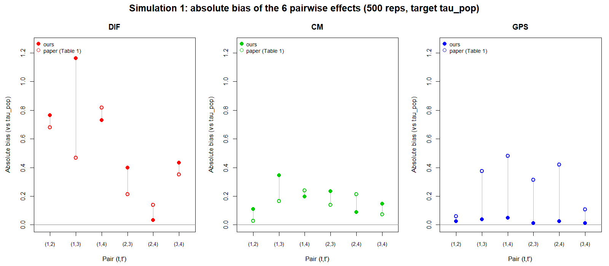
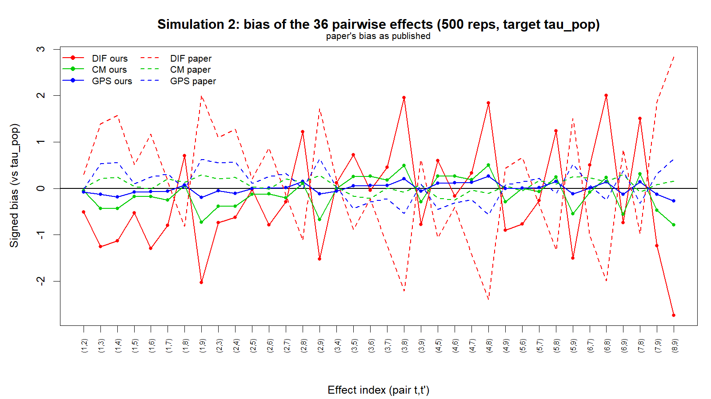
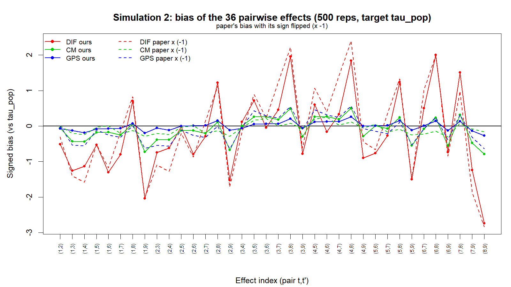
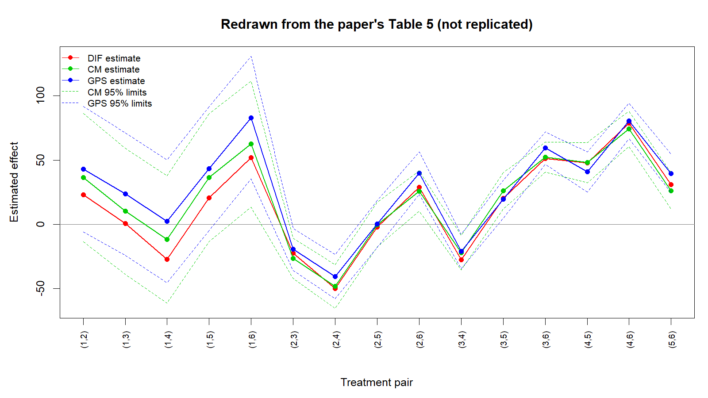

# Two-way comparison: rebuilt results and the paper's published results

All bias figures here are against the population ATE (τ\_pop); see [Two targets: τ\_pop and τ\_bal](../README.md#two-targets-τ_pop-and-τ_bal) in the README for why there are two truths. Simulation 2's published biases appear with the signs as printed in the paper's Table 3; the comparison with the paper's signs flipped is shown separately (see "A note on the sign of bias" and Figures). Our values are rounded from `results/sim1_vs_paper.csv`, `results/sim2_vs_paper.csv` and `results/sim2_bias_correlations.csv`; the paper's values are as transcribed in `results/paper_table1.csv` and `results/paper_table3.csv`. Coverage is the percentage of 95% intervals that contain the true effect.

## Simulation 1 (paper's Table 1)

**Table A.** Absolute bias, and coverage (%) for CM and GPS. The paper does not report DIF coverage.

| Pair | DIF ours | DIF paper | CM ours | CM paper | GPS ours | GPS paper | CM cov. ours | CM cov. paper | GPS cov. ours | GPS cov. paper |
| --- | --- | --- | --- | --- | --- | --- | --- | --- | --- | --- |
| (1,2) | 0.765 | 0.679 | 0.110 | 0.0264 | 0.024 | 0.0597 | 91.6 | 92 | 100.0 | 100 |
| (1,3) | 1.164 | 0.4668 | 0.345 | 0.1662 | 0.037 | 0.3742 | 83.4 | 92 | 100.0 |  99 |
| (1,4) | 0.731 | 0.8172 | 0.199 | 0.2398 | 0.048 | 0.4811 | 93.6 | 96 | 100.0 | 100 |
| (2,3) | 0.399 | 0.2122 | 0.235 | 0.1398 | 0.013 | 0.3145 | 91.4 | 95 | 100.0 |  99 |
| (2,4) | 0.034 | 0.1382 | 0.088 | 0.2134 | 0.024 | 0.4214 | 95.4 | 97 | 100.0 | 100 |
| (3,4) | 0.433 | 0.3504 | 0.146 | 0.0736 | 0.011 | 0.1069 | 93.2 | 98 | 100.0 | 100 |

*Absolute bias of the 6 Simulation 1 effects: rebuild (filled) vs the paper's Table 1 (open), against τ\_pop.*

## Simulation 2 (paper's Table 3)

**Table B1.** Signed bias, with the paper's values as published.

| Pair | DIF ours | DIF paper | CM ours | CM paper | GPS ours | GPS paper |
| --- | --- | --- | --- | --- | --- | --- |
| (1,2) | -0.513 | 0.3018 | -0.049 | 0.0018 | -0.076 | -0.01 |
| (1,3) | -1.254 | 1.3952 | -0.433 | 0.2054 | -0.128 | 0.5358 |
| (1,4) | -1.134 | 1.5757 | -0.437 | 0.2399 | -0.189 | 0.5586 |
| (1,5) | -0.533 | 0.5084 | -0.177 | 0.0395 | -0.077 | 0.1034 |
| (1,6) | -1.299 | 1.1749 | -0.171 | -0.0126 | -0.067 | 0.247 |
| (1,7) | -0.800 | 0.158 | -0.252 | 0.2096 | -0.060 | 0.3157 |
| (1,8) | 0.705 | -0.821 | 0.063 | 0.1273 | 0.075 | -0.0071 |
| (1,9) | -2.034 | 2.0151 | -0.726 | 0.2893 | -0.193 | 0.6285 |
| (2,3) | -0.741 | 1.0935 | -0.383 | 0.2036 | -0.052 | 0.5457 |
| (2,4) | -0.621 | 1.2739 | -0.388 | 0.2381 | -0.114 | 0.5685 |
| (2,5) | -0.020 | 0.2066 | -0.128 | 0.0377 | -0.001 | 0.1133 |
| (2,6) | -0.786 | 0.8732 | -0.122 | -0.0144 | 0.009 | 0.2569 |
| (2,7) | -0.287 | -0.1438 | -0.202 | 0.2078 | 0.015 | 0.3257 |
| (2,8) | 1.218 | -1.1228 | 0.112 | 0.1255 | 0.150 | 0.0029 |
| (2,9) | -1.521 | 1.7133 | -0.677 | 0.2875 | -0.117 | 0.6384 |
| (3,4) | 0.120 | 0.1805 | -0.004 | 0.0345 | -0.062 | 0.0228 |
| (3,5) | 0.720 | -0.8868 | 0.256 | -0.1659 | 0.051 | -0.4324 |
| (3,6) | -0.045 | -0.2203 | 0.262 | -0.218 | 0.061 | -0.2888 |
| (3,7) | 0.454 | -1.2373 | 0.181 | 0.0042 | 0.067 | -0.2201 |
| (3,8) | 1.958 | -2.2163 | 0.496 | -0.0782 | 0.202 | -0.5428 |
| (3,9) | -0.781 | 0.6199 | -0.294 | 0.0839 | -0.065 | 0.0927 |
| (4,5) | 0.600 | -1.0673 | 0.260 | -0.2004 | 0.113 | -0.4552 |
| (4,6) | -0.165 | -0.4007 | 0.266 | -0.2525 | 0.122 | -0.3116 |
| (4,7) | 0.334 | -1.4177 | 0.185 | -0.0303 | 0.129 | -0.2429 |
| (4,8) | 1.838 | -2.3967 | 0.500 | -0.1126 | 0.264 | -0.5656 |
| (4,9) | -0.901 | 0.4394 | -0.289 | 0.0494 | -0.004 | 0.0699 |
| (5,6) | -0.765 | 0.6666 | 0.006 | -0.0521 | 0.010 | 0.1436 |
| (5,7) | -0.266 | -0.3504 | -0.075 | 0.1701 | 0.016 | 0.2124 |
| (5,8) | 1.238 | -1.3294 | 0.240 | 0.0877 | 0.152 | -0.1104 |
| (5,9) | -1.501 | 1.5067 | -0.549 | 0.2498 | -0.116 | 0.5251 |
| (6,7) | 0.499 | -1.017 | -0.080 | 0.2222 | 0.007 | 0.0687 |
| (6,8) | 2.003 | -1.996 | 0.234 | 0.1399 | 0.142 | -0.254 |
| (6,9) | -0.736 | 0.8402 | -0.555 | 0.3019 | -0.126 | 0.3815 |
| (7,8) | 1.504 | -0.979 | 0.315 | -0.0823 | 0.135 | -0.3228 |
| (7,9) | -1.234 | 1.8571 | -0.475 | 0.0797 | -0.132 | 0.3128 |
| (8,9) | -2.739 | 2.8361 | -0.789 | 0.162 | -0.268 | 0.6355 |

**Table B2.** MSE, and coverage (%) for CM and GPS. The paper does not report DIF coverage.

| Pair | DIF MSE ours | DIF MSE paper | CM MSE ours | CM MSE paper | CM cov. ours | CM cov. paper | GPS MSE ours | GPS MSE paper | GPS cov. ours | GPS cov. paper |
| --- | --- | --- | --- | --- | --- | --- | --- | --- | --- | --- |
| (1,2) | 0.594 | 57.84 | 0.080 | 0.1274 | 87.4 | 100 | 0.227 | 0.6792 | 100.0 |  96 |
| (1,3) | 1.837 | 49.369 | 0.244 | 0.1596 | 39.6 |  92 | 0.206 | 0.7599 | 100.0 | 100 |
| (1,4) | 1.865 | 100.8098 | 0.310 | 0.2752 | 64.6 |  95 | 0.416 | 1.2158 | 100.0 |  98 |
| (1,5) | 0.639 | 67.0518 | 0.109 | 0.1463 | 86.6 |  98 | 0.249 | 0.715 | 100.0 |  99 |
| (1,6) | 2.571 | 171.6227 | 0.200 | 0.352 | 88.4 |  99 | 0.558 | 1.7528 | 100.0 | 100 |
| (1,7) | 1.247 | 112.809 | 0.196 | 0.2655 | 81.2 |  94 | 0.404 | 1.2102 | 100.0 |  99 |
| (1,8) | 1.739 | 180.6354 | 0.210 | 0.3762 | 90.0 |  99 | 0.666 | 1.6007 | 100.0 |  99 |
| (1,9) | 4.997 | 143.3044 | 0.722 | 0.4069 | 44.4 |  95 | 0.550 | 1.8175 | 100.0 |  99 |
| (2,3) | 1.031 | 90.0545 | 0.232 | 0.2307 | 63.8 |  96 | 0.320 | 1.2592 | 100.0 |  96 |
| (2,4) | 1.219 | 141.8236 | 0.286 | 0.3722 | 74.2 |  95 | 0.557 | 1.8167 | 100.0 |  99 |
| (2,5) | 0.563 | 108.4089 | 0.108 | 0.2094 | 91.2 |  98 | 0.392 | 1.273 | 100.0 |  99 |
| (2,6) | 1.667 | 213.3382 | 0.171 | 0.3651 | 90.6 |  97 | 0.643 | 2.1094 | 100.0 |  99 |
| (2,7) | 0.889 | 153.8053 | 0.187 | 0.3398 | 85.2 |  95 | 0.528 | 1.7631 | 100.0 |  98 |
| (2,8) | 2.927 | 221.493 | 0.201 | 0.4262 | 91.2 |  98 | 0.788 | 2.0662 | 100.0 |  97 |
| (2,9) | 3.407 | 181.401 | 0.663 | 0.482 | 52.4 |  92 | 0.651 | 2.3613 | 100.0 |  98 |
| (3,4) | 0.781 | 132.7905 | 0.130 | 0.2152 | 91.6 | 100 | 0.495 | 1.2421 | 100.0 | 100 |
| (3,5) | 1.030 | 98.2762 | 0.153 | 0.233 | 82.4 |  94 | 0.358 | 1.2247 | 100.0 | 100 |
| (3,6) | 1.013 | 203.3266 | 0.232 | 0.4787 | 84.8 |  96 | 0.662 | 2.0927 | 100.0 | 100 |
| (3,7) | 1.035 | 144.9614 | 0.161 | 0.2239 | 83.0 | 100 | 0.488 | 1.5009 | 100.0 | 100 |
| (3,8) | 5.265 | 212.7647 | 0.419 | 0.3516 | 66.4 |  99 | 0.745 | 2.2201 | 100.0 |  99 |
| (3,9) | 1.628 | 174.6271 | 0.252 | 0.3254 | 82.0 |  98 | 0.613 | 1.8084 | 100.0 |  99 |
| (4,5) | 1.202 | 150.22 | 0.217 | 0.3493 | 84.4 |  97 | 0.548 | 1.6829 | 100.0 |  99 |
| (4,6) | 1.360 | 255.1281 | 0.279 | 0.648 | 86.6 |  95 | 0.830 | 2.3817 | 100.0 | 100 |
| (4,7) | 1.214 | 196.272 | 0.191 | 0.2876 | 88.4 | 100 | 0.689 | 1.9039 | 100.0 |  98 |
| (4,8) | 5.216 | 263.7386 | 0.482 | 0.4394 | 69.2 |  99 | 0.964 | 2.6361 | 100.0 | 100 |
| (4,9) | 2.191 | 228.3766 | 0.295 | 0.3819 | 84.2 |  99 | 0.756 | 2.1243 | 100.0 |  98 |
| (5,6) | 1.727 | 219.9407 | 0.163 | 0.4228 | 93.4 |  96 | 0.689 | 2.1538 | 100.0 | 100 |
| (5,7) | 0.880 | 162.5709 | 0.149 | 0.3206 | 92.8 |  96 | 0.548 | 1.7036 | 100.0 |  99 |
| (5,8) | 2.974 | 232.1535 | 0.240 | 0.4387 | 85.4 |  98 | 0.785 | 2.1514 | 100.0 |  99 |
| (5,9) | 3.416 | 193.1234 | 0.497 | 0.4427 | 66.4 |  96 | 0.633 | 2.271 | 100.0 |  98 |
| (6,7) | 1.523 | 268.8625 | 0.200 | 0.5564 | 92.4 |  95 | 0.893 | 2.7217 | 100.0 | 100 |
| (6,8) | 5.997 | 335.0898 | 0.281 | 0.6331 | 87.0 |  99 | 1.060 | 3.2473 | 100.0 | 100 |
| (6,9) | 2.262 | 294.916 | 0.546 | 0.6769 | 70.6 |  97 | 0.973 | 3.1403 | 100.0 |  98 |
| (7,8) | 3.949 | 274.7638 | 0.307 | 0.3908 | 82.2 | 100 | 0.886 | 2.6812 | 100.0 | 100 |
| (7,9) | 2.787 | 240.759 | 0.406 | 0.3587 | 68.6 |  99 | 0.761 | 2.43 | 100.0 |  99 |
| (8,9) | 9.411 | 306.5584 | 0.848 | 0.5289 | 50.0 |  98 | 1.013 | 3.2702 | 100.0 | 100 |

**Note on Table B2.** The paper's DIF MSE (49.37–335.09) is 27–201 times ours (0.56–9.41) across the 36 pairs, a discrepancy far larger than any other in these tables. The paper's GPS MSE is 2.4–3.9 times ours, and its CM MSE 0.6–2.8 times ours. Coverage is higher in the paper for CM (92–100% against 39.6–93.4% here); GPS coverage is close (96–100% against 100% in every pair).

## A note on the sign of bias

- **Our convention.** Bias is the mean estimate minus the true effect (here τ\_pop).
- **The paper's convention is unknown.** Its Table 1 reports only absolute bias, so it gives no way to check how Table 3's signed values were computed.
- **Published values as printed.** The paper's Simulation 2 biases are shown exactly as printed everywhere in this repository, including Table B1.
- **The flipped overlay is visual only.** The sign-flipped figure below multiplies the paper's values by −1 for display; no data were changed.
- **Correlations** (`results/sim2_bias_correlations.csv`, 36 pairs, against τ\_pop). As published: DIF −0.954, CM −0.764, GPS −0.874. Flipped: DIF 0.954, CM 0.764, GPS 0.874. Our bias has the same sign as the published value in 5 (DIF), 7 (CM) and 7 (GPS) of the 36 pairs, and the same sign as the flipped value in 31, 29 and 29. This pattern is an observation; it does not show which convention the paper used.
- **What does not depend on the sign.** Absolute bias, MSE and coverage are the same under either convention, so Table A, Table B2 and the Simulation 1 comparison are unaffected.

## Figures

The paper's own figures are its Fig. 1 (bias of the 36 Simulation 2 effects) and Fig. 2 (the learning-mode analysis) in Guo, Liu & Wang (2022), [https://doi.org/10.1007/s40745-022-00392-x](https://doi.org/10.1007/s40745-022-00392-x). They are not reproduced here; the figures below are ours.

*Simulation 2: our bias of the 36 effects against τ\_pop, with the paper's Table 3 values as published (dashed); compare the paper's Fig. 1.*

*The same, with the paper's values multiplied by −1.*

*The paper's Table 5 (learning-mode analysis) redrawn from the published table, not replicated; compare the paper's Fig. 2.*

## How close

Simulation 1, mean absolute bias over the 6 pairs (ours against the paper's Table 1):

- **DIF:** 0.588 against 0.444.
- **CM:** 0.187 against 0.143.
- **GPS:** 0.026 against 0.293.

The Simulation 2 correlations are in "A note on the sign of bias" above. Exploratory checks of the published Table 3 (label exchange, MSE scale) are in [table3_checks.md](table3_checks.md).
